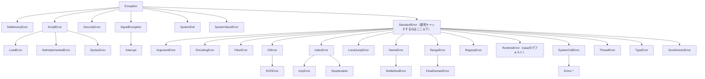

# 第8章: 例外処理

## 目次

1. [例外とは](#1-例外とは)
2. [例外のキャッチ](#2-例外のキャッチ)
3. [例外の発生](#3-例外の発生)
4. [カスタム例外](#4-カスタム例外)
5. [例外の再発生](#5-例外の再発生)
6. [ensure と else](#6-ensure-と-else)
7. [retry](#7-retry)
8. [例外処理のベストプラクティス](#8-例外処理のベストプラクティス)

---

## 1. 例外とは

### 例外クラスの階層



> **🐍 Python:** Pythonの例外階層は `BaseException` を頂点とし、通常キャッチするのは `Exception` 以下。RubyのStandardErrorがPythonのExceptionに相当する。`SystemExit`・`KeyboardInterrupt`（Rubyの `SystemExit`・`Interrupt` に相当）は `Exception` の外側にあるため、`except Exception` では捕まらない。

### よくある例外

```ruby
# ArgumentError: 引数の数や型が不正
def divide(a, b)
  raise ArgumentError, "引数は数値である必要があります" unless a.is_a?(Numeric)
end

# TypeError: 型が不正
"hello" + 1  # TypeError: no implicit conversion of Integer into String

# NoMethodError: 存在しないメソッドを呼び出し
nil.foo  # NoMethodError: undefined method `foo' for nil:NilClass

# NameError: 未定義の変数/定数を参照
puts undefined_variable  # NameError

# ZeroDivisionError: ゼロ除算
1 / 0  # ZeroDivisionError

# RuntimeError: 一般的なランタイムエラー
raise "Something went wrong"  # RuntimeError
```

**🐍 Python:** 対応する例外の例。

```python
# ValueError: 値が不正（RubyのArgumentError相当）
def divide(a, b):
    if not isinstance(a, (int, float)):
        raise ValueError("引数は数値である必要があります")

# TypeError: 型が不正
"hello" + 1  # TypeError: can only concatenate str (not "int") to str

# AttributeError: 存在しない属性/メソッドを呼び出し（RubyのNoMethodError相当）
None.foo  # AttributeError: 'NoneType' object has no attribute 'foo'

# NameError: 未定義の変数を参照
print(undefined_variable)  # NameError

# ZeroDivisionError: ゼロ除算（Rubyと同名）
1 / 0  # ZeroDivisionError: division by zero

# RuntimeError: 一般的なランタイムエラー（Rubyと同名）
raise RuntimeError("Something went wrong")
```

RubyのArgumentErrorは「引数の数の不一致」にも使われるが、Pythonで引数の数が合わない場合は `TypeError` になる。値の妥当性エラーには `ValueError` を使う。またPythonでは `raise "文字列"` はできず、必ず例外インスタンスを送出する。

---

## 2. 例外のキャッチ

### 基本的な begin-rescue

```ruby
begin
  # 危険な処理
  result = 10 / 0
rescue ZeroDivisionError
  puts "ゼロで割ることはできません"
end
```

**🐍 Python:** `begin/rescue/end` は `try/except` に対応する。

```python
try:
    result = 10 / 0
except ZeroDivisionError:
    print("ゼロで割ることはできません")
```

### 例外オブジェクトの取得

```ruby
begin
  File.read("nonexistent.txt")
rescue Errno::ENOENT => e
  puts "エラー発生: #{e.message}"
  puts "エラークラス: #{e.class}"
  puts "バックトレース:"
  puts e.backtrace.first(5).join("\n")
end
```

**🐍 Python:** `rescue E => e` は `except E as e`、`e.message` は `str(e)`、`e.class` は `type(e)` に対応。バックトレースは `traceback` モジュールで扱う。

```python
import traceback

try:
    open("nonexistent.txt")
except FileNotFoundError as e:  # RubyのErrno::ENOENT相当
    print(f"エラー発生: {e}")
    print(f"エラークラス: {type(e).__name__}")
    print("バックトレース:")
    traceback.print_exc()
```

### 複数の例外をキャッチ

```ruby
begin
  # 危険な処理
  risky_operation
rescue ZeroDivisionError
  puts "ゼロ除算エラー"
rescue TypeError
  puts "型エラー"
rescue ArgumentError, RangeError
  puts "引数または範囲エラー"
rescue StandardError => e
  puts "その他のエラー: #{e.message}"
end
```

**🐍 Python:** `except` 節を複数並べる。1つの節で複数の型を捕まえるにはタプルで指定する。

```python
try:
    risky_operation()
except ZeroDivisionError:
    print("ゼロ除算エラー")
except TypeError:
    print("型エラー")
except (ValueError, IndexError):  # 複数の型はタプルで指定
    print("引数または範囲エラー")
except Exception as e:  # RubyのStandardError相当
    print(f"その他のエラー: {e}")
```

### 例外の種類による分岐

```ruby
begin
  operation
rescue => e
  case e
  when Errno::ENOENT
    puts "ファイルが見つかりません"
  when Errno::EACCES
    puts "アクセス権がありません"
  when IOError
    puts "I/Oエラー"
  else
    raise  # 再発生
  end
end
```

### メソッド全体のrescue

```ruby
def divide(a, b)
  a / b
rescue ZeroDivisionError
  puts "ゼロでは割れません"
  nil
end

divide(10, 0)  # => nil
```

> **🐍 Python:** メソッド定義全体を暗黙の begin として rescue する構文はない。関数本体を `try/except` で囲む。

### インラインrescue

```ruby
# 1行で書く場合（シンプルなケースのみ）
result = dangerous_operation rescue default_value

# 例
value = JSON.parse(json_string) rescue {}
number = Integer(user_input) rescue 0

# 注意: StandardError のみキャッチ
# 細かい制御が必要な場合は使わない
```

> **🐍 Python:** 後置の1行 rescue に相当する構文はない。`try/except` で書くか、`dict.get(key)` や `int(x)` を `try` で囲むなどエラーを回避するAPIを選ぶ。

---

## 3. 例外の発生

### raise / fail

```ruby
# RuntimeError を発生
raise "Something went wrong"
fail "Something went wrong"  # raiseの別名

# 特定の例外クラスを発生
raise ArgumentError, "Invalid argument"
raise TypeError.new("Expected String")

# 例外オブジェクトを直接渡す
error = RuntimeError.new("Custom error")
error.set_backtrace(caller)
raise error

# バックトレースを指定
raise RuntimeError, "Error", caller
```

**🐍 Python:** `raise ArgumentError, "..."` は `raise ValueError("...")` に対応する（`fail` のような別名はない）。例外は必ずインスタンス化して送出する。

```python
# 例外クラスを送出
raise ValueError("Invalid argument")  # RubyのArgumentError相当
raise TypeError("Expected str")

# 例外オブジェクトを直接渡す
error = RuntimeError("Custom error")
raise error
```

### 条件付きraise

```ruby
def set_age(age)
  raise ArgumentError, "年齢は正の数である必要があります" if age < 0
  raise ArgumentError, "年齢が大きすぎます" if age > 150
  @age = age
end

# ガード節として使用
def process(data)
  raise ArgumentError, "dataは必須です" unless data
  raise TypeError, "dataはHashである必要があります" unless data.is_a?(Hash)

  # メイン処理
end
```

**🐍 Python:** ガード節は通常の `if` で書く（Rubyの後置 `if`/`unless` に相当する構文はない）。

```python
def set_age(age):
    if age < 0:
        raise ValueError("年齢は正の数である必要があります")
    if age > 150:
        raise ValueError("年齢が大きすぎます")
    self.age = age
```

### raise の使い分け

```ruby
class User
  def save
    # 失敗時は false を返す
    return false unless valid?
    perform_save
    true
  end

  def save!
    # 失敗時は例外を発生
    raise ValidationError, errors.full_messages.join(", ") unless valid?
    perform_save
    true
  end
end

# 呼び出し側
if user.save
  puts "保存成功"
else
  puts "保存失敗"
end

# または
begin
  user.save!
  puts "保存成功"
rescue ValidationError => e
  puts "バリデーションエラー: #{e.message}"
end
```

---

## 4. カスタム例外

### 基本的なカスタム例外

```ruby
# StandardErrorを継承（推奨）
class MyAppError < StandardError
end

class ValidationError < MyAppError
end

class AuthenticationError < MyAppError
end

class AuthorizationError < MyAppError
end

# 使用
raise ValidationError, "名前は必須です"
```

**🐍 Python:** `class MyError < StandardError` は `class MyError(Exception):` に対応する。継承ツリーで親クラスを指定して捕捉できる点も同じ。

```python
class MyAppError(Exception):
    pass

class ValidationError(MyAppError):
    pass

class AuthenticationError(MyAppError):
    pass

# 使用
raise ValidationError("名前は必須です")
```

### 属性を持つカスタム例外

```ruby
class ApiError < StandardError
  attr_reader :status_code, :response_body

  def initialize(message, status_code: nil, response_body: nil)
    @status_code = status_code
    @response_body = response_body
    super(message)
  end
end

class NotFoundError < ApiError
  def initialize(resource, id)
    super("#{resource} with id #{id} not found", status_code: 404)
  end
end

class ValidationError < ApiError
  attr_reader :errors

  def initialize(errors)
    @errors = errors
    super("Validation failed: #{errors.join(', ')}", status_code: 422)
  end
end

# 使用
begin
  raise NotFoundError.new("User", 123)
rescue ApiError => e
  puts "Status: #{e.status_code}"
  puts "Message: #{e.message}"
end
```

**🐍 Python:** `super(message)` は `super().__init__(message)` に対応。追加の属性は `__init__` で設定する。

```python
class ApiError(Exception):
    def __init__(self, message, status_code=None, response_body=None):
        super().__init__(message)
        self.status_code = status_code
        self.response_body = response_body

class NotFoundError(ApiError):
    def __init__(self, resource, id):
        super().__init__(f"{resource} with id {id} not found", status_code=404)

try:
    raise NotFoundError("User", 123)
except ApiError as e:
    print(f"Status: {e.status_code}")
    print(f"Message: {e}")
```

### 例外クラスの階層設計

```ruby
module MyApp
  # ベースエラー
  class Error < StandardError; end

  # ドメインエラー
  module Domain
    class Error < MyApp::Error; end
    class ValidationError < Error; end
    class BusinessRuleError < Error; end
  end

  # インフラエラー
  module Infrastructure
    class Error < MyApp::Error; end
    class DatabaseError < Error; end
    class NetworkError < Error; end
    class CacheError < Error; end
  end

  # アプリケーションエラー
  module Application
    class Error < MyApp::Error; end
    class AuthenticationError < Error; end
    class AuthorizationError < Error; end
  end
end

# 使用
begin
  raise MyApp::Domain::ValidationError, "Invalid data"
rescue MyApp::Domain::Error => e
  puts "ドメインエラー: #{e.message}"
rescue MyApp::Error => e
  puts "アプリケーションエラー: #{e.message}"
end
```

---

## 5. 例外の再発生

### 単純な再発生

```ruby
begin
  risky_operation
rescue => e
  logger.error("エラー発生: #{e.message}")
  raise  # 同じ例外を再発生
end
```

**🐍 Python:** 引数なしの `raise` で現在処理中の例外をそのまま再送出する（Rubyの引数なし `raise` と同じ）。

```python
try:
    risky_operation()
except Exception as e:
    logger.error(f"エラー発生: {e}")
    raise  # 同じ例外を再発生
```

### 例外のラップ

```ruby
class WrappedError < StandardError
  attr_reader :original_error

  def initialize(message, original_error)
    @original_error = original_error
    super("#{message}: #{original_error.message}")
    set_backtrace(original_error.backtrace)
  end
end

begin
  external_api_call
rescue Timeout::Error => e
  raise WrappedError.new("API call failed", e)
end
```

### cause（Ruby 2.1+）

```ruby
begin
  begin
    raise "Original error"
  rescue => e
    raise "Wrapped error"  # cause が自動的に設定される
  end
rescue => e
  puts "Error: #{e.message}"
  puts "Cause: #{e.cause.message}" if e.cause
end
```

**🐍 Python:** except節内でさらに例外を送出すると元の例外が `__context__` に自動設定される。明示的に連鎖させるには `raise ... from e` を使い、`e.__cause__` で原因を辿れる（Rubyの `e.cause` に相当）。

```python
try:
    try:
        raise ValueError("Original error")
    except ValueError as e:
        raise RuntimeError("Wrapped error") from e
except RuntimeError as e:
    print(f"Error: {e}")
    if e.__cause__:
        print(f"Cause: {e.__cause__}")
```

---

## 6. ensure と else

### ensure

```ruby
# 例外の有無に関わらず実行される
file = nil
begin
  file = File.open("data.txt")
  process(file)
rescue IOError => e
  puts "I/Oエラー: #{e.message}"
ensure
  file&.close  # 必ず実行される
  puts "クリーンアップ完了"
end
```

**🐍 Python:** `ensure` は `finally` に対応。例外の有無に関わらず実行される。

```python
file = None
try:
    file = open("data.txt")
    process(file)
except IOError as e:
    print(f"I/Oエラー: {e}")
finally:
    if file:
        file.close()  # 必ず実行される
    print("クリーンアップ完了")
```

### else

```ruby
# 例外が発生しなかった場合のみ実行
begin
  result = calculate(x, y)
rescue ZeroDivisionError
  puts "ゼロ除算エラー"
  result = 0
else
  # 成功時のみ実行
  puts "計算成功: #{result}"
  save_result(result)
ensure
  # 常に実行
  cleanup
end
```

**🐍 Python:** `else` 節も同じ意味（例外が発生しなかった場合のみ実行）。`try/except/else/finally` の順で書く。

```python
try:
    result = calculate(x, y)
except ZeroDivisionError:
    print("ゼロ除算エラー")
    result = 0
else:
    # 成功時のみ実行
    print(f"計算成功: {result}")
    save_result(result)
finally:
    # 常に実行
    cleanup()
```

### ブロック構文での ensure

```ruby
def with_file(path)
  file = File.open(path)
  yield file
ensure
  file&.close
end

with_file("data.txt") do |f|
  puts f.read
end
```

### リソース管理のパターン

```ruby
# ブロック構文（推奨）
File.open("data.txt") do |file|
  # ファイル操作
end  # 自動的にクローズ

# トランザクション風
def with_transaction
  begin_transaction
  yield
  commit_transaction
rescue => e
  rollback_transaction
  raise
end

with_transaction do
  update_database
end
```

**🐍 Python:** ブロックによる自動クローズは `with` 文（コンテキストマネージャ）に対応する。

```python
with open("data.txt") as file:
    # ファイル操作
    ...
# ブロックを抜けると自動的にクローズ
```

---

## 7. retry

### 基本的なretry

```ruby
attempts = 0
begin
  attempts += 1
  puts "試行 #{attempts}回目"
  connect_to_server
rescue ConnectionError
  if attempts < 3
    sleep(1)
    retry  # begin から再実行
  else
    raise
  end
end
```

**🐍 Python:** `begin` から処理を再実行する `retry` キーワードはない。ループと `try/except` を組み合わせて再試行する。

```python
import time

for attempt in range(1, 4):  # 1, 2, 3
    try:
        print(f"試行 {attempt}回目")
        connect_to_server()
        break  # 成功したらループを抜ける
    except ConnectionError:
        if attempt < 3:
            time.sleep(1)
        else:
            raise
```

### 指数バックオフ

```ruby
def with_retry(max_attempts: 3, base_delay: 1)
  attempts = 0
  begin
    attempts += 1
    yield
  rescue StandardError => e
    if attempts < max_attempts
      delay = base_delay * (2 ** (attempts - 1))  # 1, 2, 4, 8...
      puts "リトライまで #{delay}秒待機..."
      sleep(delay)
      retry
    else
      raise
    end
  end
end

with_retry(max_attempts: 5) do
  api_call
end
```

### Retryable パターン

```ruby
module Retryable
  def self.run(max_attempts: 3, on: [StandardError], delay: 0)
    attempts = 0
    begin
      attempts += 1
      yield attempts
    rescue *on => e
      if attempts < max_attempts
        sleep(delay) if delay > 0
        retry
      else
        raise
      end
    end
  end
end

# 使用
Retryable.run(max_attempts: 5, on: [Timeout::Error, Net::HTTPError], delay: 2) do |attempt|
  puts "Attempt #{attempt}"
  http_request
end
```

---

## 8. 例外処理のベストプラクティス

### 適切な例外をキャッチする

```ruby
# 悪い例: すべての例外をキャッチ
begin
  operation
rescue Exception => e  # 危険！
  # Interrupt や SystemExit もキャッチしてしまう
end

# 良い例: StandardError以下をキャッチ
begin
  operation
rescue StandardError => e
  handle_error(e)
end

# さらに良い: 具体的な例外をキャッチ
begin
  operation
rescue SpecificError => e
  handle_specific_error(e)
end
```

**🐍 Python:** 裸の `except:` は `BaseException`（`SystemExit`・`KeyboardInterrupt` を含む）まで捕まえるため危険。RubyでStandardErrorを指定するのと同様に、Pythonでは `except Exception` を使い、可能なら具体的な型を指定する。

```python
# 悪い例: すべての例外を捕捉
try:
    operation()
except:  # 危険！ KeyboardInterrupt なども捕まえる
    pass

# 良い例: Exception以下を捕捉
try:
    operation()
except Exception as e:
    handle_error(e)

# さらに良い: 具体的な例外を捕捉
try:
    operation()
except SpecificError as e:
    handle_specific_error(e)
```

### 例外を握りつぶさない

```ruby
# 悪い例: 例外を無視
begin
  operation
rescue
  # 何もしない
end

# 良い例: 最低限ログを残す
begin
  operation
rescue => e
  logger.error("Error: #{e.message}")
  logger.debug(e.backtrace.join("\n"))
  # 適切な処理
end
```

### 例外と制御フローを分ける

```ruby
# 悪い例: 例外を制御フローに使用
def find_user(id)
  User.find(id)
rescue ActiveRecord::RecordNotFound
  nil
end

# 良い例: nilを返すメソッドを使用
def find_user(id)
  User.find_by(id: id)  # 見つからない場合はnil
end

# または
def find_user(id)
  User.find(id)
rescue ActiveRecord::RecordNotFound => e
  raise UserNotFoundError, "User #{id} not found"  # ドメイン例外に変換
end
```

### 早期リターン vs 例外

```ruby
# 入力検証: 例外を使用
def process(data)
  raise ArgumentError, "data is required" if data.nil?
  raise ArgumentError, "data must be a Hash" unless data.is_a?(Hash)
  # 処理
end

# 業務ロジック: 結果オブジェクトを使用
class Result
  attr_reader :value, :error

  def self.success(value)
    new(value: value, success: true)
  end

  def self.failure(error)
    new(error: error, success: false)
  end

  def initialize(value: nil, error: nil, success:)
    @value = value
    @error = error
    @success = success
  end

  def success?
    @success
  end

  def failure?
    !@success
  end
end

def create_user(params)
  return Result.failure("Name is required") if params[:name].blank?
  return Result.failure("Email is invalid") unless valid_email?(params[:email])

  user = User.create(params)
  Result.success(user)
end

result = create_user(params)
if result.success?
  render json: result.value
else
  render json: { error: result.error }, status: 422
end
```

### 例外のテスト

```ruby
# RSpec
describe "#divide" do
  it "raises ZeroDivisionError when dividing by zero" do
    expect { divide(10, 0) }.to raise_error(ZeroDivisionError)
  end

  it "raises ArgumentError with specific message" do
    expect { divide("a", 1) }.to raise_error(ArgumentError, /数値/)
  end

  it "raises custom error with attributes" do
    expect { api_call }.to raise_error(ApiError) do |error|
      expect(error.status_code).to eq(404)
    end
  end
end
```

### グローバル例外ハンドラ

```ruby
# トップレベルでの例外処理
at_exit do
  if $!  # 最後の例外
    logger.fatal("Unhandled exception: #{$!.message}")
    logger.fatal($!.backtrace.join("\n"))
  end
end

# Railsでのグローバルハンドラ
class ApplicationController < ActionController::Base
  rescue_from StandardError, with: :handle_error
  rescue_from ActiveRecord::RecordNotFound, with: :handle_not_found
  rescue_from ActionController::ParameterMissing, with: :handle_bad_request

  private

  def handle_error(exception)
    logger.error("Error: #{exception.message}")
    render json: { error: "Internal server error" }, status: 500
  end

  def handle_not_found(exception)
    render json: { error: "Not found" }, status: 404
  end

  def handle_bad_request(exception)
    render json: { error: exception.message }, status: 400
  end
end
```

---

## 実践例: 堅牢な API クライアント

```ruby
class ApiClient
  class Error < StandardError
    attr_reader :response

    def initialize(message, response: nil)
      @response = response
      super(message)
    end
  end

  class NetworkError < Error; end
  class TimeoutError < Error; end
  class ServerError < Error; end
  class ClientError < Error; end
  class NotFoundError < ClientError; end
  class UnauthorizedError < ClientError; end
  class RateLimitError < ClientError; end

  def initialize(base_url:, api_key:, timeout: 30)
    @base_url = base_url
    @api_key = api_key
    @timeout = timeout
  end

  def get(path, params = {})
    request(:get, path, params: params)
  end

  def post(path, body = {})
    request(:post, path, body: body)
  end

  private

  def request(method, path, params: {}, body: nil)
    with_retry do
      response = perform_request(method, path, params, body)
      handle_response(response)
    end
  end

  def perform_request(method, path, params, body)
    # HTTP リクエストの実行
    uri = URI("#{@base_url}#{path}")
    # ...実装...
  rescue Timeout::Error
    raise TimeoutError, "Request timed out"
  rescue SocketError, Errno::ECONNREFUSED => e
    raise NetworkError, "Network error: #{e.message}"
  end

  def handle_response(response)
    case response.code.to_i
    when 200..299
      JSON.parse(response.body)
    when 401
      raise UnauthorizedError.new("Unauthorized", response: response)
    when 404
      raise NotFoundError.new("Not found", response: response)
    when 429
      raise RateLimitError.new("Rate limit exceeded", response: response)
    when 400..499
      raise ClientError.new("Client error: #{response.code}", response: response)
    when 500..599
      raise ServerError.new("Server error: #{response.code}", response: response)
    end
  end

  def with_retry(max_attempts: 3)
    attempts = 0
    begin
      attempts += 1
      yield
    rescue NetworkError, TimeoutError, ServerError => e
      if attempts < max_attempts
        delay = 2 ** (attempts - 1)
        sleep(delay)
        retry
      else
        raise
      end
    rescue RateLimitError => e
      retry_after = e.response&.headers&.[]("Retry-After")&.to_i || 60
      sleep(retry_after)
      retry if attempts < max_attempts
      raise
    end
  end
end

# 使用
client = ApiClient.new(base_url: "https://api.example.com", api_key: "xxx")

begin
  user = client.get("/users/123")
  puts user
rescue ApiClient::NotFoundError
  puts "ユーザーが見つかりません"
rescue ApiClient::UnauthorizedError
  puts "認証エラー: APIキーを確認してください"
rescue ApiClient::RateLimitError
  puts "レート制限: しばらく待ってから再試行してください"
rescue ApiClient::Error => e
  puts "APIエラー: #{e.message}"
end
```

---

## 次のステップ

例外処理を理解したら、次はファイル操作について学びましょう。

→ [第9章: ファイル操作](09_ファイル操作.md)

← [第7章: モジュール](07_モジュール.md)
