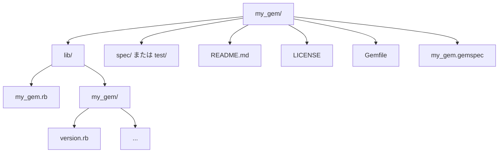

# 第10章: Gem（パッケージ管理）

## 目次

1. [Gemとは](#1-gemとは)
2. [Gemのインストールと管理](#2-gemのインストールと管理)
3. [Bundler](#3-bundler)
4. [Gemfile の書き方](#4-gemfile-の書き方)
5. [よく使われるGem](#5-よく使われるgem)
6. [Gemの作成](#6-gemの作成)
7. [Gemのセキュリティ](#7-gemのセキュリティ)
8. [トラブルシューティング](#8-トラブルシューティング)

---

## 1. Gemとは

### RubyGems

RubyGemsはRubyのパッケージ管理システムです。ライブラリやアプリケーションを「Gem」という形式で配布・インストールできます。

```bash
# RubyGemsのバージョン確認
gem -v

# RubyGemsの更新
gem update --system
```

**🐍 Python:**

```bash
# pip（Pythonのパッケージ管理システム）のバージョン確認
pip --version

# pip 自体の更新
pip install --upgrade pip
```

RubyGemsは言語標準に統合されたパッケージ管理システムです。Pythonでの相当物は `pip` で、こちらも標準で付属します。

### Gemの構造



---

## 2. Gemのインストールと管理

### 基本的なコマンド

```bash
# インストール
gem install rails
gem install rails -v 7.0.0        # バージョン指定
gem install rails -v "~> 7.0"     # バージョン範囲
gem install rails --pre           # プレリリース版

# アンインストール
gem uninstall rails
gem uninstall rails -v 7.0.0      # バージョン指定
gem uninstall rails --all         # 全バージョン

# 一覧
gem list                          # インストール済み一覧
gem list rails                    # 特定のGemを検索
gem list --remote rails           # リモートを検索

# 情報
gem info rails                    # ローカルのGem情報
gem specification rails           # 詳細なスペック

# 検索
gem search rails                  # リモートで検索
gem search ^rails$                # 正規表現

# 更新
gem update                        # すべて更新
gem update rails                  # 特定のGemを更新

# クリーンアップ
gem cleanup                       # 古いバージョンを削除
```

**🐍 Python:**

```bash
# インストール
pip install requests
pip install requests==2.31.0      # バージョン指定（-v ではなく == で固定）
pip install "requests>=2.31,<3"   # バージョン範囲
pip install --pre requests        # プレリリース版

# アンインストール
pip uninstall requests
# 注: pip はバージョン単位のアンインストール不可（常に現在の1バージョンのみ）

# 一覧
pip list                          # インストール済み一覧
pip show requests                 # 特定パッケージの情報（gem info 相当）

# 検索
# pip search はサービス停止のため利用不可。PyPI (https://pypi.org) をブラウザで検索

# 更新
pip install --upgrade requests    # 特定パッケージを更新

# 一括更新の標準コマンドは pip に無い（requirements で管理するのが一般的）
```

`gem install X -v 7.0.0` のバージョン指定は、pipでは `pip install X==7.0.0` と `==` で表現します。`gem search`（リモート検索）に相当する `pip search` は現在停止しており、PyPIのサイトで検索します。

### Gemの場所

```bash
# インストール先の確認
gem environment
gem env home              # GEM_HOME

# Gemのパス
gem which rails          # メインファイルのパス

# 環境変数
export GEM_HOME=~/.gem
export GEM_PATH=~/.gem
```

### ドキュメント

```bash
# ドキュメント付きでインストール
gem install rails --document

# ドキュメントなしでインストール（高速）
gem install rails --no-document

# デフォルトの設定（~/.gemrc）
# gem: --no-document

# ローカルでドキュメントを見る
gem server                # http://localhost:8808
```

---

## 3. Bundler

### Bundlerとは

Bundlerはプロジェクトごとの依存関係を管理するツールです。

```bash
# インストール
gem install bundler

# バージョン確認
bundle -v
bundler -v
```

**🐍 Python:** Bundlerに相当する仕組みは、Pythonでは `pip + venv`（仮想環境）の組み合わせ、または `Poetry` / `uv` といった統合ツールが担います。

```bash
# 仮想環境ツールは標準ライブラリなので追加インストール不要（venv）
python -m venv --help

# Poetry / uv を使う場合はそれ自体をインストール
pip install poetry
```

大きな思想差として、Bundlerは「システムに入れたGemをプロジェクト単位で選択・固定する」のに対し、Pythonのvenvは「プロジェクトごとに隔離された独立のPython環境を作り、そこにパッケージを入れる」というアプローチを取ります。

### 基本的な使い方

```bash
# Gemfile を作成
bundle init

# 依存関係をインストール
bundle install
bundle                    # install は省略可能

# Gemfile.lock に基づいてインストール
bundle install --deployment   # 本番環境向け

# 特定のGemを追加
bundle add rails
bundle add rspec --group development

# 依存関係の更新
bundle update             # すべて更新
bundle update rails       # 特定のGemを更新

# 実行
bundle exec ruby script.rb
bundle exec rails server
bundle exec rspec
```

**🐍 Python:** venvを使う流れは以下のようになります。

```bash
# 仮想環境の作成（Gemfile 作成に相当する初期化ステップ）
python -m venv venv

# 依存関係をインストール（bundle install 相当）
pip install -r requirements.txt

# 特定パッケージを追加（bundle add 相当。追加後は freeze で記録するのが慣習）
pip install rich
pip freeze > requirements.txt

# 依存関係の更新（bundle update 相当）
pip install --upgrade -r requirements.txt

# Poetry を使う場合の追加・更新
poetry add rich
poetry update
```

`bundle exec cmd` は「Gemfileで固定した環境でコマンドを実行する」ものです。Pythonでは各コマンドに `bundle exec` を付けるのではなく、事前に仮想環境を有効化（`source venv/bin/activate`、Windowsは `venv\Scripts\activate`）してからコマンドを実行し、そのシェルの間ずっと隔離環境が効き続ける、という思想の違いがあります。Poetryでは `poetry run cmd` が `bundle exec cmd` に最も近い書き方です。

### bundle exec

```bash
# Gemfile の環境でコマンドを実行
bundle exec ruby script.rb
bundle exec rails console
bundle exec rspec spec/

# シェルを起動
bundle exec bash

# binstubs を使う（bundle exec 不要に）
bundle binstubs rspec
bin/rspec spec/
```

### その他のコマンド

```bash
# 依存関係の確認
bundle list              # インストールされたGem一覧
bundle show rails        # 特定のGemのパス
bundle info rails        # 詳細情報

# 依存関係のツリー表示
bundle viz               # グラフィカル表示（graphviz必要）

# Gemfile のチェック
bundle check             # 依存関係が満たされているか

# キャッシュ
bundle cache             # vendor/cache にGemをキャッシュ
bundle install --local   # キャッシュからインストール

# 設定
bundle config list       # 設定一覧
bundle config set path vendor/bundle  # インストール先
bundle config set without development test  # 除外するグループ
```

---

## 4. Gemfile の書き方

### 基本構文

```ruby
# Gemのソース
source "https://rubygems.org"

# Rubyのバージョン
ruby "3.3.0"

# Gem の指定
gem "rails", "~> 7.0"
gem "pg"
gem "puma"
```

**🐍 Python:** `Gemfile` に相当するのは `requirements.txt`（シンプルな一覧）、または `pyproject.toml`（Poetry/uv など現代的なツール）です。

```text
# requirements.txt
django>=4.2,<5
psycopg2
gunicorn
```

```toml
# pyproject.toml（Poetry の例）
[tool.poetry.dependencies]
python = "^3.11"
django = "^4.2"
psycopg2 = "*"
gunicorn = "*"
```

`Gemfile` のように「ソースやRubyバージョン」をコード的に書けるのに対し、`requirements.txt` は基本的にパッケージ名とバージョン制約を1行ずつ並べるだけの素朴な形式です。より宣言的な管理は `pyproject.toml` が担います。

### バージョン指定

```ruby
# 厳密なバージョン
gem "rails", "7.0.0"

# バージョン範囲
gem "rails", ">= 7.0.0"          # 7.0.0 以上
gem "rails", "< 8.0"             # 8.0 未満
gem "rails", ">= 7.0", "< 8.0"   # 7.0以上8.0未満

# 悲観的バージョン制約（推奨）
gem "rails", "~> 7.0.0"          # >= 7.0.0, < 7.1.0
gem "rails", "~> 7.0"            # >= 7.0, < 8.0
gem "rails", "~> 7"              # >= 7, < 8

# バージョンなし（最新）
gem "rails"
```

### グループ

```ruby
# 基本的なグループ
group :development do
  gem "better_errors"
  gem "binding_of_caller"
end

group :test do
  gem "rspec"
  gem "factory_bot"
end

group :development, :test do
  gem "pry"
  gem "pry-byebug"
end

# グループのインストール除外
# bundle config set without development test
# bundle install
```

**🐍 Python:** `group :development, :test` のようなグループ分けは、Poetryの依存グループ（`--group`）や、`pyproject.toml` の optional-dependencies（extras）で表現します。

```toml
# pyproject.toml（Poetry の依存グループ）
[tool.poetry.group.dev.dependencies]
pytest = "^8.0"
ruff = "^0.5"
```

```bash
# 開発用グループに追加（group :development do ... 相当）
poetry add --group dev pytest ruff

# 開発グループを除外してインストール（bundle config set without development 相当）
poetry install --without dev
```

素の `requirements.txt` にはグループの概念がないため、慣習的に `requirements.txt`（本番用）と `requirements-dev.txt`（開発用）のようにファイルを分けて管理します。

### プラットフォーム

```ruby
# 特定のプラットフォームのみ
gem "tzinfo-data", platforms: [:mingw, :mswin, :x64_mingw, :jruby]
gem "wdm", platforms: [:mingw, :mswin, :x64_mingw]

# プラットフォームブロック
platforms :ruby do
  gem "sqlite3"
end

platforms :jruby do
  gem "activerecord-jdbc-adapter"
end
```

### Git リポジトリからインストール

```ruby
# GitHub
gem "rails", github: "rails/rails"
gem "rails", github: "rails/rails", branch: "main"
gem "rails", github: "rails/rails", tag: "v7.0.0"
gem "rails", github: "rails/rails", ref: "abc123"

# 任意のGitリポジトリ
gem "my_gem", git: "https://github.com/user/my_gem.git"
gem "my_gem", git: "git@github.com:user/my_gem.git"

# サブディレクトリ
gem "sub_gem", github: "user/monorepo", glob: "sub_gem/*.gemspec"
```

### ローカルのGem

```ruby
# パス指定
gem "my_gem", path: "../my_gem"
gem "my_gem", path: "/absolute/path/to/my_gem"

# 開発中のGemをテスト
gem "my_gem", path: "~/projects/my_gem"
```

### オプション

```ruby
# require の制御
gem "aws-sdk", require: false    # 自動requireしない
gem "activerecord", require: "active_record"  # 別名でrequire

# 依存関係
gem "my_gem", require: ["my_gem", "my_gem/extension"]
```

### 完全な例

```ruby
source "https://rubygems.org"
git_source(:github) { |repo| "https://github.com/#{repo}.git" }

ruby "3.3.0"

# Rails
gem "rails", "~> 7.1.0"

# データベース
gem "pg", "~> 1.5"

# Webサーバー
gem "puma", "~> 6.0"

# フロントエンド
gem "importmap-rails"
gem "turbo-rails"
gem "stimulus-rails"

# その他
gem "bootsnap", require: false
gem "tzinfo-data", platforms: %i[mingw mswin x64_mingw jruby]

group :development, :test do
  gem "debug", platforms: %i[mri mingw x64_mingw]
  gem "rspec-rails", "~> 6.0"
  gem "factory_bot_rails"
  gem "faker"
end

group :development do
  gem "web-console"
  gem "rack-mini-profiler"
  gem "rubocop", require: false
  gem "rubocop-rails", require: false
end

group :test do
  gem "capybara"
  gem "selenium-webdriver"
  gem "shoulda-matchers"
  gem "simplecov", require: false
end
```

---

## 5. よく使われるGem

### Web フレームワーク

| Gem | 説明 |
|-----|------|
| rails | フルスタックWebフレームワーク |
| sinatra | 軽量Webフレームワーク |
| hanami | クリーンアーキテクチャ指向 |
| roda | 高速ルーティング |
| grape | REST API特化 |

### データベース

| Gem | 説明 |
|-----|------|
| pg | PostgreSQLアダプタ |
| mysql2 | MySQLアダプタ |
| sqlite3 | SQLiteアダプタ |
| sequel | 軽量ORM |
| rom-rb | データマッパー |

### テスト

| Gem | 説明 |
|-----|------|
| rspec | BDDテストフレームワーク |
| minitest | 標準のテストフレームワーク |
| factory_bot | テストデータ生成 |
| faker | ダミーデータ生成 |
| capybara | E2Eテスト |
| vcr | HTTPインタラクション記録 |
| webmock | HTTPモック |
| simplecov | コードカバレッジ |

### コード品質

| Gem | 説明 |
|-----|------|
| rubocop | Linter/Formatter |
| rubocop-rails | Rails用ルール |
| rubocop-rspec | RSpec用ルール |
| brakeman | セキュリティスキャナ |
| bundler-audit | 脆弱性チェック |
| reek | コードの匂い検出 |

### 認証・認可

| Gem | 説明 |
|-----|------|
| devise | 認証ソリューション |
| omniauth | OAuth認証 |
| pundit | 認可 |
| cancancan | 認可 |
| jwt | JWT処理 |

### HTTP クライアント

| Gem | 説明 |
|-----|------|
| faraday | HTTPクライアント |
| httparty | シンプルなHTTPクライアント |
| rest-client | HTTPクライアント |
| typhoeus | 並列HTTPリクエスト |

### バックグラウンドジョブ

| Gem | 説明 |
|-----|------|
| sidekiq | Redisベースのジョブ |
| delayed_job | DBベースのジョブ |
| resque | Redisベースのジョブ |
| good_job | PostgreSQLベースのジョブ |

### その他

| Gem | 説明 |
|-----|------|
| pry | 高機能REPL |
| dotenv | 環境変数管理 |
| figaro | 設定管理 |
| nokogiri | HTML/XMLパーサー |
| redis | Redisクライアント |
| aws-sdk | AWS SDK |

---

## 6. Gemの作成

### 雛形の作成

```bash
# Bundlerで作成
bundle gem my_gem

# オプション付き
bundle gem my_gem --test=rspec --ci=github --linter=rubocop
```

### gemspec ファイル

```ruby
# my_gem.gemspec
Gem::Specification.new do |spec|
  spec.name          = "my_gem"
  spec.version       = MyGem::VERSION
  spec.authors       = ["Your Name"]
  spec.email         = ["your@email.com"]

  spec.summary       = "Short summary of the gem"
  spec.description   = "Longer description of the gem"
  spec.homepage      = "https://github.com/user/my_gem"
  spec.license       = "MIT"

  spec.required_ruby_version = ">= 3.0.0"

  spec.metadata["homepage_uri"] = spec.homepage
  spec.metadata["source_code_uri"] = spec.homepage
  spec.metadata["changelog_uri"] = "#{spec.homepage}/blob/main/CHANGELOG.md"

  # ファイル指定
  spec.files = Dir.chdir(__dir__) do
    `git ls-files -z`.split("\x0").reject do |f|
      f.match(%r{\A(?:test|spec|features)/})
    end
  end

  spec.bindir        = "exe"
  spec.executables   = spec.files.grep(%r{\Aexe/}) { |f| File.basename(f) }
  spec.require_paths = ["lib"]

  # 依存関係
  spec.add_dependency "activesupport", "~> 7.0"

  # 開発時の依存関係
  spec.add_development_dependency "rake", "~> 13.0"
  spec.add_development_dependency "rspec", "~> 3.0"
  spec.add_development_dependency "rubocop", "~> 1.0"
end
```

### メインファイル

```ruby
# lib/my_gem.rb
require_relative "my_gem/version"

module MyGem
  class Error < StandardError; end

  # 機能の実装
  def self.hello
    "Hello from MyGem!"
  end
end

# lib/my_gem/version.rb
module MyGem
  VERSION = "0.1.0"
end
```

### ビルドと公開

```bash
# ビルド
gem build my_gem.gemspec

# ローカルでインストールしてテスト
gem install ./my_gem-0.1.0.gem

# RubyGems.org に公開
gem push my_gem-0.1.0.gem

# Rakeタスクで
rake build        # gem build
rake install      # ローカルインストール
rake release      # タグ付け + push
```

**🐍 Python:** 自作パッケージのビルドと公開（PyPIへの登録）は、標準的には `build` + `twine`、Poetryなら `poetry build` / `poetry publish` を使います。

```bash
# 標準ツールでのビルドと公開
pip install build twine
python -m build            # gem build 相当（dist/ に成果物を生成）
twine upload dist/*        # gem push 相当（PyPI に公開）

# Poetry を使う場合
poetry build               # gem build 相当
poetry publish             # gem push 相当
```

RubyGems.orgへの `gem push` に相当するのが、PyPI（<https://pypi.org>）への `twine upload` / `poetry publish` です。

### CLIツールとして

```ruby
# exe/my_gem
#!/usr/bin/env ruby

require "my_gem"
require "my_gem/cli"

MyGem::CLI.start(ARGV)

# lib/my_gem/cli.rb
require "optparse"

module MyGem
  class CLI
    def self.start(args)
      options = {}

      OptionParser.new do |opts|
        opts.banner = "Usage: my_gem [options]"

        opts.on("-v", "--version", "Show version") do
          puts MyGem::VERSION
          exit
        end

        opts.on("-h", "--help", "Show help") do
          puts opts
          exit
        end
      end.parse!(args)

      # メイン処理
      puts MyGem.hello
    end
  end
end
```

---

## 7. Gemのセキュリティ

### 脆弱性チェック

```bash
# bundler-audit
gem install bundler-audit
bundle audit check --update

# GitHub Advisory Database を使用
bundle audit

# 自動修正の提案
bundle audit --fix
```

> **🐍 Python:** `pip install pip-audit` → `pip-audit`（`bundle audit` 相当。依存関係の既知の脆弱性をスキャン）

### Gemfile.lock の重要性

```bash
# Gemfile.lock はバージョン管理に含める
# 本番環境では Gemfile.lock に基づいてインストール
bundle install --deployment

# CI でのチェック
bundle install --frozen  # Gemfile.lock と一致しない場合エラー
```

**🐍 Python:** `Gemfile.lock`（全依存関係を厳密にピン止めした再現可能なロックファイル）に相当するのは、`poetry.lock` / `uv.lock`、あるいは `pip freeze` で全バージョンを固定した `requirements.txt` です。

```bash
# pip freeze で現在の環境を厳密にピン止め（簡易的なロックファイル相当）
pip freeze > requirements.txt

# ロックファイルに厳密に従ってインストール（bundle install --frozen 相当）
poetry install --sync    # poetry.lock どおりに同期
uv sync --locked         # uv.lock と一致しない場合エラー
```

`bundle install --deployment` / `--frozen` のように「ロック内容から逸脱させない」運用は、Poetryの `--sync` や uvの `--locked` が対応します。どちらもロックファイルはバージョン管理にコミットするのが原則です。

### 信頼できるソースの使用

```ruby
# Gemfile
source "https://rubygems.org"  # HTTPSを使用

# プライベートGemサーバー
source "https://gems.example.com" do
  gem "private_gem"
end

# 認証が必要な場合
# bundle config set gems.example.com username:password
```

### 署名の確認

```bash
# 署名されたGemのインストール
gem install my_gem -P HighSecurity

# セキュリティポリシー
# NoSecurity: 検証なし
# LowSecurity: 署名があれば検証
# MediumSecurity: 署名必須、信頼されたCAのみ
# HighSecurity: 署名必須、信頼された証明書のみ
```

---

## 8. トラブルシューティング

### よくある問題

#### ネイティブ拡張のビルドエラー

```bash
# 開発ツールのインストール
# macOS
xcode-select --install

# Ubuntu
sudo apt-get install build-essential

# Windows
# RubyInstaller の DevKit を使用

# 特定のライブラリが必要な場合
# macOS
brew install postgresql
gem install pg -- --with-pg-config=/opt/homebrew/bin/pg_config

# Ubuntu
sudo apt-get install libpq-dev
```

#### バージョンの競合

```bash
# 依存関係の確認
bundle exec gem dependency rails --reverse-dependencies

# 詳細なエラー表示
bundle install --verbose

# キャッシュのクリア
bundle clean --force
rm -rf vendor/bundle
bundle install
```

#### Gemfile.lock の競合

```bash
# Gemfile.lock を再生成
rm Gemfile.lock
bundle install

# 特定のプラットフォームを追加
bundle lock --add-platform x86_64-linux
bundle lock --add-platform x86_64-darwin
```

### デバッグ

```bash
# 詳細な情報
bundle install --verbose
gem install rails --verbose

# 依存関係の確認
bundle show --paths
bundle exec gem list

# ロードパスの確認
ruby -e "puts $LOAD_PATH"
bundle exec ruby -e "puts $LOAD_PATH"

# Gemの場所
bundle info rails
bundle show rails
```

### 環境のリセット

```bash
# Bundler の設定をリセット
rm -rf .bundle/
rm -rf vendor/bundle/

# システムのGemをクリーンアップ
gem cleanup

# すべてのGemを削除（注意！）
gem uninstall --all

# rbenv/rvm の再設定
rbenv rehash
rvm use ruby-3.3.0
```

### CI での問題

```yaml
# GitHub Actions の例
- name: Setup Ruby
  uses: ruby/setup-ruby@v1
  with:
    ruby-version: '3.3'
    bundler-cache: true  # キャッシュを使用

- name: Install dependencies
  run: |
    bundle config set --local deployment true
    bundle config set --local without development
    bundle install --jobs 4 --retry 3
```

---

## 実践例: プロジェクトのセットアップ

```bash
# 1. プロジェクトディレクトリ作成
mkdir my_project
cd my_project

# 2. Rubyバージョン指定
echo "3.3.0" > .ruby-version

# 3. Gemfile 作成
cat > Gemfile << 'EOF'
source "https://rubygems.org"

ruby "3.3.0"

gem "rake"
gem "zeitwerk"

group :development, :test do
  gem "rspec"
  gem "pry"
  gem "rubocop"
end

group :test do
  gem "simplecov", require: false
end
EOF

# 4. 依存関係インストール
bundle install

# 5. 設定ファイル
bundle binstubs rspec-core rubocop
bundle config set --local path vendor/bundle
bundle config set --local without production

# 6. .gitignore
cat > .gitignore << 'EOF'
/.bundle/
/vendor/bundle/
*.gem
.rspec_status
/coverage/
EOF

# 7. 初期化
bundle exec rspec --init
bundle exec rubocop --init
```

---

## 次のステップ

Gemを理解したら、次はRubyのイディオムについて学びましょう。

→ [第11章: イディオム](11_イディオム.md)

← [第9章: ファイル操作](09_ファイル操作.md)
