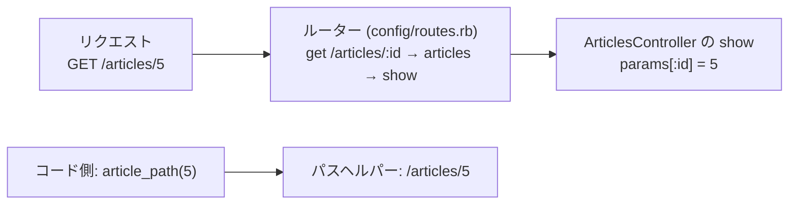
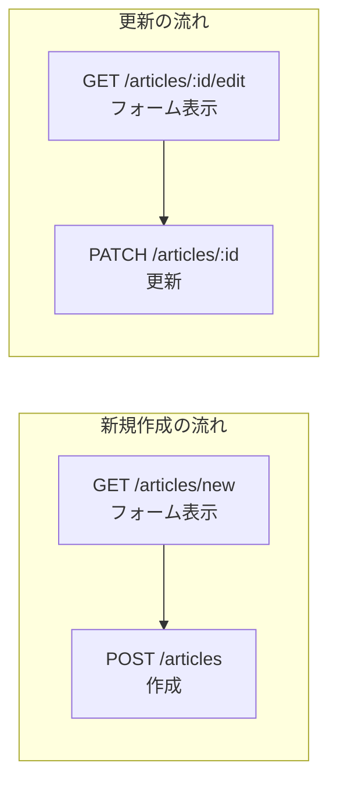

# Rails 第2章: ルーティング

ルーティングは、受信したHTTPリクエスト（URLとメソッド）を、どのコントローラのどのアクションで処理するかへ振り分ける仕組みです。設定はすべて `config/routes.rb` に集約され、逆にコードからURLを組み立てる「パスヘルパー」も同時に生成されます。本章では Rails 7.2 / 8 系に準拠して、基本から `resources`・ネスト・制約・エンジンのマウントまでを実務目線で解説します。

---

## 目次

1. [ルーティングの役割と基本](#1-ルーティングの役割と基本)
2. [HTTPメソッド別ルート](#2-httpメソッド別ルート)
3. [root（ルートパス）の設定](#3-rootルートパスの設定)
4. [resources（RESTfulルーティング）](#4-resourcesrestfulルーティング)
5. [resource（単数リソース）](#5-resource単数リソース)
6. [only と except によるアクション限定](#6-only-と-except-によるアクション限定)
7. [ネストしたリソースと shallow](#7-ネストしたリソースと-shallow)
8. [member と collection ルート](#8-member-と-collection-ルート)
9. [名前付きルートとパスヘルパー](#9-名前付きルートとパスヘルパー)
10. [namespace と scope](#10-namespace-と-scope)
11. [constraints（制約）と defaults](#11-constraints制約と-defaults)
12. [redirect と mount](#12-redirect-と-mount)
13. [concern と concerns](#13-concern-と-concerns)
14. [動的セグメントとグロブ](#14-動的セグメントとグロブ)
15. [bin/rails routes でルート確認](#15-binrails-routes-でルート確認)

---

## 1. ルーティングの役割と基本

Railsのルーターは、URLとHTTPメソッドの組を「コントローラ#アクション」に対応付ける役割を持ちます。同時に、その逆方向としてアプリ内でURLを生成するための **パスヘルパー** を作り出します。



ルート定義はすべて `Rails.application.routes.draw do ... end` ブロック内に書きます。

```ruby
# config/routes.rb
Rails.application.routes.draw do
  # 上から順にマッチング判定され、最初に一致したルートが採用される
  get "/about", to: "pages#about"        # GET /about -> PagesController#about
  post "/contact", to: "messages#create" # POST /contact -> MessagesController#create
end
```

ポイント:

- ルートは **上から順に評価** され、最初にマッチしたものが使われる。より具体的なルートを上に置く。
- `to:` には `"コントローラ名#アクション名"` を文字列で指定する（コントローラ名は複数形・スネークケース）。
- 定義した内容は `bin/rails routes` で一覧確認できる（第15節）。

**🎯 Django:** 同じ「URL↔処理」の対応を、Django は `config/urls.py`（URLconf）の `urlpatterns` リストに定義する。上から順にマッチする点は同じだが、Django は HTTP メソッドで振り分けない（メソッド別処理はビュー側の役割・第2節）。

```python
# config/urls.py（プロジェクト全体の URLconf）
from django.urls import path
from pages import views as pages_views
from messages_app import views as messages_views

urlpatterns = [
    path("about", pages_views.about),        # /about -> about ビュー
    path("contact", messages_views.create),  # /contact -> create ビュー
]
```

Rails がすべてを `routes.rb` に集約する「集中定義」なのに対し、Django は **アプリごとに `urls.py` を持ち**、プロジェクトの URLconf から `include()` で束ねる分割思想が主流。

```python
# config/urls.py（各アプリの urls.py を include() で取り込む）
from django.urls import include, path

urlpatterns = [
    path("articles/", include("articles.urls")),  # articles アプリの urls.py へ委譲
]
```

---

## 2. HTTPメソッド別ルート

RESTでは同じパスでもHTTPメソッドによって意味が変わります。Railsは各メソッドに対応するDSLを提供します。

```ruby
Rails.application.routes.draw do
  get    "/articles",     to: "articles#index"   # 取得（一覧）
  post   "/articles",     to: "articles#create"  # 作成
  get    "/articles/:id", to: "articles#show"    # 取得（1件）
  patch  "/articles/:id", to: "articles#update"  # 部分更新
  put    "/articles/:id", to: "articles#update"  # 全体更新
  delete "/articles/:id", to: "articles#destroy" # 削除
end
```

**🎯 Django:** Django の URLconf は HTTP メソッドを区別せず、パスとビューの対応だけを定義する。メソッド別の処理はビュー側で表現する — 関数ビューなら `request.method` で分岐、クラスベースビュー(CBV)なら `get()`/`post()`/`patch()` などのハンドラに分ける。

```python
# articles/views.py — 関数ビュー: request.method で分岐
from django.views.decorators.http import require_http_methods

@require_http_methods(["GET", "POST"])
def articles(request):
    if request.method == "GET":
        ...   # 一覧（index 相当）
    elif request.method == "POST":
        ...   # 作成（create 相当）

# クラスベースビュー(CBV): メソッドごとにハンドラを分ける
from django.views import View

class ArticleView(View):
    def get(self, request, id):    ...   # 取得（show 相当）
    def patch(self, request, id):  ...   # 部分更新（update 相当）
    def delete(self, request, id): ...   # 削除（destroy 相当）
```

Rails の `match ... via: [:get, :post]`（複数メソッド許可）に当たるのは、ビューに付ける `@require_http_methods([...])` デコレータ。URL 定義側でメソッドを絞る仕組みは無い。

| メソッド | 主な用途 | 冪等性 | HTMLフォームからの直接送信 |
|----------|----------|--------|----------------------------|
| GET      | リソースの取得 | あり | 可能 |
| POST     | リソースの作成 | なし | 可能 |
| PATCH    | リソースの部分更新 | なし | `_method` で擬似的に可 |
| PUT      | リソースの全体置換 | あり | `_method` で擬似的に可 |
| DELETE   | リソースの削除 | あり | `_method` で擬似的に可 |

ブラウザのHTMLフォームはGETとPOSTしか送れないため、PATCH/PUT/DELETEは隠しフィールド `_method` で表現します。Railsのフォームヘルパー（`form_with` 等）が自動で付与します。

```erb
<%# 実体はPOSTだが、_method=patch によりPATCHとして扱われる %>
<%= form_with model: @article do |f| %>
  ...
<% end %>
```

`match` を使えば複数メソッドを1行でまとめられます。

```ruby
# GETとPOSTの両方を同じアクションで受ける
match "/search", to: "search#index", via: [:get, :post]

# すべてのメソッドを受ける（原則非推奨・限定的に使う）
match "/webhook", to: "hooks#receive", via: :all
```

---

## 3. root（ルートパス）の設定

`root` は `/`（アプリのトップページ）に対応するルートです。慣例として `routes.rb` の先頭付近に書きます。

```ruby
Rails.application.routes.draw do
  # GET / -> PagesController#home
  root "pages#home"

  # to: 形式でも書ける（上と同義）
  # root to: "pages#home"
end
```

- `root` に対応するパスヘルパーは `root_path`（`/`）と `root_url`（`http://host/`）。
- HTTPメソッドは **GET固定**。
- `namespace` 内に書くと、その名前空間のトップを定義できる（第10節参照）。

**🎯 Django:** Django にトップページ専用の宣言は無く、空文字列パス `""` を `path()` で普通に定義するだけ。

```python
# config/urls.py
from django.urls import path
from pages import views

urlpatterns = [
    path("", views.home),   # / -> home ビュー（空パスがトップページ）
]
```

Rails の `root` が GET 固定なのに対し、Django の空パスは他の HTTP メソッドもビュー側で受けられる。

---

## 4. resources（RESTfulルーティング）

`resources` は、1つのリソースに対するRESTfulな7つのルートを一括生成する最も重要なマクロです。

```ruby
Rails.application.routes.draw do
  resources :articles
end
```

この1行が生成する7ルートの対応は次のとおりです（`resources :articles` の場合）。

| HTTPメソッド | パス | コントローラ#アクション | パスヘルパー | 用途 |
|--------------|------|--------------------------|--------------|------|
| GET       | /articles          | articles#index   | `articles_path`            | 一覧表示 |
| GET       | /articles/new      | articles#new     | `new_article_path`         | 新規作成フォーム |
| POST      | /articles          | articles#create  | `articles_path`            | 新規作成の実行 |
| GET       | /articles/:id      | articles#show    | `article_path(:id)`        | 詳細表示 |
| GET       | /articles/:id/edit | articles#edit    | `edit_article_path(:id)`   | 編集フォーム |
| PATCH/PUT | /articles/:id      | articles#update  | `article_path(:id)`        | 更新の実行 |
| DELETE    | /articles/:id      | articles#destroy | `article_path(:id)`        | 削除の実行 |

覚え方（新規作成と更新でパスとメソッドがどう対応するか）:



複数リソースはまとめて宣言できます。

```ruby
resources :articles, :comments, :users
```

### パスヘルパーの単数・複数の使い分け

- **複数形ヘルパー** (`articles_path`) … コレクション（一覧・作成先）を指す。IDを取らない。
- **単数形ヘルパー** (`article_path(@article)`) … 特定の1件を指す。IDを取る。
- `new_` / `edit_` プレフィックスはそれぞれ新規フォーム・編集フォームのパス。

**🎯 Django:** Rails の `resources` のような「7ルート自動生成」は Django 標準には無い。素の Django では `path()` を手書きし、メソッド別処理はビュー内で分岐する。URL はメソッドを区別しないため、7アクションは **4つのパターン** に集約される。

```python
# articles/urls.py — path() を手書き（URL はメソッド非依存）
from django.urls import path
from . import views

app_name = "articles"
urlpatterns = [
    path("", views.articles, name="index"),                 # GET(一覧)/POST(作成) を1ビューで分岐
    path("new", views.new_article, name="new"),             # GET /articles/new
    path("<int:id>", views.article, name="show"),           # GET/PATCH/PUT/DELETE を1ビューで分岐
    path("<int:id>/edit", views.edit_article, name="edit"), # GET /articles/:id/edit
]
```

REST API なら DRF の `DefaultRouter` + `ViewSet` が最も近く、`resources` 相当のルートを自動生成する。

```python
# DRF: ルーターが list/create/retrieve/update/partial_update/destroy を URL 化
from rest_framework.routers import DefaultRouter
from .views import ArticleViewSet

router = DefaultRouter()
router.register(r"articles", ArticleViewSet, basename="article")
urlpatterns = router.urls
```

DRF が生成するのは6アクション。Rails の `new`/`edit`（フォーム表示）は API では不要なため無い点が対応表の違い。

---

## 5. resource（単数リソース）

`resource`（単数形）は、URLに `:id` を含まない **1ユーザーにつき1つしか存在しないリソース** に使います。例: ログイン中ユーザー自身のプロフィール、設定画面など。

```ruby
Rails.application.routes.draw do
  resource :profile   # 単数形で宣言
end
```

生成される6ルート（`index` が無く、`:id` を含まない点が `resources` との違い）。

| HTTPメソッド | パス | コントローラ#アクション | パスヘルパー |
|--------------|------|--------------------------|--------------|
| GET       | /profile/new  | profiles#new     | `new_profile_path`  |
| POST      | /profile      | profiles#create  | `profile_path`      |
| GET       | /profile      | profiles#show    | `profile_path`      |
| GET       | /profile/edit | profiles#edit    | `edit_profile_path` |
| PATCH/PUT | /profile      | profiles#update  | `profile_path`      |
| DELETE    | /profile      | profiles#destroy | `profile_path`      |

`resources` との違いのまとめ:

| 項目 | `resources :articles` | `resource :profile` |
|------|-----------------------|---------------------|
| `index` アクション | あり | **なし** |
| URLの `:id` | あり | **なし** |
| コントローラ名 | 複数形 (`ArticlesController`) | **複数形** (`ProfilesController`) |
| パスヘルパー | 複数形・単数形の両方 | 単数形のみ |

注意: `resource`（単数）でもコントローラ名は **複数形** が既定です。単数形コントローラを使いたい場合は `controller:` オプションで指定します。

**🎯 Django:** Django に単数リソース専用の仕組みは無く、`<int:id>` を含まないパスを `path()` で手書きするだけ。DRF にも単数リソース用の標準ルーターは無い。

```python
# profiles/urls.py — :id を含まないパスを並べる
from django.urls import path
from . import views

urlpatterns = [
    path("profile/new", views.new_profile),
    path("profile", views.profile),        # GET(show)/POST(create)/PATCH/DELETE を1ビューで分岐
    path("profile/edit", views.edit_profile),
]
```

---

## 6. only と except によるアクション限定

7アクション全部が不要なことは多いため、`only:` と `except:` で生成範囲を絞ります。ルート数を減らすことはセキュリティ・可読性の両面で有効です。

```ruby
# 指定したアクションだけ生成
resources :articles, only: [:index, :show]

# 指定したアクションを除外して生成
resources :comments, except: [:destroy]

# 1件だけならシンボル単体でも可
resources :sessions, only: :new
```

- `only:` は「これだけ作る」、`except:` は「これ以外を作る」。両者は併用しない。
- 生成されないルートにアクセスすると `ActionController::RoutingError`（404）になる。

**🎯 Django:** 素の Django では最初から必要な `path()` だけを書けばよく、`only`/`except` に当たる概念自体が不要。DRF では ViewSet のミックスインを組み合わせて生成アクションを絞る。

```python
# DRF: 必要なミックスインだけを組み合わせる（Rails の only: [:index, :show] 相当）
from rest_framework import viewsets, mixins

class ArticleViewSet(mixins.ListModelMixin,
                     mixins.RetrieveModelMixin,
                     viewsets.GenericViewSet):
    ...   # list と retrieve だけ生成。読み取り専用なら ReadOnlyModelViewSet でも同じ
```

---

## 7. ネストしたリソースと shallow

親子関係のあるリソースはネストで表現します。「記事に属するコメント」なら次のように書きます。

```ruby
resources :articles do
  resources :comments
end
```

生成されるパスは親IDを含みます。

| HTTPメソッド | パス | パスヘルパー |
|--------------|------|--------------|
| GET  | /articles/:article_id/comments      | `article_comments_path(@article)` |
| POST | /articles/:article_id/comments      | `article_comments_path(@article)` |
| GET  | /articles/:article_id/comments/:id  | `article_comment_path(@article, @comment)` |

コントローラでは `params[:article_id]`（親）と `params[:id]`（子）の両方を受け取れます。

### shallow: ネストの深さを抑える

`show` / `edit` / `update` / `destroy` は子ID単独で特定できるため、親IDは冗長です。`shallow: true` を使うと、コレクション系（index/new/create）だけネストし、メンバー系は浅いURLにできます。

```ruby
resources :articles do
  resources :comments, shallow: true
end
```

| アクション | shallowなし | shallowあり |
|-----------|-------------|-------------|
| index  | /articles/:article_id/comments        | /articles/:article_id/comments |
| new    | /articles/:article_id/comments/new    | /articles/:article_id/comments/new |
| create | /articles/:article_id/comments        | /articles/:article_id/comments |
| show   | /articles/:article_id/comments/:id    | **/comments/:id** |
| edit   | /articles/:article_id/comments/:id/edit | **/comments/:id/edit** |
| update | /articles/:article_id/comments/:id    | **/comments/:id** |
| destroy| /articles/:article_id/comments/:id    | **/comments/:id** |

ネストは1段までに留めるのが原則です。深いネストはURLもヘルパーも複雑化するため、`shallow` の活用を推奨します。

**🎯 Django:** Django はネストも「親セグメントをパスに含めて手書き」で表現する。`shallow` に当たる自動化は無い。

```python
# articles/urls.py — 親IDをパスに含めてネストを表現
from django.urls import path
from . import views

urlpatterns = [
    path("articles/<int:article_id>/comments", views.comments),         # index/create
    path("articles/<int:article_id>/comments/<int:id>", views.comment), # show/update/destroy
]
# ビューは kwargs で親子両方を受け取る:  def comment(request, article_id, id): ...
```

浅いURLへ逃がしたい（`shallow` 相当）場合は `path("comments/<int:id>", ...)` を別途書く。DRF のネストは標準では無く、`drf-nested-routers` などサードパーティ製ルーターを使う。

---

## 8. member と collection ルート

RESTの7アクション以外の独自ルートを追加したいときは `member` と `collection` を使います。

- **member** … 特定の1件に対する操作。URLに `:id` を含む。
- **collection** … リソース全体に対する操作。`:id` を含まない。

```ruby
resources :articles do
  member do
    patch :publish   # PATCH /articles/:id/publish -> articles#publish
    get   :preview   # GET   /articles/:id/preview -> articles#preview
  end

  collection do
    get :search      # GET /articles/search -> articles#search
    get :archived    # GET /articles/archived -> articles#archived
  end
end
```

| 種別 | 定義 | パス | パスヘルパー |
|------|------|------|--------------|
| member     | `patch :publish` | /articles/:id/publish | `publish_article_path(@article)` |
| collection | `get :search`    | /articles/search      | `search_articles_path` |

**🎯 Django:** DRF では ViewSet に `@action` を足すと7アクション以外のルートを追加できる。`detail=True` が Rails の `member`（:id を含む）、`detail=False` が `collection`（:id を含まない）に対応する。

```python
# DRF: ViewSet に独自アクションを追加
from rest_framework.decorators import action

class ArticleViewSet(viewsets.ModelViewSet):
    @action(detail=True, methods=["patch"])   # member 相当: /articles/{id}/publish
    def publish(self, request, pk=None): ...

    @action(detail=False, methods=["get"])    # collection 相当: /articles/search
    def search(self, request): ...
```

素の Django なら、該当する `path()` を1つ追加するだけ。

ルートが1つだけなら `on:` オプションで短く書けます。

```ruby
resources :articles do
  get :preview, on: :member       # /articles/:id/preview
  get :search,  on: :collection   # /articles/search
end
```

---

## 9. 名前付きルートとパスヘルパー

各ルートには名前が付き、その名前を基に `_path` と `_url` のヘルパーメソッドが生成されます。文字列でURLを直書きせず、必ずヘルパーを使うのが原則です（URL構造の変更に強くなる）。

```ruby
# get の as: で任意のヘルパー名を付ける
get "/faq", to: "pages#faq", as: :faq
# => faq_path ("/faq") と faq_url ("http://host/faq") が生成される
```

**🎯 Django:** Rails のパスヘルパー（`article_path`）に当たるのが Django の `reverse()` とテンプレートタグ ``。Rails はヘルパー名が自動生成されるのに対し、Django は `path(..., name="...")` で明示的に付けた名前を **文字列で** 参照する。

```python
# urls.py: name= でルートに名前を付ける
path("faq", views.faq, name="faq")

# Python 側: reverse() で名前から URL を生成
from django.urls import reverse
reverse("faq")                       # => "/faq"
reverse("articles:show", args=[5])   # => "/articles/5"（app_name:name 形式）
```

テンプレートでは `` / `` と書く。`_path` と `_url` の使い分けに当たるものとして、絶対URLが必要な場面では `request.build_absolute_uri(reverse("faq"))` を使う。

### `_path` と `_url` の違い

| ヘルパー | 返す値 | 主な用途 |
|----------|--------|----------|
| `article_path(@article)` | 相対パス `/articles/5` | `link_to`、フォーム、通常のリンク |
| `article_url(@article)`  | 絶対URL `https://host/articles/5` | `redirect_to`、メール本文、外部連携 |

一般に、アプリ内リンクは `_path`、リダイレクトやメールなど「完全なURLが必要な場面」は `_url` を使います。

### ビュー・コントローラでの利用

```ruby
# ビュー(link_to): 第1引数が表示テキスト、第2引数が遷移先
# <%= link_to "詳細", article_path(@article) %>
# <%= link_to "一覧", articles_path %>
# <%= link_to "編集", edit_article_path(@article) %>

# モデルを直接渡すとRailsが適切なパスに変換する
# <%= link_to "詳細", @article %>          # article_path(@article) と同義

# コントローラ(redirect_to)
class ArticlesController < ApplicationController
  def create
    @article = Article.new(article_params)
    if @article.save
      # 作成後は詳細ページへ。モデルを渡すとshowパスへ変換される
      redirect_to @article, notice: "作成しました"
    else
      render :new, status: :unprocessable_entity
    end
  end
end
```

追加の引数はクエリ文字列になります。

```ruby
articles_path(page: 2, sort: "new")
# => "/articles?page=2&sort=new"
```

---

## 10. namespace と scope

URLプレフィックス・コントローラのモジュール・ヘルパー名の接頭辞を制御する仕組みです。用途に応じて `namespace` と `scope` を使い分けます。

### namespace: 3要素すべてを変える

管理画面など、URL・モジュール・ヘルパーをまとめて分けたいときに使います。

```ruby
namespace :admin do
  resources :articles
end
```

生成結果:

| 要素 | 値 |
|------|----|
| URL | `/admin/articles` |
| コントローラ | `Admin::ArticlesController`（`app/controllers/admin/` 配下） |
| パスヘルパー | `admin_articles_path` |

### scope: 3要素を個別に制御

`scope` は `module`（コントローラ）・`path`（URL）・`as`（ヘルパー名）を独立して指定できます。

```ruby
# URLは /admin だが、コントローラは Admin:: 配下ではなくトップレベル
scope path: "admin" do
  resources :articles          # URL: /admin/articles, Controller: ArticlesController
end

# コントローラだけ Admin:: に、URLとヘルパーはそのまま
scope module: :admin do
  resources :articles          # URL: /articles, Controller: Admin::ArticlesController
end

# ヘルパー名だけ接頭辞を付ける
scope as: :admin do
  resources :articles          # ヘルパー: admin_articles_path, URL: /articles
end
```

| オプション | 変わるもの | 変わらないもの |
|-----------|-----------|----------------|
| `namespace :admin` | URL・モジュール・ヘルパー（すべて `admin`） | — |
| `scope module:` | コントローラのモジュールのみ | URL・ヘルパー名 |
| `scope path:`   | URLのみ | モジュール・ヘルパー名 |
| `scope as:`     | ヘルパー名のみ | URL・モジュール |

`namespace :admin` は、実質 `scope path: "admin", module: "admin", as: "admin"` と同じです。

**🎯 Django:** Django には `namespace`/`scope` のように「URL・モジュール・ヘルパー」を一括制御する DSL は無い。URLプレフィックスは `include()` を束ねる側の `path()` で、ヘルパー名前空間は `include()` の `namespace=` かアプリ側の `app_name` で与える。

```python
# config/urls.py: URLプレフィックス /admin/ と名前空間 admin を付与
from django.urls import include, path

urlpatterns = [
    path("admin/", include(("articles.urls", "articles"), namespace="admin")),
    # reverse("admin:index") のように名前空間付きで参照する
]
```

コントローラのモジュール分割（`scope module:`）に当たるものは、そもそもアプリ（Python パッケージ）単位で分かれているため個別指定は不要。

---

## 11. constraints（制約）と defaults

### params制約

動的セグメントが満たすべき形式を正規表現で縛れます。マッチしない場合はそのルートを飛ばします（次のルート判定へ）。

```ruby
# :id は数字のみ許可（/articles/abc はこのルートにマッチしない）
get "/articles/:id", to: "articles#show", constraints: { id: /\d+/ }

# resources でも使える
resources :articles, constraints: { id: /\d+/ }

# ブロック形式でまとめて制約
constraints(id: /\d+/) do
  resources :articles
  resources :comments
end
```

**🎯 Django:** Rails の `constraints: { id: /\d+/ }` に当たるのが Django のパスコンバータ（`<int:>` など）と、より柔軟な `re_path()` の正規表現。

```python
from django.urls import path, re_path

# パスコンバータで型を縛る（<int:> は数字のみマッチ）
path("articles/<int:id>", views.article)

# 複雑な条件は re_path() の正規表現で（constraints: { id: /\d+/ } 相当）
re_path(r"^articles/(?P<id>\d+)$", views.article)
```

なお、サブドメイン・ホスト・ヘッダなど「リクエスト属性での制約」（次項）に相当する URLconf 機能は Django には無く、ミドルウェアやビュー内・デコレータ（あるいは `django-hosts` 等）で判定する。

### リクエスト制約

サブドメイン・IPアドレス・フォーマットなど、リクエストオブジェクトの属性で制約できます。

```ruby
# サブドメインが api のときだけ有効
constraints subdomain: "api" do
  resources :articles
end

# ホスト名で制約
get "/internal", to: "admin#dashboard", constraints: { host: "internal.example.com" }
```

`request` を受け取り真偽を返す `matches?` メソッドを持つ **カスタム制約オブジェクト** も使えます。

```ruby
# lib/api_key_constraint.rb などに定義
class ApiKeyConstraint
  def matches?(request)
    request.headers["X-Api-Key"].present?
  end
end

constraints(ApiKeyConstraint.new) do
  resources :articles
end
```

### defaults

パラメータの既定値を与えます。APIのフォーマット固定などに便利です。

```ruby
# format を常に json に固定
resources :articles, defaults: { format: :json }

# 個別ルートにも指定できる
get "/feed", to: "feeds#show", defaults: { format: "rss" }
```

**🎯 Django:** Rails の `defaults:`（パラメータ既定値）に当たるのが `path()` の第3引数。追加の kwargs としてビューに渡される。

```python
# path() の第3引数で追加 kwargs をビューへ渡す
path("feed", views.show, {"format": "rss"})   # ビューに format="rss" が渡る
```

---

## 12. redirect と mount

### redirect ルート

旧URLの互換維持や恒久リダイレクトをルーティング層で完結できます。

```ruby
# 単純なリダイレクト（デフォルトは 301 Moved Permanently）
get "/old_articles", to: redirect("/articles")

# セグメントを差し込むリダイレクト（%{...} でパラメータ参照）
get "/posts/:id", to: redirect("/articles/%{id}")

# ステータスコードを指定（302にするなど）
get "/temp", to: redirect("/articles", status: 302)

# ブロックで動的に生成
get "/legacy/:name", to: redirect { |params, req| "/#{params[:name]}" }
```

**🎯 Django:** Rails の `to: redirect(...)` に当たるのが Django の `RedirectView`。

```python
from django.urls import path
from django.views.generic import RedirectView

urlpatterns = [
    # permanent=True で 301（デフォルトは 302）
    path("old_articles", RedirectView.as_view(url="/articles", permanent=True)),
    # url は %(name)s でキャプチャ値を差し込める（Rails の %{id} 相当）
    path("posts/<int:id>", RedirectView.as_view(url="/articles/%(id)s")),
]
```

### mount（Rackアプリ・エンジンのマウント）

Rackに準拠したアプリや、Railsエンジン（gem）を特定のパスにぶら下げます。

```ruby
# Sidekiqの管理画面をマウント
require "sidekiq/web"
mount Sidekiq::Web => "/sidekiq"

# 独自のRackアプリをマウント
mount HealthCheck.new => "/health"

# エンジンのマウント（as: でヘルパー名前空間を付与）
mount MyEngine::Engine => "/blog", as: "blog_engine"
```

`mount` されたエンジンは自身の `routes.rb` を持ち、独立したルーティング空間を形成します。

**🎯 Django:** Rails の `mount`（Rack アプリ・エンジンのマウント）に直接対応する仕組みは Django には無い。機能単位の取り込みは `include()` で行い、外部パッケージが提供する `urls` をプレフィックス付きで束ねる（管理 UI などはこの形で組み込む）。

```python
# config/urls.py: 外部アプリが提供する urls をパスにぶら下げる
from django.contrib import admin
from django.urls import include, path

urlpatterns = [
    path("admin/", admin.site.urls),       # Django 管理サイト（Rails の mount 相当の使い方）
    path("blog/", include("blog.urls")),   # /blog 配下に blog アプリを取り込む
]
```

---

## 13. concern と concerns

複数のリソースで共通するネストされたルート群を、`concern` で定義し `concerns:` で使い回せます。DRYにルートを共有する仕組みです。

```ruby
Rails.application.routes.draw do
  # 共通のルート群を名前付きで定義
  concern :commentable do
    resources :comments
  end

  concern :taggable do
    resources :tags, only: [:index, :create, :destroy]
  end

  # 各リソースで concerns: を使って展開
  resources :articles, concerns: [:commentable, :taggable]
  resources :photos,   concerns: :commentable

  # ブロック内でも使える
  resources :users do
    concerns :commentable
  end
end
```

上記の `resources :articles, concerns: [:commentable, :taggable]` は、`articles` の下に `comments` と `tags` をネストしたのと同じ結果になります。

**🎯 Django:** Django に `concern`/`concerns` のような専用構文は無い。共通ルート群は `path()` のリストを返す関数を書いて使い回すか、共有アプリを `include()` する。

```python
# 共通ルートを生成する関数を作って展開する
def commentable(prefix):
    return [path(f"{prefix}/comments", views.comments)]

urlpatterns = [
    *commentable("articles"),
    *commentable("photos"),
]
```

---

## 14. 動的セグメントとグロブ

### 動的セグメント（:name）

`:` で始まる部分は動的セグメントとなり、`params` に取り込まれます。

```ruby
# /users/42/posts/7 -> params[:user_id]="42", params[:id]="7"
get "/users/:user_id/posts/:id", to: "posts#show"
```

- 動的セグメントは既定で `.` と `/` を含まない。
- `format`（拡張子）は特別扱いされ、`/articles/5.json` の `.json` は `params[:format]` になる。

**🎯 Django:** Rails の動的セグメント `:name` に当たるのがパスコンバータ `<型:name>`。既定でスラッシュを含まない点も同じ。

```python
# 動的セグメント: 型付きコンバータで変数を取り込む
path("users/<int:user_id>/posts/<int:id>", views.show)
# /users/42/posts/7 -> ビューに user_id=42, id=7（kwargs）が渡る
# 主なコンバータ: <int:> 数値 / <str:> スラッシュ以外 / <slug:> スラッグ / <uuid:>
```

### グロブセグメント（*name）

`*` で始まるセグメントは、残りのパス全体（`/` を含む）をまとめて取り込みます。ワイルドカードルートやCMSの階層パスに使います。

```ruby
# /files/images/2026/logo.png -> params[:path]="images/2026/logo.png"
get "/files/*path", to: "files#show"

# 末尾以外にも置ける
get "/*category/articles", to: "articles#index"
```

**🎯 Django:** Rails のグロブ `*path`（`/` を含む残り全体）に当たるのが `<path:>` コンバータ。

```python
from django.urls import path, re_path

# <path:> は "/" を含む残りを取り込む
path("files/<path:path>", views.show)
# /files/images/2026/logo.png -> path="images/2026/logo.png"

# 末尾以外や複雑なパターンは re_path() の正規表現で
re_path(r"^(?P<category>.+)/articles$", views.index)
```

### catch-all（404ページなど）

すべてのルート定義の **最後** にワイルドカードを置くと、どれにもマッチしなかったリクエストを拾えます（順序が重要）。

```ruby
Rails.application.routes.draw do
  root "pages#home"
  resources :articles
  # ... 他のルート ...

  # 上のどれにも一致しないリクエストをここで受ける（必ず最後に書く）
  match "*unmatched", to: "errors#not_found", via: :all
end
```

**🎯 Django:** catch-all も末尾に `<path:>` を置く。順序が重要で最後に書く点は Rails と同じ。

```python
# urlpatterns の最後に置く
path("<path:unmatched>", views.not_found)
```

ただし Django は未マッチ時に自動で 404 を返すため、この catch-all は独自エラーページを出したい場合などに使う。

---

## 15. bin/rails routes でルート確認

定義したルートの一覧は `bin/rails routes` で確認します。デバッグ時の必須コマンドです。

```bash
# 全ルートを一覧表示
bin/rails routes

# 特定文字列を含むルートだけ絞り込み（-g は --grep の短縮）
bin/rails routes -g article
bin/rails routes --grep article

# コントローラ単位で絞り込み
bin/rails routes -c articles
bin/rails routes --controller ArticlesController

# 拡張表示（未使用の情報も含む見やすい形式）
bin/rails routes --expanded
```

**🎯 Django:** Django 標準にはルート一覧コマンドが無い。`django-extensions`（サードパーティ）を入れると `show_urls` で同等の確認ができる。

```bash
# django-extensions の show_urls コマンド
python manage.py show_urls                 # 全 URL パターンを一覧表示
python manage.py show_urls | grep article  # 絞り込み
```

出力は「URL / ビュー / 名前」の対応で、Rails の Prefix 列に当たるのが URL 名（`name=`）。

出力は「Prefix / Verb / URI Pattern / Controller#Action」の4列です。

```text
       Prefix Verb   URI Pattern                  Controller#Action
     articles GET    /articles(.:format)          articles#index
              POST   /articles(.:format)          articles#create
  new_article GET    /articles/new(.:format)      articles#new
 edit_article GET    /articles/:id/edit(.:format) articles#edit
      article GET    /articles/:id(.:format)      articles#show
              PATCH  /articles/:id(.:format)      articles#update
              PUT    /articles/:id(.:format)      articles#update
              DELETE /articles/:id(.:format)      articles#destroy
```

読み方:

- **Prefix** … パスヘルパー名の元。`article` なら `article_path` / `article_url` が使える。空欄は直上のPrefixを共有する。
- **Verb** … HTTPメソッド。
- **URI Pattern** … 実際のパス。`(.:format)` は拡張子が任意で付けられることを示す。
- **Controller#Action** … 振り分け先。

ブラウザからも `http://localhost:3000/rails/info/routes`（development環境）で同じ一覧を確認できます。

---

[← 第1章: 概要](01_Rails概要.md) | [Rails目次](README.md) | [第3章: コントローラ →](03_コントローラ.md)
