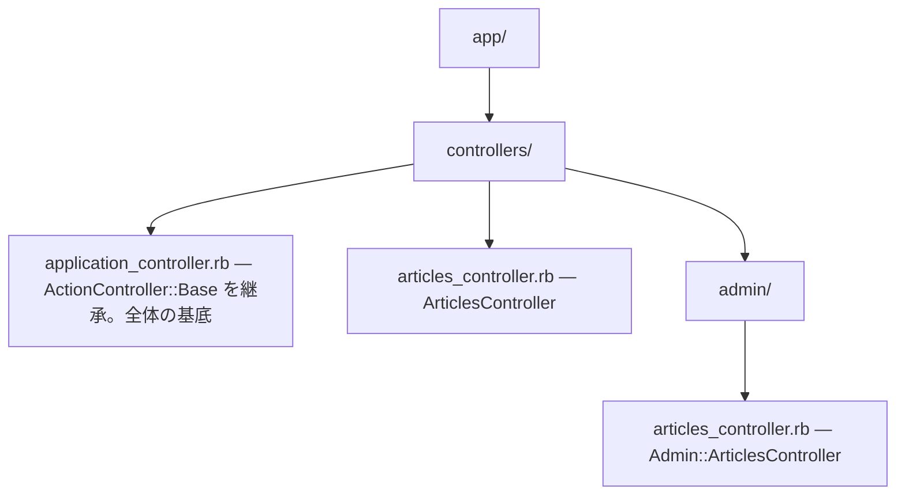

# Rails 第3章: コントローラ

コントローラ（ActionController）は、ルーティングから渡されたリクエストを受け取り、モデルを操作し、レスポンス（ビューのレンダリングやリダイレクト）を返す MVC の「制御役」です。この章では標準7アクションを軸に、パラメータ処理、Strong Parameters、レンダリング、フィルタ、セッションや例外処理まで、実務で必須の知識を Rails 7.2 / 8 系に準拠して解説します。

---

## 目次

1. [コントローラの役割と命名規約](#1-コントローラの役割と命名規約)
2. [コントローラの生成 (generate controller)](#2-コントローラの生成-generate-controller)
3. [アクションと標準7アクション](#3-アクションと標準7アクション)
4. [パラメータ params](#4-パラメータ-params)
5. [Strong Parameters](#5-strong-parameters)
6. [render と redirect_to](#6-render-と-redirect_to)
7. [respond_to とフォーマット](#7-respond_to-とフォーマット)
8. [フィルタ (before_action / after_action / around_action)](#8-フィルタ-before_action--after_action--around_action)
9. [セッション・cookies・flash](#9-セッションcookiesflash)
10. [ステータスコード](#10-ステータスコード)
11. [例外処理 rescue_from](#11-例外処理-rescue_from)
12. [helper_method と request / response](#12-helper_method-と-request--response)
13. [CSRF対策とパラメータの安全な扱い](#13-csrf対策とパラメータの安全な扱い)

---

## 1. コントローラの役割と命名規約

コントローラの責務は「リクエストを解釈し、適切なモデル操作を行い、レスポンスを組み立てる」ことです。ビジネスロジックそのものはモデルに寄せ、コントローラは薄く保つ（Skinny Controller）のが基本方針です。

### 命名規約

- クラス名は**複数形 + Controller**（例: `ArticlesController`, `UsersController`）。
- すべて `ApplicationController` を継承する。`ApplicationController` は `ActionController::Base` を継承する。
- ファイルは `app/controllers/` 配下にスネークケースで配置（例: `app/controllers/articles_controller.rb`）。
- 名前空間（モジュール）を使う場合はサブディレクトリに置く（例: `Admin::ArticlesController` → `app/controllers/admin/articles_controller.rb`）。



```ruby
# app/controllers/application_controller.rb
class ApplicationController < ActionController::Base
  # 全コントローラ共通の設定・フィルタ・ヘルパをここに書く
end

# app/controllers/articles_controller.rb
class ArticlesController < ApplicationController
  # 個別のリソースに対する処理
end
```

| 対象 | 規約 | 例 |
|------|------|-----|
| クラス名 | 複数形 + `Controller` | `ArticlesController` |
| ファイル名 | スネークケース複数形 | `articles_controller.rb` |
| 基底クラス | `ApplicationController` を継承 | `< ApplicationController` |
| 名前空間 | モジュール = サブディレクトリ | `Admin::ArticlesController` |

> 補足: API 専用アプリでは `ApplicationController < ActionController::API` とし、ビューや Cookie 関連の機能を省いた軽量な基底を使うこともあります。

**🎯 Django:** Rails の Controller は Django では「ビュー（`views.py`）」に相当します。Django が言う "View" は Rails の View（テンプレート）ではなく、リクエストを処理する制御役である点に注意してください。Django には関数ベースビュー(FBV)とクラスベースビュー(CBV)の2系統があります。

```python
# Django ではロジックは views.py に書く
# 関数ベースビュー(FBV)
from django.shortcuts import render

def index(request):
    articles = Article.objects.order_by("-created_at")
    return render(request, "articles/index.html", {"articles": articles})

# クラスベースビュー(CBV)
from django.views import View

class ArticlesView(View):
    def get(self, request):
        ...
```

Django のビューは「1関数（または1クラス）＝1エンドポイント」が基本で、1コントローラに複数アクションをまとめる Rails とは構造が異なります。`〜Controller` のような命名の強制規約もありません。

---

## 2. コントローラの生成 (generate controller)

`bin/rails generate controller` でコントローラとビュー、ルート、テストの雛形をまとめて生成できます（`generate` は `g` に省略可）。

```bash
# 基本形: コントローラ名（複数形）に続けてアクション名を並べる
bin/rails generate controller Articles index show

# 名前空間付き
bin/rails g controller Admin::Articles index

# ビューを生成しない場合
bin/rails g controller Articles index --no-view-specs --skip-routes
```

上記 `Articles index show` を実行すると、おおむね次が生成されます。

```text
create  app/controllers/articles_controller.rb  # index / show アクションの雛形
create  app/views/articles/index.html.erb        # 対応するビュー
create  app/views/articles/show.html.erb
route   get 'articles/index'                      # 単純な get ルート（要調整）
create  app/helpers/articles_helper.rb
create  test/controllers/articles_controller_test.rb
```

> 注意: `generate controller` が追記するのは `get 'articles/index'` のような単純ルートです。RESTful なリソースを扱う場合は `config/routes.rb` を `resources :articles` に書き換えるのが一般的です。逆に `bin/rails g scaffold Article title body:text` を使えば、モデル・7アクション・ビュー・`resources` ルートまで一式生成されます。

生成物を取り消したいときは `destroy` を使います。

```bash
bin/rails destroy controller Articles   # 生成したファイル群を削除
```

---

## 3. アクションと標準7アクション

コントローラの public メソッドが「アクション」です。RESTful リソースでは以下の**標準7アクション**が定義されます。`resources :articles` はこの7つのルートを一括生成します。

| アクション | HTTPメソッド | パス | 役割 |
|-----------|-------------|------|------|
| `index` | GET | `/articles` | 一覧表示 |
| `show` | GET | `/articles/:id` | 個別表示 |
| `new` | GET | `/articles/new` | 新規作成フォーム |
| `create` | POST | `/articles` | 作成処理 |
| `edit` | GET | `/articles/:id/edit` | 編集フォーム |
| `update` | PATCH/PUT | `/articles/:id` | 更新処理 |
| `destroy` | DELETE | `/articles/:id` | 削除処理 |

`new`/`edit` は「フォームを表示する」GET アクション、`create`/`update`/`destroy` は「データを変更する」アクションという対応です。以下は通しの実装例です。

```ruby
# app/controllers/articles_controller.rb
class ArticlesController < ApplicationController
  # 各アクションの前に対象レコードを取得（DRY化）
  before_action :set_article, only: %i[show edit update destroy]

  # GET /articles
  def index
    @articles = Article.order(created_at: :desc)
  end

  # GET /articles/:id
  def show
    # set_article で @article を取得済み。index.html.erb などをレンダリング
  end

  # GET /articles/new
  def new
    @article = Article.new   # 空のオブジェクトをフォームに渡す
  end

  # POST /articles
  def create
    @article = Article.new(article_params)
    if @article.save
      # 保存成功 → 詳細ページへリダイレクト（PRGパターン）
      redirect_to @article, notice: "記事を作成しました。"
    else
      # 失敗 → new を再描画。status: :unprocessable_entity が Turbo で必須
      render :new, status: :unprocessable_entity
    end
  end

  # GET /articles/:id/edit
  def edit
    # @article は set_article で取得済み。フォームを表示
  end

  # PATCH/PUT /articles/:id
  def update
    if @article.update(article_params)
      redirect_to @article, notice: "記事を更新しました。"
    else
      render :edit, status: :unprocessable_entity
    end
  end

  # DELETE /articles/:id
  def destroy
    @article.destroy
    # 削除後は一覧へ。status: :see_other が Turbo での DELETE 後に必要
    redirect_to articles_path, notice: "記事を削除しました。", status: :see_other
  end

  private

  # 共通処理: :id から対象レコードを取得
  def set_article
    @article = Article.find(params[:id])
  end

  # Strong Parameters（次節で詳説）
  def article_params
    params.require(:article).permit(:title, :body)
  end
end
```

> Rails 7 以降のデフォルトである Turbo（Hotwire）では、フォーム送信のバリデーション失敗時に `status: :unprocessable_entity`、DELETE 後のリダイレクトに `status: :see_other` を付けないと期待通り動かない点に注意してください。

**🎯 Django:** Rails の標準7アクションは、Django の汎用クラスベースビュー(CBV) がほぼ1対1で対応します。

```python
from django.views.generic import (
    ListView, DetailView, CreateView, UpdateView, DeleteView,
)

class ArticleListView(ListView):      # index
    model = Article

class ArticleDetailView(DetailView):  # show
    model = Article

class ArticleCreateView(CreateView):  # new + create
    model = Article
    fields = ["title", "body"]

class ArticleUpdateView(UpdateView):  # edit + update
    model = Article
    fields = ["title", "body"]

class ArticleDeleteView(DeleteView):  # destroy
    model = Article
    success_url = "/articles/"
```

Rails の `new`/`create`、`edit`/`update` が、それぞれ `CreateView`/`UpdateView` の1クラス（GET＝フォーム表示、POST＝保存）に統合される点が構造上の違いです。

---

## 4. パラメータ params

`params` はリクエストに含まれるパラメータをまとめた `ActionController::Parameters` オブジェクトです。以下の3種類が**統合されて**アクセスできます。

| 由来 | 例 | 取得 |
|------|-----|------|
| ルート（動的セグメント） | `/articles/:id` の `5` | `params[:id]` |
| クエリ文字列 | `?page=2&sort=name` | `params[:page]` |
| ボディ（フォーム/JSON） | POSTされた `article[title]` | `params[:article][:title]` |

```ruby
# GET /articles/5?page=2
params[:id]     # => "5"（ルートパラメータ。基本は文字列）
params[:page]   # => "2"（クエリパラメータ）

# キーはシンボル・文字列どちらでもアクセス可（HashWithIndifferentAccess 相当）
params[:id] == params["id"]   # => true
```

### ネストしたパラメータ

フォームの `article[title]` のような入力は、ネストしたハッシュとして届きます。

```ruby
# 送信データ: article[title]=Hello&article[tags][]=ruby&article[tags][]=rails
params[:article]           # => { "title" => "Hello", "tags" => ["ruby", "rails"] }
params[:article][:title]   # => "Hello"
params[:article][:tags]    # => ["ruby", "rails"]（配列パラメータ）
params.dig(:article, :title)  # => "Hello"（安全にネストを辿る）
```

> 注意: `params` の値は基本的に**文字列**です（数値も `"5"` のように届く）。数値として使う場合は `to_i` などで変換します。ただし後述の Strong Parameters を通し、モデルの型に沿ってキャストするのが実務的です。

**🎯 Django:** Rails が「ルート／クエリ／ボディ」を1つの `params` に統合するのに対し、Django は取得元ごとにオブジェクトが分かれます。

```python
# URL 動的セグメント → ビュー関数の引数（urls.py の <int:id> 等）
def show(request, id):        # params[:id] 相当
    ...

request.GET["page"]           # クエリ文字列（params[:page] 相当）
request.POST["title"]         # フォームボディ（params[:article][:title] 相当）
request.GET.get("page")       # キー不在でも例外にせず None を返す
```

URL 引数・`request.GET`・`request.POST` を明確に区別するのが Django の思想です（値が文字列である点は Rails と共通）。

---

## 5. Strong Parameters

マスアサインメント脆弱性（意図しない属性の一括更新）を防ぐため、モデルに渡すパラメータは**明示的に許可**する必要があります。これが Strong Parameters です。

```ruby
# require: 指定キーが存在しなければ ActionController::ParameterMissing 例外
# permit: 許可する属性だけをホワイトリスト指定
def article_params
  params.require(:article).permit(:title, :body, :published)
end

# Article.new(article_params) のように使う
```

### 配列・ネストの許可

```ruby
# スカラー値の配列を許可する場合: キーに空配列を渡す
params.require(:article).permit(:title, tag_ids: [])

# ネストした属性（accepts_nested_attributes_for と併用）
params.require(:article).permit(
  :title,
  comments_attributes: [:id, :body, :_destroy]  # 許可するキーを配列で列挙
)

# ハッシュ丸ごと（キーが可変）を許可する場合
params.require(:article).permit(preferences: {})
```

### permit! の注意

`permit!` はすべての属性を無条件に許可します。**マスアサインメント脆弱性に直結する**ため、ユーザー入力に対しては原則使用しないでください。

```ruby
# 危険: すべてのパラメータを許可してしまう。外部入力には使わない
params.require(:article).permit!
```

| メソッド | 挙動 | 備考 |
|----------|------|------|
| `require(:key)` | キー必須。無ければ `ParameterMissing` (400) | ネストの起点 |
| `permit(:a, :b)` | 指定キーのみ許可 | 未許可キーは黙って除外 |
| `permit(tags: [])` | スカラー配列を許可 | 空配列がマーカー |
| `permit(attrs: [:x])` | ネストハッシュを許可 | 許可キーを列挙 |
| `permit!` | 全許可 | 原則禁止 |

> 補足: `permit` で除外されたキーは例外にならず、ログに `Unpermitted parameters:` と警告が出るだけです。想定外のキーはここで気付けます。

**🎯 Django:** Django には Strong Parameters に相当する仕組みはなく、代わりに Form / ModelForm（DRF なら Serializer）が「許可する項目の宣言」とバリデーションを兼ねます。

```python
from django import forms

class ArticleForm(forms.ModelForm):
    class Meta:
        model = Article
        fields = ["title", "body"]   # 許可する項目をここで明示（= permit 相当）

# ビュー側
form = ArticleForm(request.POST)
if form.is_valid():
    form.save()
```

Rails は「コントローラで許可リストを書く」思想、Django は「フォーム／シリアライザという専用クラスで許可とバリデーションを一体化する」思想という設計差があります。`fields` に無い項目はマスアサインメントされません。

---

## 6. render と redirect_to

`render` は**現在のリクエスト内でレスポンス本文を生成**します。`redirect_to` は**新しいリクエストを促す HTTP リダイレクト（3xx）を返す**もので、両者は根本的に異なります。

### render

```ruby
# テンプレート指定（アクション名の暗黙レンダリングと同じ）
render :edit                      # app/views/xxx/edit.html.erb
render "articles/show"            # パス指定
render action: :new               # action オプション

# 本文を直接返す
render json: @article             # JSON（to_json 相当）+ Content-Type: application/json
render json: @article, status: :created
render plain: "OK"                # テキスト。Content-Type: text/plain
render html: "<b>hi</b>".html_safe  # HTML断片
render inline: "<%= @article.title %>"  # ERB文字列（多用は避ける）

# ステータス・レイアウト指定
render :show, status: :ok
render :show, layout: "print"     # 別レイアウトを使用
render :show, layout: false       # レイアウトなし
render :new, status: :unprocessable_entity  # バリデーション失敗時の定番
```

### redirect_to

```ruby
redirect_to @article                       # article_path(@article) へ（302）
redirect_to articles_path                  # パスヘルパ
redirect_to root_url                       # フルURL
redirect_to @article, notice: "保存しました"  # flash[:notice] を同時セット
redirect_to @article, status: :see_other   # 303（Turboでの更新後など）
redirect_back(fallback_location: root_path) # 直前のページ（Referer）へ。無ければfallback
```

### 違いのまとめと DoubleRenderError

```text
render      : 同一リクエスト内でレスポンス本文を確定（HTTPは200等）
              → @article などのインスタンス変数はビューでそのまま使える
redirect_to : 3xx + Location ヘッダを返す。ブラウザが新規リクエストを送る
              → インスタンス変数は引き継がれない（flashで値を渡す）
```

1回のアクションで `render` / `redirect_to` を**2回以上呼ぶと `AbstractController::DoubleRenderError`** になります。条件分岐で片方だけが実行されるようにし、後続処理を止めたい場合は `return` を添えます。

```ruby
def show
  if @article.nil?
    redirect_to articles_path and return  # ここで処理を打ち切る
  end
  # redirect 済みの場合、and return が無いと下の render で二重描画エラー
  render :show
end
```

> 明示的な `render`/`redirect_to` を書かなければ、Rails はアクション名と同名のテンプレートを**暗黙的にレンダリング**します。

**🎯 Django:**

```python
from django.shortcuts import render, redirect
from django.http import JsonResponse, HttpResponse

render(request, "articles/show.html", {"article": article})  # テンプレート描画（render :show 相当）
JsonResponse({"id": article.id})                              # render json: 相当
HttpResponse("OK", content_type="text/plain")                # render plain: 相当
HttpResponse(status=422)                                      # status: 相当
return redirect("article_detail", pk=article.id)             # redirect_to（302）相当
return redirect(article)                                      # get_absolute_url() を利用してリダイレクト
```

Rails は明示的な `render` を書かなくても暗黙レンダリングされますが、Django のビューは必ず `HttpResponse` 系オブジェクトを `return` する必要があります。

---

## 7. respond_to とフォーマット

1つのアクションで HTML と JSON など複数フォーマットに応答したい場合は `respond_to` を使います。リクエストの拡張子や `Accept` ヘッダに応じて分岐します。

```ruby
# GET /articles/1  または  GET /articles/1.json
def show
  @article = Article.find(params[:id])

  respond_to do |format|
    format.html                              # show.html.erb を描画
    format.json { render json: @article }    # JSON を返す
  end
end

def create
  @article = Article.new(article_params)

  respond_to do |format|
    if @article.save
      format.html { redirect_to @article, notice: "作成しました。" }
      format.json { render json: @article, status: :created, location: @article }
    else
      format.html { render :new, status: :unprocessable_entity }
      format.json { render json: @article.errors, status: :unprocessable_entity }
    end
  end
end
```

現在のフォーマットは `request.format` で判定できます。

```ruby
request.format.json?   # => true / false
request.format.symbol  # => :json など
```

**🎯 Django:** 素の Django に `respond_to` のようなフォーマット分岐の糖衣構文はなく、`request` を見て自前で分岐するか、DRF のコンテンツネゴシエーションに任せます。

```python
from django.shortcuts import get_object_or_404, render
from django.http import JsonResponse

# 素の Django: 自前で分岐
def show(request, id):
    article = get_object_or_404(Article, pk=id)
    if request.headers.get("Accept") == "application/json":
        return JsonResponse({"title": article.title})
    return render(request, "articles/show.html", {"article": article})
```

DRF では Serializer と `Accept` ヘッダに基づくコンテンツネゴシエーションが自動で働き、Rails の `respond_to` に近い体験になります。

---

## 8. フィルタ (before_action / after_action / around_action)

フィルタはアクションの前後に共通処理を差し込む仕組みです。認証・レコード取得・ロギングなどに使います。

| フィルタ | 実行タイミング | 主な用途 |
|----------|----------------|----------|
| `before_action` | アクション**前** | 認証、レコード取得、リダイレクト |
| `after_action` | アクション**後** | ロギング、レスポンス加工 |
| `around_action` | アクションを**囲む** | 計測、トランザクション的処理 |

> 重要: `before_filter` / `after_filter` / `around_filter` は Rails 5.0 で削除された**旧記法**です。現行では必ず `before_action` 系を使ってください。

```ruby
class ArticlesController < ApplicationController
  # only: 指定アクションだけに適用
  before_action :require_login, except: %i[index show]
  before_action :set_article, only: %i[show edit update destroy]

  # around_action: yield の前後を挟む
  around_action :log_duration, only: :index

  private

  def require_login
    # before_action 内で render / redirect_to するとアクションは実行されない
    redirect_to login_path, alert: "ログインしてください。" unless logged_in?
  end

  def set_article
    @article = Article.find(params[:id])
  end

  def log_duration
    started = Time.current
    yield                                   # ここで本来のアクションが動く
    Rails.logger.info("所要 #{Time.current - started}s")
  end
end
```

### only / except と skip

```ruby
before_action :require_login, only: %i[edit update destroy]  # この3つだけ
before_action :require_login, except: %i[index show]         # この2つ以外

# 親から継承したフィルタを個別に無効化
skip_before_action :require_login, only: :index
```

> 補足: `before_action` が `redirect_to` や `render` を実行すると、以降のフィルタとアクション本体は**実行されません**（フィルタチェーンが停止）。認証ガードはこの性質を利用しています。

**🎯 Django:** Rails のフィルタに対応する手段は Django では複数あります。アプリ全体を横断するならミドルウェア、FBV にはデコレータ、CBV には `dispatch()` のオーバーライドや Mixin を使います。

```python
# FBV: デコレータ（before_action :require_login 相当）
from django.contrib.auth.decorators import login_required

@login_required
def edit(request, id):
    ...

# CBV: Mixin（フィルタを継承で共有するのに近い）
from django.contrib.auth.mixins import LoginRequiredMixin

class ArticleUpdateView(LoginRequiredMixin, UpdateView):
    model = Article

# CBV: dispatch() で前後を挟む（around_action に近い）
class MyView(View):
    def dispatch(self, request, *args, **kwargs):
        # アクション前の共通処理
        return super().dispatch(request, *args, **kwargs)
```

Rails が `before_action`/`around_action` で一元的に宣言するのに対し、Django は「適用範囲（全体＝ミドルウェア／個別＝デコレータ・Mixin）」で手段を使い分けます。

---

## 9. セッション・cookies・flash

### session

`session` はリクエストをまたいでユーザーごとの状態を保持します（デフォルトは暗号化された Cookie ストア）。ログイン中のユーザーIDなど小さな値の保存に使います。

```ruby
session[:user_id] = @user.id     # 保存
current = session[:user_id]      # 取得
session.delete(:user_id)         # 個別削除
reset_session                    # 全消去（ログアウト時などセキュリティ上の定番）
```

> 注意: Cookie ストアのセッションは容量が約 4KB に制限されます。大きなデータや秘匿性の高いデータは DB 側に保存してください。

### cookies

```ruby
cookies[:theme] = "dark"                             # 平文Cookie
cookies[:theme] = { value: "dark", expires: 1.week } # 有効期限付き
cookies.signed[:user_id] = @user.id                  # 署名付き（改ざん検知）
cookies.encrypted[:token] = secret                   # 暗号化（値を秘匿）
cookies.delete(:theme)                               # 削除

value = cookies.signed[:user_id]   # 署名が不正なら nil
```

| 種別 | 改ざん検知 | 値の秘匿 | 用途 |
|------|-----------|---------|------|
| `cookies` | なし | なし | 表示設定など非機密 |
| `cookies.signed` | あり | なし | ユーザーIDなど（値は見える） |
| `cookies.encrypted` | あり | あり | トークンなど機密値 |

### flash

`flash` は**次のリクエストにだけ**引き継がれる一時メッセージです。リダイレクト後の通知に使います。

```ruby
redirect_to @article, notice: "保存しました。"   # flash[:notice] のショートカット
redirect_to root_path, alert: "権限がありません。" # flash[:alert] のショートカット
flash[:info] = "任意のキーも使える"

# flash.now: 同一リクエスト内でのみ有効（render と併用。次には残さない）
flash.now[:alert] = "入力に誤りがあります。"
render :new, status: :unprocessable_entity
```

```text
redirect_to + flash      : 次のリクエスト（リダイレクト先）で表示
render      + flash.now  : 今このリクエストで描画するビューで表示
```

`notice` と `alert` は特別扱いされ、`redirect_to` のオプションとして直接渡せます。それ以外のキー（`:info` など）は `flash[:xxx]` で設定します。

**🎯 Django:**

```python
request.session["user_id"] = user.id     # session[:user_id] = 相当
request.session.get("user_id")           # session[:user_id] 相当（不在は None）
del request.session["user_id"]           # session.delete 相当
request.session.flush()                  # reset_session 相当

request.COOKIES.get("theme")             # cookies[:theme] の読み取り
response.set_cookie("theme", "dark")     # cookies[:theme] = の書き込み
response.set_signed_cookie("uid", uid)   # cookies.signed 相当（改ざん検知）

# flash ↔ django.contrib.messages
from django.contrib import messages
messages.success(request, "保存しました。")  # リダイレクト後に一度だけ表示
```

Rails の `flash` は `django.contrib.messages` フレームワークに相当し、「次のリクエストで一度だけ表示される」という挙動も同じです。Django の Cookie では読み取り(`request.COOKIES`)と書き込み(`response.set_cookie`)でオブジェクトが分かれる点が Rails と異なります。

---

## 10. ステータスコード

`status:` にはシンボルで指定できます（`Rack::Utils::SYMBOL_TO_STATUS_CODE` に基づく）。数値より意図が明確で推奨されます。

| シンボル | コード | 意味 | 主な用途 |
|----------|--------|------|----------|
| `:ok` | 200 | OK | 通常の成功 |
| `:created` | 201 | Created | リソース作成成功 |
| `:no_content` | 204 | No Content | 本文なし成功（DELETE等） |
| `:moved_permanently` | 301 | Moved Permanently | 恒久リダイレクト |
| `:found` | 302 | Found | 一時リダイレクト（redirect_toの既定） |
| `:see_other` | 303 | See Other | POST後のリダイレクト（Turbo DELETE後） |
| `:not_modified` | 304 | Not Modified | キャッシュ有効 |
| `:bad_request` | 400 | Bad Request | 不正なリクエスト |
| `:unauthorized` | 401 | Unauthorized | 未認証 |
| `:forbidden` | 403 | Forbidden | 権限なし |
| `:not_found` | 404 | Not Found | リソース不在 |
| `:unprocessable_entity` | 422 | Unprocessable Entity | バリデーション失敗 |
| `:too_many_requests` | 429 | Too Many Requests | レート制限 |
| `:internal_server_error` | 500 | Internal Server Error | サーバ内部エラー |
| `:service_unavailable` | 503 | Service Unavailable | 一時的に利用不可 |

```ruby
render json: @article, status: :created                  # 201
render json: @article.errors, status: :unprocessable_entity  # 422
head :no_content                                         # 204（本文なしで応答）
head :not_found                                          # 404 のみ返す
```

> 補足: `head` はボディを持たずステータス（と任意ヘッダ）だけを返すときに使います。

**🎯 Django:** ステータスコードはシンボルではなく整数で指定します。DRF では意味の分かる定数（`status` モジュール）が使え、Rails のシンボルに近くなります。

```python
from django.http import HttpResponse, JsonResponse

HttpResponse(status=201)                       # :created 相当
JsonResponse(errors, status=422)               # :unprocessable_entity 相当
HttpResponse(status=204)                       # head :no_content 相当

# DRF: 定数で意図を明示（Rails のシンボルに近い）
from rest_framework import status
from rest_framework.response import Response
Response(data, status=status.HTTP_201_CREATED)
```

---

## 11. 例外処理 rescue_from

コントローラ全体で発生する例外を一括ハンドリングするには `rescue_from` を使います。代表例は `ActiveRecord::RecordNotFound` を 404 ページに変換する処理です。

```ruby
class ApplicationController < ActionController::Base
  # 特定の例外クラスに対するハンドラを登録
  rescue_from ActiveRecord::RecordNotFound, with: :record_not_found
  rescue_from Pundit::NotAuthorizedError, with: :forbidden

  private

  def record_not_found
    respond_to do |format|
      format.html { render file: Rails.root.join("public/404.html"),
                           status: :not_found, layout: false }
      format.json { render json: { error: "Not Found" }, status: :not_found }
    end
  end

  def forbidden(exception)
    # ブロック形式で例外オブジェクトを受け取ることも可能
    logger.warn(exception.message)
    head :forbidden
  end
end
```

> 注意: `rescue_from` の登録は**下に書いたものが優先**（後勝ち）で評価されます。また、開発環境では `config.consider_all_requests_local = true` のため詳細なエラー画面が表示され、`rescue_from` の効果を確認しづらい場合があります。本番相当の挙動は production 環境で確認してください。

**🎯 Django:** Django には `rescue_from` のようなコントローラ単位の宣言的ハンドラはなく、例外を送出してプロジェクト全体のハンドラ（`handler404` 等）で拾うか、ビュー内で `try/except` します。`ActiveRecord::RecordNotFound` → 404 に相当するのは `Http404` / `get_object_or_404` です。

```python
from django.http import Http404
from django.shortcuts import get_object_or_404

def show(request, id):
    article = get_object_or_404(Article, pk=id)  # 無ければ Http404 → 404 ページ
    ...

# urls.py で 404 ハンドラを差し替え（rescue_from ...RecordNotFound の全体版に近い）
handler404 = "myapp.views.custom_404"

# DRF は「例外 → レスポンス」変換のハンドラ機構を標準で持つ（exception_handler）
```

Rails の `Article.find`（失敗で `RecordNotFound`）は Django の `get_object_or_404` に、`rescue_from ActiveRecord::RecordNotFound` は `Http404` の自動 404 変換に対応します。

---

## 12. helper_method と request / response

### helper_method

コントローラで定義したメソッドをビューからも呼べるようにするのが `helper_method` です。ログイン中ユーザーの参照などでよく使います。

```ruby
class ApplicationController < ActionController::Base
  helper_method :current_user, :logged_in?

  private

  def current_user
    # メモ化。session の user_id からユーザーを引く
    @current_user ||= User.find_by(id: session[:user_id])
  end

  def logged_in?
    current_user.present?
  end
end
```

```erb
<%# ビュー側でそのまま呼べる %>
<% if logged_in? %>
  こんにちは、<%= current_user.name %> さん
<% end %>
```

### request / response オブジェクト

アクション内では `request`（`ActionDispatch::Request`）と `response` から多くの情報を取得できます。

| 式 | 内容 |
|----|------|
| `request.method` | HTTPメソッド（`"GET"` 等） |
| `request.get?` / `post?` | メソッド判定 |
| `request.path` | パス（`/articles/1`） |
| `request.fullpath` | クエリ込みパス |
| `request.url` | 完全URL |
| `request.remote_ip` | クライアントIP |
| `request.user_agent` | User-Agent |
| `request.headers["X-..."]` | 任意リクエストヘッダ |
| `request.format` | レスポンス形式（`:html` 等） |
| `request.xhr?` | XHR（Ajax）判定 |
| `response.status` | レスポンスのステータスコード |
| `response.headers["..."]` | レスポンスヘッダの設定 |

```ruby
def show
  logger.info "アクセス元: #{request.remote_ip} / UA: #{request.user_agent}"
  response.headers["X-Article-Id"] = params[:id]  # 独自ヘッダを付与
end
```

---

## 13. CSRF対策とパラメータの安全な扱い

### protect_from_forgery（CSRF対策）

Rails は CSRF（クロスサイトリクエストフォージェリ）対策をデフォルトで有効にしています。`ApplicationController < ActionController::Base` を継承していれば、`protect_from_forgery with: :exception` 相当が自動で働きます。

- `form_with` などのフォームヘルパは自動で**認証トークン（authenticity token）**を埋め込む。
- GET 以外のリクエストでトークンが一致しないと `ActionController::InvalidAuthenticityToken` 例外が発生する。

```ruby
class ApplicationController < ActionController::Base
  # 明示するなら（通常は不要。デフォルトで有効）
  protect_from_forgery with: :exception
end
```

外部からの API 呼び出しなど、Cookie セッションを使わないエンドポイントでのみ、限定的に検証を外します（無効化は影響範囲を最小に）。

```ruby
class Api::WebhooksController < ApplicationController
  # Webhook など特定アクションのみトークン検証をスキップ
  skip_before_action :verify_authenticity_token, only: :receive
end
```

> 補足: `ActionController::API` を継承する API 専用コントローラでは、そもそもフォーム由来の CSRF 検証は組み込まれていません（トークンではなく別の認証方式を使う前提）。

**🎯 Django:** Django も CSRF 対策をデフォルトで有効化しています（`CsrfViewMiddleware`）。ただし Rails のフォームヘルパが自動でトークンを埋め込むのと異なり、テンプレートのフォームには `` を明示的に書く必要があります。

```python
# settings.py の MIDDLEWARE に既定で含まれる
# "django.middleware.csrf.CsrfViewMiddleware"

# 特定ビューだけ検証を外す（skip_before_action :verify_authenticity_token 相当）
from django.views.decorators.csrf import csrf_exempt

@csrf_exempt
def webhook(request):
    ...
```

```html
<!-- テンプレート側でトークンを明示（form_with が自動生成する authenticity token に相当） -->
<form method="post">
  
  ...
</form>
```

無効化は Rails の `skip_before_action :verify_authenticity_token` に対応する `csrf_exempt` を、影響範囲を絞って使います。

### パラメータの安全な扱い（まとめ）

- モデルへ渡す値は必ず **Strong Parameters** を通す（`permit!` は原則禁止）。
- SQL は文字列連結せず、プレースホルダやハッシュ条件を使う（SQLインジェクション対策）。
- ファイルパスやリダイレクト先にユーザー入力をそのまま使わない（パストラバーサル / オープンリダイレクト対策）。

```ruby
# 悪い例: 文字列連結でSQLインジェクションの余地
Article.where("title = '#{params[:q]}'")

# 良い例: プレースホルダ / ハッシュ条件でエスケープを任せる
Article.where("title = ?", params[:q])
Article.where(title: params[:q])

# オープンリダイレクト対策: 外部URLへ飛ばさない
redirect_to params[:return_to], allow_other_host: false  # 既定でfalse。他ホストを拒否
```

---

これでコントローラの主要機能を一通り押さえました。次章では、コントローラから操作する対象であるモデル（ActiveRecord）を扱います。

[← 第2章: ルーティング](02_ルーティング.md) | [Rails目次](README.md) | [第4章: モデルとActiveRecord →](04_モデルとActiveRecord.md)
