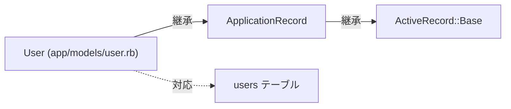
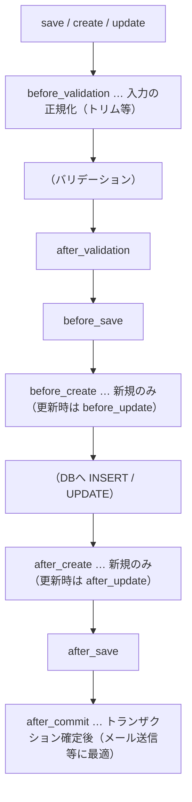

# Rails 第4章: モデルとActiveRecord

モデルはMVCの「M」を担い、アプリケーションのデータとビジネスロジックを表現します。Railsではモデルの基盤としてActiveRecord（O/Rマッパー）を利用し、SQLをほとんど書かずにデータベースを操作できます。この章では、モデルの命名規約からマイグレーション、CRUD、クエリ、バリデーション、コールバック、トランザクションまでを実務目線で解説します。

> 補足: ActiveRecordを「Rails以外の単体」で使う場合の接続設定などは [docs/gems/activerecord.md](../gems/activerecord.md) を参照してください。本章はRailsアプリに統合された前提で説明します。

---

## 目次

1. [モデルの役割と命名規約](#モデルの役割と命名規約)
2. [モデルとカラム型の生成](#モデルとカラム型の生成)
3. [マイグレーション](#マイグレーション)
4. [CRUD操作](#crud操作)
5. [クエリインターフェース](#クエリインターフェース)
6. [スコープ](#スコープ)
7. [バリデーション](#バリデーション)
8. [コールバック](#コールバック)
9. [enum](#enum)
10. [トランザクション](#トランザクション)
11. [タイムスタンプ](#タイムスタンプ)

---

## モデルの役割と命名規約

モデルは「テーブル1つ」に対応するRubyクラスです。データの読み書き、バリデーション、業務ロジックを担当します。



### 命名規約（Convention over Configuration）

Railsは「規約」に従うことで設定を最小化します。名前を規約通りにすれば、モデルとテーブルは自動で結びつきます。

| 対象 | 形式 | 例 |
|------|------|-----|
| モデルクラス | 単数形・パスカルケース | `User`, `BlogPost` |
| ファイル名 | 単数形・スネークケース | `app/models/user.rb`, `app/models/blog_post.rb` |
| テーブル名 | 複数形・スネークケース | `users`, `blog_posts` |
| 主キー | `id`（bigint, 自動採番） | `id` |
| 外部キー | `<単数形>_id` | `user_id`, `blog_post_id` |

```ruby
# app/models/user.rb
class User < ApplicationRecord
  # クラス名 User → テーブル users に自動で対応
  # カラムはスキーマから自動でアクセサ化される（name, age など）
end
```

**🎯 Django:** Djangoはモデル（`models.py`）にフィールドを明示的に書き、その定義が真実の源（source of truth）になります。

```python
# blog/models.py
from django.db import models

class User(models.Model):
    name = models.CharField(max_length=255)
    age = models.IntegerField(null=True)
    # クラス名 User → テーブルは既定で blog_user（アプリ名_モデル名・小文字）
```

Railsは**スキーマ（DB）が真実**でモデルにカラムを書かない（マイグレーションでDBを定義し、カラムはスキーマから自動でアクセサ化される）のに対し、Djangoは**モデルのフィールド定義が真実**で、そこからDBスキーマを生成します。この思想の違いが、以降のモデル定義・マイグレーション全体の差の根っこです。テーブル名の既定もRailsは複数形（`users`）、Djangoは `アプリ名_モデル名`（`blog_user`）と異なります。

`ApplicationRecord`（`app/models/application_record.rb`）は全モデルの親クラスで、アプリ共通の設定やメソッドを集約する場所です。

```ruby
# app/models/application_record.rb
class ApplicationRecord < ActiveRecord::Base
  primary_abstract_class # このクラス自体はテーブルを持たない
end
```

規約から外れる場合だけ明示します。

```ruby
class User < ApplicationRecord
  self.table_name  = "app_users" # テーブル名を上書き
  self.primary_key = "uuid"      # 主キーを上書き
end
```

---

## モデルとカラム型の生成

ジェネレータでモデル・マイグレーション・テストの雛形を一括生成します。

```bash
# 書式: bin/rails generate model <モデル名(単数形)> <カラム名>:<型> ...
bin/rails generate model User name:string age:integer
# g は generate の省略形
bin/rails g model Article title:string body:text published:boolean
```

**🎯 Django:** Djangoにモデル生成コマンドは無く、`models.py` にクラスを手書きしてから `makemigrations` で差分を検出してマイグレーションを生成します。

```python
# blog/models.py
class Article(models.Model):
    title = models.CharField(max_length=255)
    body = models.TextField()
    published = models.BooleanField(default=False)
```

```bash
python manage.py makemigrations   # models.py の差分からマイグレーションを自動生成
```

Railsは「型を引数で渡してジェネレータがマイグレーションを作る」、Djangoは「フィールドを書いて差分から生成する」という順序の違いがあります。

生成されるファイル:

```text
db/migrate/20260725093000_create_users.rb  # マイグレーション
app/models/user.rb                          # モデル
test/models/user_test.rb                    # テスト（RSpec導入時はspec配下）
test/fixtures/users.yml                     # フィクスチャ
```

### カラム型一覧

`カラム名:型` の「型」には以下を指定できます（実際のDB型はアダプタにより異なる）。

| 指定する型 | 用途 | PostgreSQLでの型 |
|-----------|------|------------------|
| `string` | 短い文字列（既定255文字） | `varchar` |
| `text` | 長い文字列・本文 | `text` |
| `integer` | 整数 | `integer` |
| `bigint` | 大きな整数・外部キー | `bigint` |
| `float` | 浮動小数点（誤差あり） | `float` |
| `decimal` | 高精度小数（金額など） | `decimal` |
| `boolean` | 真偽値 | `boolean` |
| `date` | 日付のみ | `date` |
| `time` | 時刻のみ | `time` |
| `datetime` | 日時 | `timestamp` |
| `binary` | バイナリデータ | `bytea` |
| `references` | 外部キー（`belongs_to`） | `bigint` + index |
| `json` / `jsonb` | 構造化データ | `json` / `jsonb` |

**🎯 Django:** 上記の型はDjangoのフィールドクラスに概ね対応します。

| Rails の型 | Django のフィールド |
|-----------|---------------------|
| `string` | `CharField(max_length=...)` |
| `text` | `TextField` |
| `integer` | `IntegerField` |
| `bigint` | `BigIntegerField` |
| `float` | `FloatField` |
| `decimal` | `DecimalField(max_digits=, decimal_places=)` |
| `boolean` | `BooleanField` |
| `date` | `DateField` |
| `time` | `TimeField` |
| `datetime` | `DateTimeField` |
| `binary` | `BinaryField` |
| `references` | `ForeignKey(to, on_delete=...)` |
| `json` / `jsonb` | `JSONField` |

`CharField` は `max_length` が必須、`ForeignKey` は `on_delete`（`CASCADE` など）が必須である点がRailsと異なります。

金額など誤差が許されない値は必ず `decimal` を使い、精度を指定します。

```bash
# precision=全体桁数, scale=小数点以下桁数
bin/rails g model Product name:string price:decimal{10,2}
```

`references`（`belongs_to`）を使うと、外部キーカラムとインデックスがまとめて作られます。

```bash
bin/rails g model Comment body:text user:references
# → user_id(bigint) カラム + インデックス + belongs_to :user が付与される
# email:string:uniq のように :uniq / :index を付ければインデックスも同時生成できる
```

---

## マイグレーション

マイグレーションはスキーマ変更をRubyコードで記述し、バージョン管理する仕組みです。SQLを直接書かずにテーブル定義を進化させられます。

### マイグレーションの生成と構造

```ruby
# db/migrate/20260725093000_create_users.rb
class CreateUsers < ActiveRecord::Migration[8.0] # Railsのバージョンを明示
  def change
    create_table :users do |t|
      t.string  :name, null: false          # NOT NULL 制約
      t.integer :age
      t.string  :email, null: false
      t.boolean :active, default: true       # デフォルト値
      t.timestamps # created_at / updated_at を追加
    end
    add_index :users, :email, unique: true   # ユニークインデックス
  end
end
```

`change` メソッドはRailsが「逆操作」を推測できるため、1つ書くだけでマイグレーション（適用）とロールバック（取り消し）の両方に対応します。

### 既存テーブルの変更

新しいマイグレーションを作って差分だけ記述します。

```bash
bin/rails g migration AddBioToUsers bio:text
bin/rails g migration AddIndexToUsersName
```

```ruby
class ChangeUsersSchema < ActiveRecord::Migration[8.0]
  def change
    add_column    :users, :bio, :text                 # カラム追加
    add_index     :users, :name                        # インデックス追加
    add_reference :users, :team, foreign_key: true     # 外部キー(team_id)追加
    rename_column :users, :bio, :profile               # カラム名変更
    change_column_null :users, :age, false             # NOT NULL 化
  end
end
```

主なスキーマ操作:

| メソッド | 役割 |
|---------|------|
| `create_table` / `drop_table` | テーブル作成 / 削除 |
| `add_column` / `remove_column` | カラム追加 / 削除 |
| `rename_column` / `change_column` | カラム名変更 / 型・制約変更 |
| `add_index` / `remove_index` | インデックス追加 / 削除 |
| `add_reference` / `remove_reference` | 外部キーカラム（`_id`）追加 / 削除 |
| `add_foreign_key` | 外部キー制約の追加 |

### マイグレーションの実行と確認

```bash
bin/rails db:migrate            # 未適用のマイグレーションを全て適用
bin/rails db:migrate:status     # 各マイグレーションの適用状況を一覧表示
bin/rails db:rollback           # 直前の1件を取り消す
bin/rails db:rollback STEP=3    # 直近3件を取り消す
bin/rails db:migrate VERSION=20260725093000  # 指定バージョンまで移動
bin/rails db:migrate:redo       # rollback → migrate を一度に（動作確認用）
```

**🎯 Django:** Djangoは `makemigrations`（モデル差分からマイグレーションを生成）と `migrate`（DBへ適用）の2段階です。

```bash
python manage.py makemigrations        # models.py の変更からマイグレーションを生成
python manage.py migrate               # 未適用のマイグレーションをDBへ適用
python manage.py migrate blog 0002     # blogアプリを0002まで移動（前後どちらへも）
python manage.py migrate blog zero     # blogの全マイグレーションを取り消す
python manage.py showmigrations        # 適用状況の一覧（db:migrate:status 相当）
```

Railsのマイグレーションは**開発者が変更内容を手で記述**しますが、Djangoは**モデル定義の差分から `makemigrations` が自動生成**します。ロールバック専用コマンドは無く、`migrate アプリ名 番号` で任意のバージョンへ前後に移動する形（`db:rollback` 相当）です。

`db:migrate:status` は各マイグレーションを `up`（適用済み）/ `down`（未適用）で一覧表示します。

### schema.rb と可逆性

マイグレーションを適用すると、現在のスキーマ全体が `db/schema.rb` に書き出されます。**新しい環境ではマイグレーションを1件ずつ実行するのではなく `db:schema:load` で一括構築する**のが基本です。

```bash
bin/rails db:schema:load   # schema.rb から一気にテーブルを作成（高速）
```

`change` で自動反転できない操作（データを伴う変更など）は、`up`（適用）と `down`（取り消し）を分けて書きます。

```ruby
class BackfillUserStatus < ActiveRecord::Migration[8.0]
  def up
    add_column :users, :status, :integer, default: 0
    User.update_all(status: 1)  # 既存データを埋める（不可逆）
  end

  def down
    remove_column :users, :status
  end
end
```

どうしても戻せない変更は、`down` 内で `raise ActiveRecord::IrreversibleMigration` を明示します。

> 注意: マイグレーション内で `User` などのモデルを直接参照すると、将来モデルが変わったときに過去のマイグレーションが壊れることがあります。データ移行は慎重に。

---

## CRUD操作

CRUD（Create / Read / Update / Delete）はデータ操作の基本です。

### Create（作成）

```ruby
# new でメモリ上に作り、save で保存（2段階）
user = User.new(name: "Alice", age: 30)
user.save            # 保存成功なら true、バリデーション失敗なら false
# create は new + save を一度に行う（失敗しても例外は出ない）
user = User.create(name: "Bob", age: 25)
# create! はバリデーション失敗時に例外を投げる（ActiveRecord::RecordInvalid）
user = User.create!(name: "Carol", age: 40)
```

**🎯 Django:** Djangoはマネージャ `objects` 経由で操作します。`create()` は保存まで一度に行います。

```python
user = User(name="Alice", age=30)
user.save()                                      # INSERT（戻り値なし）
user = User.objects.create(name="Bob", age=25)   # new + save を一度に
```

Railsの `save`/`create` は戻り値（`true`/`false`）で成否を分岐できますが、Djangoの `save()`/`create()` は戻り値で成否を判定せず、バリデーションも自動では走りません（検証は別途 `full_clean()` で行う。後述）。

`save` / `create` は**失敗時に false / 未保存オブジェクトを返す**のに対し、末尾に `!` が付くメソッドは**失敗時に例外を投げます**。フォーム処理では戻り値で分岐（`if user.save ... else ...`）し、失敗時は `user.errors` の内容を使って再描画します。確実に成功させたい処理では `!` 系を使います。

### Read（取得）

```ruby
User.find(1)                 # 主キーで検索。見つからなければ RecordNotFound 例外
User.find_by(email: "a@b.c") # 条件で1件。見つからなければ nil
User.find_by!(email: "x")    # 見つからなければ例外
User.where(active: true)     # 条件に合う複数件（ActiveRecord::Relation）
User.first                   # 主キー昇順で先頭1件
User.last                    # 主キー昇順で末尾1件
User.all                     # 全件（Relation。実際のSQLは使う時に発行される）
```

**🎯 Django:** 取得も `objects` 経由。1件取得の `get()` は、見つからないと `DoesNotExist`、複数該当すると `MultipleObjectsReturned` を投げます。

```python
User.objects.get(pk=1)                          # 主キーで1件。無ければ DoesNotExist（find 相当）
User.objects.filter(email="a@b.c").first()      # 条件で1件、無ければ None（find_by 相当）
User.objects.filter(active=True)                # 条件に合う複数件（QuerySet）
User.objects.all()                              # 全件（QuerySet・遅延評価）
```

Railsは `find`（例外）と `find_by`（nil）で分かれますが、Djangoは `get()`（例外）と `filter(...).first()`（None）で使い分けます。

### Update（更新）

```ruby
user = User.find(1)
user.update(age: 31)      # 属性を代入して保存。失敗時 false
user.update!(age: 31)     # 失敗時 例外
user.age = 32; user.save  # 個別に代入してから save でもよい
# バリデーションを通さない一括更新（コールバックも走らない・直接UPDATE文）
User.where(active: false).update_all(active: true)
```

**🎯 Django:** インスタンスの属性を変えて `save()`、または QuerySet に対して `update()` で一括更新します。

```python
user = User.objects.get(pk=1)
user.age = 31
user.save()                                            # UPDATE（対象行のみ）
User.objects.filter(active=False).update(active=True)  # 一括UPDATE（update_all 相当）
```

`queryset.update()` はRailsの `update_all` と同じく、バリデーションやシグナル（コールバック）を通さず直接UPDATE文を発行します。

### Delete（削除）

```ruby
user = User.find(1)
user.destroy    # コールバック（before_destroy等）を実行して削除
user.delete     # コールバックを実行せず、直接DELETE文を発行（高速だが注意）
User.where(active: false).destroy_all # 条件に合う全件を destroy
User.where(active: false).delete_all  # 全件を DELETE（コールバック無し）
```

**🎯 Django:** 削除はインスタンスまたは QuerySet の `delete()` です。

```python
user = User.objects.get(pk=1)
user.delete()                                  # 1件削除
User.objects.filter(active=False).delete()     # 条件に合う全件を削除
```

Railsは `destroy`（コールバックあり）と `delete`（コールバック無し・直接DELETE）を区別しますが、Djangoの `delete()` はデフォルトで関連の連鎖削除やシグナルを伴います（`ForeignKey` の `on_delete` 設定に従う）。

| メソッド | バリデーション | コールバック | 失敗時 |
|---------|:---:|:---:|--------|
| `save` / `create` / `update` | 実行する | 実行する | `false` を返す |
| `save!` / `create!` / `update!` | 実行する | 実行する | 例外を投げる |
| `update_all` / `delete_all` | しない | しない | – |
| `destroy` | – | 実行する | – |
| `delete` | – | しない | – |

---

## クエリインターフェース

`where` などのクエリメソッドは `ActiveRecord::Relation` を返し、メソッドチェーンで組み立てられます。SQLは結果が必要になった時点で初めて実行されます（遅延評価）。

**🎯 Django:** DjangoのクエリAPIも同じく遅延評価で、`filter()` などは `QuerySet` を返し、結果が必要になるまでSQLを発行しません。`QuerySet` は一度評価するとその結果をキャッシュするため、同じオブジェクトを再度ループしてもクエリは1回だけです。

### where

```ruby
User.where(active: true)                     # active = true
User.where(age: 20..30)                       # BETWEEN 20 AND 30（範囲）
User.where(age: [20, 30, 40])                 # IN (20, 30, 40)（配列）
User.where(name: nil)                         # IS NULL
User.where.not(active: true)                  # NOT（active <> true）
User.where(active: true).where("age > ?", 18) # AND でつながる
```

**🎯 Django:** 条件は `filter()`、否定は `exclude()`。比較や集合は**フィールドルックアップ**（`__gte`, `__in`, `__contains` など）で表します。

```python
User.objects.filter(active=True)               # active = true
User.objects.filter(age__range=(20, 30))       # BETWEEN 20 AND 30
User.objects.filter(age__in=[20, 30, 40])      # IN (20, 30, 40)
User.objects.filter(name__isnull=True)         # IS NULL
User.objects.exclude(active=True)              # NOT（where.not 相当）
User.objects.filter(active=True, age__gt=18)   # AND（複数条件はカンマ区切り）
```

RailsのハッシュとSQL文字列の使い分けに対し、Djangoは `フィールド__ルックアップ=値` の記法で大小・部分一致・IN などを表現します。OR条件は `Q` オブジェクト（`Q(a=1) | Q(b=2)`）を使います。

### SQLインジェクションを避ける

**文字列に外部入力を直接埋め込むのは厳禁**です。プレースホルダ（`?` や名前付き）を使います。

```ruby
# NG: 文字列連結（インジェクションの危険）
User.where("name = '#{params[:name]}'")
# OK: プレースホルダ（? に値が安全にエスケープされて渡る）
User.where("name = ?", params[:name])
# OK: 名前付きプレースホルダ（可読性が高い）
User.where("age >= :min AND age <= :max", min: 20, max: 30)
# 最も安全: ハッシュ条件（自動でエスケープ）
User.where(name: params[:name])
```

### 並び替え・件数制御

```ruby
User.order(:age)                    # 昇順（ASC）
User.order(age: :desc)              # 降順
User.order(age: :desc, name: :asc)  # 複数キー
User.limit(10)                      # 最大10件
User.limit(10).offset(20)           # 21件目から10件（ページング）
```

**🎯 Django:** 並び替えは `order_by()`、件数制御はPythonの**スライス**で表します。

```python
User.objects.order_by("age")             # 昇順（ASC）
User.objects.order_by("-age")            # 降順（先頭に - を付ける）
User.objects.order_by("-age", "name")    # 複数キー
User.objects.all()[:10]                  # LIMIT 10
User.objects.all()[20:30]                # OFFSET 20 LIMIT 10（ページング）
```

Railsの `limit`/`offset` に相当する専用メソッドは無く、Pythonのスライス構文 `[start:stop]` を使います。

### 取得カラムを絞る

```ruby
User.select(:id, :name)      # id と name だけを持つオブジェクトを返す
User.pluck(:name)            # ["Alice", "Bob"] のように値の配列を直接取得
User.pluck(:id, :name)       # [[1, "Alice"], [2, "Bob"]]
User.distinct.pluck(:age)    # 重複を除いた値
```

`select` はモデルオブジェクトを返し、`pluck` は配列を返します。単に値の一覧が欲しいだけなら `pluck` が効率的です。

**🎯 Django:** 値の配列は `values_list()`、辞書のリストは `values()` で取得します。

```python
User.objects.values_list("name", flat=True)   # ["Alice", "Bob"]（pluck 単一列相当）
User.objects.values_list("id", "name")        # [(1, "Alice"), (2, "Bob")]
User.objects.values("id", "name")             # [{"id": 1, "name": "Alice"}, ...]
```

Railsの `pluck(:name)` に当たるのが `values_list("name", flat=True)` で、`flat=True` を付けるとタプルではなく値そのものの配列になります。

### 集計・グループ化

```ruby
User.count                          # 件数
User.where(active: true).count      # 条件付き件数
User.sum(:age)                      # 合計
User.average(:age)                  # 平均
User.minimum(:age)                  # 最小
User.maximum(:age)                  # 最大
# GROUP BY / HAVING
User.group(:age).count              # {20 => 3, 30 => 5} 年齢ごとの人数
User.group(:team_id).having("COUNT(*) > ?", 5).count # 5人超のチーム
```

**🎯 Django:** 単純な件数は `count()`、集計関数は `aggregate()`、グループ集計は `annotate()` を使います。

```python
from django.db.models import Count, Sum, Avg

User.objects.count()                              # 件数
User.objects.filter(active=True).count()          # 条件付き件数
User.objects.aggregate(Sum("age"))                # {"age__sum": 123} 合計
User.objects.aggregate(Avg("age"))                # 平均
# GROUP BY: values(...).annotate(...)
User.objects.values("age").annotate(n=Count("id"))                       # 年齢ごとの人数
User.objects.values("team_id").annotate(n=Count("id")).filter(n__gt=5)   # HAVING 相当
```

Railsの `group(...).count` は、Djangoでは `values("グループ列").annotate(集計)` の形で表し、`having` に当たる絞り込みは `annotate` の後段の `filter()` で行います。

### 存在確認と大量データの処理

```ruby
User.exists?(id: 1)            # 存在すれば true（軽量なSQL）
User.where(active: true).any?  # 1件でもあるか
# 大量レコードはバッチで処理してメモリ枯渇を防ぐ（配列単位なら find_in_batches）
User.find_each(batch_size: 1000) do |user|
  puts user.name # 1000件ずつ取得しながら1件ずつ処理
end
```

### 先頭・末尾・任意の1件

```ruby
User.first    # ORDER BY id ASC LIMIT 1
User.last     # ORDER BY id DESC LIMIT 1
User.take     # 順序指定なしで1件（LIMIT 1のみ、最も軽い）
User.first(3) # 先頭3件を配列で
```

> N+1問題（関連を都度読み込んで大量のSQLが発行される問題）は、`includes` による事前読み込みで解決します。詳しくは第5章「アソシエーション」で扱います。

---

## スコープ

`scope` は、よく使う検索条件に名前を付けて再利用する仕組みです。返り値は必ず `Relation` になるため、チェーンできます。

```ruby
class Article < ApplicationRecord
  scope :published, -> { where(published: true) }
  scope :recent,    -> { order(created_at: :desc) }
  # 引数付きスコープ
  scope :written_by, ->(user) { where(user_id: user.id) }
  scope :newer_than, ->(date) { where("created_at > ?", date) }
end

# スコープはチェーンして組み合わせられる
Article.published.recent.limit(5)
Article.written_by(current_user).published
```

**🎯 Django:** Djangoに `scope` 専用の構文は無く、カスタム **Manager** または **QuerySet** のメソッドとして定義します。

```python
class ArticleQuerySet(models.QuerySet):
    def published(self):
        return self.filter(published=True)

    def recent(self):
        return self.order_by("-created_at")

class Article(models.Model):
    # ... フィールド定義 ...
    objects = ArticleQuerySet.as_manager()

# スコープと同様にチェーンできる
Article.objects.published().recent()[:5]
```

`QuerySet` のメソッドとして定義するとRailsのスコープと同様にチェーンできます。Railsの `default_scope` に当たるものはデフォルトマネージャの `get_queryset()` をオーバーライドして実現しますが、こちらも濫用は避けるのが定石です。

### クラスメソッドとの比較

スコープはクラスメソッドとほぼ等価です。条件が複雑になる場合はクラスメソッドの方が読みやすいこともあります。

```ruby
class Article < ApplicationRecord
  # 上の scope :published と同じ意味
  def self.published
    where(published: true)
  end
end
```

| 観点 | `scope` | クラスメソッド |
|------|---------|----------------|
| 記述量 | 短い（1行向き） | やや多い |
| 条件分岐 | 書きにくい | `if` などを自由に書ける |
| nil を返した場合 | 自動で `all` になり安全 | `nil` を返すとチェーンが壊れる |

複雑な分岐がある場合はクラスメソッドが安全です。スコープ内で条件により何も返さない場合、Railsが自動的に `all`（全件Relation）にフォールバックしてくれる利点があります。

### default_scope の注意

`default_scope` は**そのモデルへの全クエリに暗黙で条件を付与**します。便利に見えますが、想定外の挙動（`unscoped` しないと消せない、`new` の初期値にも影響する等）を招きやすいため、原則避けるのが定石です。

```ruby
class Article < ApplicationRecord
  default_scope { where(deleted: false) } # 全クエリに deleted=false が付く（要注意）
end

Article.unscoped.all # default_scope を無効化したいときは unscoped
```

---

## バリデーション

バリデーションは、不正なデータが保存されるのを防ぎます。`save` / `create` / `update` の前に自動実行され、失敗すると保存されません。

```ruby
class User < ApplicationRecord
  validates :name,  presence: true
  validates :email, presence: true, uniqueness: true
  validates :age,   numericality: { greater_than_or_equal_to: 0 }
end
```

**🎯 Django:** Djangoの検証はフィールドの制約・`validators=` 引数・モデルの `clean()` に書き、`full_clean()` で実行します。

```python
from django.core.validators import MinValueValidator
from django.core.exceptions import ValidationError

class User(models.Model):
    name = models.CharField(max_length=50)              # presence/length はフィールド制約
    email = models.EmailField(unique=True)              # uniqueness
    age = models.IntegerField(validators=[MinValueValidator(0)])

    def clean(self):                                    # 複数フィールドにまたがる検証
        if self.age and self.age > 150:
            raise ValidationError({"age": "範囲外です"})

user = User(name="")
user.full_clean()   # ここで検証を実行（valid? に相当。失敗で ValidationError）
```

**大きな違い**: Railsは `save` 時にモデルのバリデーションが**自動実行**されますが、Djangoの `save()` は `full_clean()` を**自動では呼びません**。実務ではフォーム（`ModelForm`）やDRFのシリアライザ側で検証するのが主流で、モデル単体で検証したいときは明示的に `full_clean()` を呼びます。

### 主なバリデーションヘルパー

| ヘルパー | 意味 | 例 |
|---------|------|-----|
| `presence` | 空でないこと | `presence: true` |
| `uniqueness` | 一意であること | `uniqueness: true` |
| `length` | 文字数の範囲 | `length: { minimum: 3, maximum: 20 }` |
| `numericality` | 数値・大小制約 | `numericality: { only_integer: true }` |
| `format` | 正規表現に一致 | `format: { with: /\A[\w.+-]+@[\w-]+\.[\w.-]+\z/ }` |
| `inclusion` | 値が集合に含まれる | `inclusion: { in: %w[small medium large] }` |
| `exclusion` | 値が集合に含まれない | `exclusion: { in: %w[admin root] }` |
| `confirmation` | 確認用フィールドと一致 | `confirmation: true` |
| `acceptance` | チェックボックス同意 | `acceptance: true` |

```ruby
class User < ApplicationRecord
  validates :name, presence: true, length: { maximum: 50 }
  validates :email,
            presence: true,
            uniqueness: { case_sensitive: false },
            format: { with: URI::MailTo::EMAIL_REGEXP }
  validates :age, numericality: { only_integer: true, in: 0..150 }
  validates :role, inclusion: { in: %w[member editor admin] }
  validates :password, confirmation: true # password_confirmation と一致を検証
end
```

> `uniqueness` はアプリ側のチェックにすぎず、同時リクエストでは重複が入り得ます。**確実に重複を防ぐにはDBのユニークインデックス（`add_index ..., unique: true`）を併用**してください。

### 条件付き・タイミング指定

```ruby
class User < ApplicationRecord
  # 条件付き（if / unless）: シンボルでメソッド名、Procも可
  validates :card_number, presence: true, if: :paid_plan?
  validates :nickname, presence: true, unless: -> { admin? }
  # on: で実行タイミングを限定（:create / :update）
  validates :terms_of_service, acceptance: true, on: :create

  private

  def paid_plan? = plan == "paid"
end
```

### カスタムバリデーション

```ruby
class User < ApplicationRecord
  validate :email_domain_allowed # 独自メソッドで検証

  private

  def email_domain_allowed
    return if email.blank?
    unless email.end_with?("@example.com")
      errors.add(:email, "は許可されたドメインではありません")
    end
  end
end
```

### エラーの確認

```ruby
user = User.new(name: "")
user.valid?                  # false（バリデーションを実行し結果を返す）
user.invalid?                # true
user.errors.any?             # エラーがあるか
user.errors[:name]           # => ["can't be blank"] 属性ごとのメッセージ
user.errors.full_messages    # => ["Name can't be blank"] 完全なメッセージ
user.errors.full_messages_for(:name) # 特定属性の完全メッセージ
```

ビューでは、この `errors.full_messages` を `each` で回して一覧表示するのが定番です。

---

## コールバック

コールバックは、オブジェクトのライフサイクル（保存・更新・削除）の特定タイミングで処理を差し込む仕組みです。

### 保存時のライフサイクル



### 主なコールバック

| コールバック | 発火タイミング |
|-------------|----------------|
| `before_validation` / `after_validation` | バリデーション前後 |
| `before_save` / `after_save` | 保存（作成・更新の両方）前後 |
| `before_create` / `after_create` | 新規作成時のみ前後 |
| `before_update` / `after_update` | 更新時のみ前後 |
| `before_destroy` / `after_destroy` | 削除前後 |
| `after_commit` / `after_rollback` | トランザクション確定 / 取消後 |

```ruby
class User < ApplicationRecord
  before_validation :normalize_email
  before_create     :set_default_role
  after_commit      :send_welcome_email, on: :create
  before_destroy    :ensure_not_admin

  private

  def normalize_email
    self.email = email.to_s.strip.downcase # 保存前に整形
  end

  def set_default_role
    self.role ||= "member"
  end

  def send_welcome_email
    # after_commit なので確実にDB保存済みの状態でメール送信できる
    UserMailer.welcome(self).deliver_later
  end

  def ensure_not_admin
    # throw(:abort) すると以降のコールバックと保存/削除が中断される
    throw(:abort) if role == "admin"
  end
end
```

**🎯 Django:** DjangoにコールバックDSLは無く、**シグナル**（`pre_save`/`post_save`/`pre_delete`/`post_delete` など）か、`save()` メソッドのオーバーライドで実現します。

```python
from django.db.models.signals import post_save
from django.dispatch import receiver

class User(models.Model):
    # ... フィールド定義 ...
    def save(self, *args, **kwargs):
        self.email = self.email.strip().lower()   # before_save 相当の前処理
        super().save(*args, **kwargs)

@receiver(post_save, sender=User)
def send_welcome_email(sender, instance, created, **kwargs):
    if created:                                    # after_create 相当（created で新規判定）
        ...  # メール送信など
```

Railsの `before_save`/`after_save` は `save()` オーバーライドや `pre_save`/`post_save` シグナルに、`before_create`/`after_create` はシグナルの `created` 判定に対応します。Railsの `after_commit`（トランザクション確定後）に厳密に当たるものは標準では無く、`transaction.on_commit(...)` を使います。

### 使いどころと注意

- **メール送信・外部API呼び出し**は `after_commit` に置く。`after_save` だとトランザクションがロールバックされてもメールが飛んでしまう危険がある。
- コールバックにロジックを詰め込みすぎると、保存のたびに副作用が走り**テストや保守が難しくなる**。複雑な業務処理はサービスクラスやフォームオブジェクトに切り出すのが現代的な指針。
- `update_all` / `delete_all` は**コールバックを実行しない**点に注意。

---

## enum

`enum` は、整数カラムに名前付きの状態を割り当てる機能です。コードでは意味のある名前で扱いつつ、DBには整数で保存されます。

```ruby
class Article < ApplicationRecord
  # Rails 7以降の推奨記法（第1引数にカラム名）
  enum :status, { draft: 0, published: 1, archived: 2 }, default: :draft
end

article = Article.new
article.status          # => "draft"
article.published!      # status を published に更新して保存
article.published?      # => true（状態を問い合わせる述語メソッド）
article.draft?          # => false
Article.published       # status = 1 のレコードを返すスコープが自動生成
Article.statuses        # => {"draft"=>0, "published"=>1, "archived"=>2}
```

**🎯 Django:** Djangoは `TextChoices` / `IntegerChoices` で選択肢を定義し、フィールドの `choices=` に渡します。

```python
class Article(models.Model):
    class Status(models.IntegerChoices):
        DRAFT = 0, "下書き"
        PUBLISHED = 1, "公開"
        ARCHIVED = 2, "アーカイブ"

    status = models.IntegerField(choices=Status.choices, default=Status.DRAFT)

article = Article(status=Article.Status.PUBLISHED)
article.get_status_display()   # => "公開"（表示用ラベル）
Article.objects.filter(status=Article.Status.PUBLISHED)
```

Railsの `enum` は `published?`・`published!`・スコープ `Article.published` を自動生成しますが、Djangoの `Choices` はそうした述語・更新メソッド・スコープを自動生成しません（代わりに `get_<field>_display()` で表示ラベルを得られる点が特徴）。

`enum` を定義すると、状態ごとに以下が自動で用意されます。

| 自動生成される要素 | 例 |
|-------------------|-----|
| 述語メソッド | `article.published?` |
| 状態変更メソッド | `article.published!` |
| スコープ | `Article.published` |
| 一覧ハッシュ | `Article.statuses` |

> DBに保存されるのは整数（`draft`→0）です。途中で数値の割り当てを変えると既存データの意味が変わってしまうため、**一度決めた対応は変更しない**のが鉄則です。値の意図しない変更を防ぐなら、ハッシュで明示的に数値を指定しておきます。

---

## トランザクション

複数の更新を「すべて成功、または、すべて取り消し」の単位（原子性）でまとめるのがトランザクションです。途中で例外が発生すると、ブロック内の変更はすべてロールバックされます。

```ruby
ActiveRecord::Base.transaction do
  sender.update!(balance: sender.balance - 1000)     # 送金元から減算
  receiver.update!(balance: receiver.balance + 1000) # 送金先へ加算
  # ここで例外が起きれば、上の update! も両方取り消される
  raise ActiveRecord::Rollback if stock_insufficient? # 明示的な取消（外に伝播しない）
end
```

**🎯 Django:** Djangoは `transaction.atomic()` をコンテキストマネージャ（またはデコレータ）として使います。

```python
from django.db import transaction

with transaction.atomic():
    sender.balance -= 1000
    sender.save()
    receiver.balance += 1000
    receiver.save()
    # ブロック内で例外が送出されると、変更はすべてロールバックされる
```

`atomic()` ブロック内で例外が起きるとロールバックされる点はRailsと同じです。Railsの `ActiveRecord::Rollback`（外へ伝播しない明示的取消）に厳密に当たるものは無く、Djangoでは `transaction.set_rollback(True)` でロールバックを予約するか、通常の例外で中断します。

`!` 付きメソッド（`save!` / `update!` / `create!`）を使う点が重要です。`!` 無しは失敗しても例外を投げず `false` を返すだけなので、ロールバックが起きません。

`ActiveRecord::Rollback` は特別な例外で、**トランザクションを取り消すが、ブロックの外へは伝播しません**（`transaction` 呼び出し自体は例外を出さずに終わる）。それ以外の例外はロールバック後に外へ再送出されます。ブロック内の `A.save! / B.save! / C.save!` はどれか1つでも失敗すればすべて取り消され、全て成功したときだけ一括でコミット（確定）されます。

なお `ActiveRecord::Base.transaction` の代わりに、任意のモデルクラスで `User.transaction do ... end` としても同じトランザクションを開始できます。

---

## タイムスタンプ

Railsは `created_at` と `updated_at` という2つの日時カラムを特別扱いします。マイグレーションで `t.timestamps` を書くだけで両方が追加されます。

```ruby
create_table :users do |t|
  t.string :name
  t.timestamps # created_at, updated_at (どちらも NOT NULL) を追加
end
```

| カラム | 更新タイミング |
|--------|----------------|
| `created_at` | レコード作成時に一度だけ設定される |
| `updated_at` | 作成時および更新（保存）のたびに自動更新される |

```ruby
user = User.create(name: "Alice")
user.created_at   # => 2026-07-25 09:30:00 UTC（作成時に設定）
user.update(name: "Alice B")
user.updated_at   # => 更新時刻に変わる（created_at は不変）
user.touch        # 属性を変えずに updated_at だけ現在時刻に更新
```

**🎯 Django:** Djangoに `timestamps` のような一括追加は無く、フィールドごとに `auto_now_add` / `auto_now` を指定します。

```python
class User(models.Model):
    created_at = models.DateTimeField(auto_now_add=True)  # 作成時に一度だけ設定（created_at 相当）
    updated_at = models.DateTimeField(auto_now=True)      # 保存のたびに更新（updated_at 相当）
```

`auto_now_add=True` がRailsの `created_at`、`auto_now=True` が `updated_at` に対応します。ただしこれらは `save()` 時にのみ更新され、`queryset.update()` では自動更新されない点に注意が必要です（Railsの `touch` に厳密に当たるものはありません）。

これらのカラムはActiveRecordが自動管理するため、**手動で代入する必要はありません**。既存テーブルに後から追加するときは、既存行のために既定値を与えます（例: `add_timestamps :users, null: false, default: -> { "CURRENT_TIMESTAMP" }`）。

---

この章では、モデルの基礎からActiveRecordによるデータ操作、バリデーション、コールバック、トランザクションまでを扱いました。次章では、モデル同士を結びつける「アソシエーション」を学び、複数テーブルにまたがるデータを自在に扱えるようにします。

[← 第3章: コントローラ](03_コントローラ.md) | [Rails目次](README.md) | [第5章: アソシエーション →](05_アソシエーション.md)
