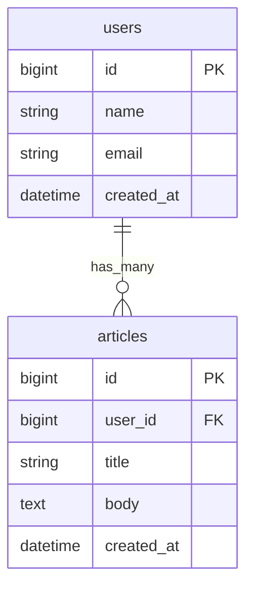
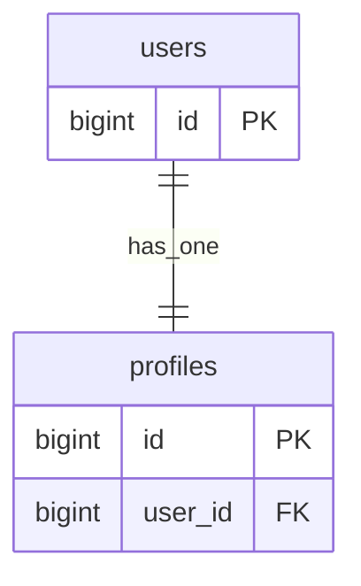
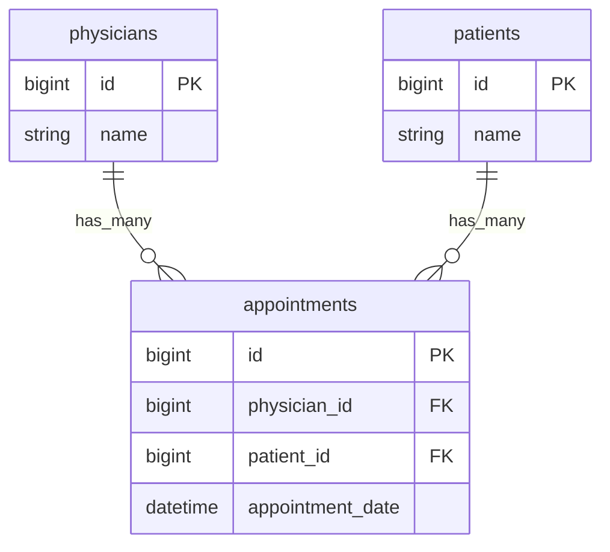
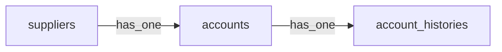
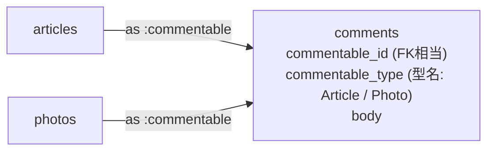
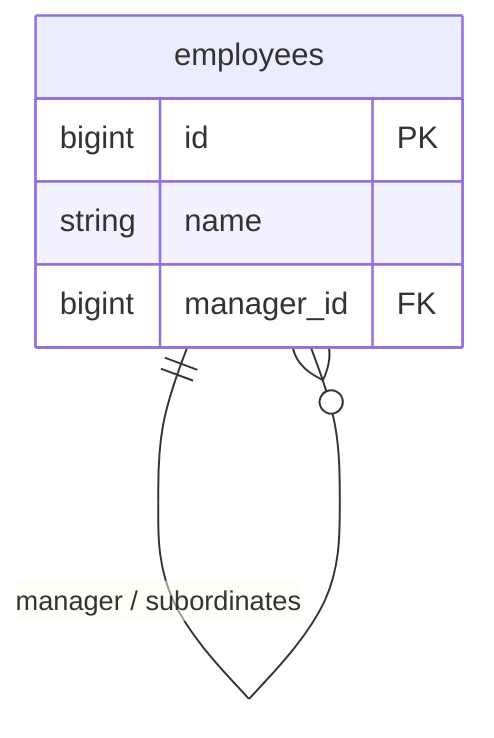

# Rails 第5章: アソシエーション

ActiveRecord のアソシエーション（関連付け）は、テーブル間のリレーションをモデル上のメソッドとして扱えるようにする仕組みです。外部キーによる結び付きを `belongs_to` / `has_many` などの宣言で表現し、`user.articles` のようなオブジェクト参照でデータを取得・操作できます。本章では基本の1対多から多対多・ポリモーフィック・自己結合までを扱い、実務で必ず問題になる N+1 問題とその解決策も整理します。

---

## 目次

1. [アソシエーションとは](#1-アソシエーションとは)
2. [belongs_to と has_many（1対多）](#2-belongs_to-と-has_many1対多)
3. [has_one（1対1）](#3-has_one1対1)
4. [has_many :through（多対多）](#4-has_many-through多対多)
5. [has_one :through](#5-has_one-through)
6. [has_and_belongs_to_many（HABTM）](#6-has_and_belongs_to_manyhabtm)
7. [ポリモーフィック関連](#7-ポリモーフィック関連)
8. [自己結合（self-join）](#8-自己結合self-join)
9. [主要オプション一覧](#9-主要オプション一覧)
10. [関連経由の操作](#10-関連経由の操作)
11. [N+1問題と解決](#11-n1問題と解決)
12. [counter_cache](#12-counter_cache)
13. [ネストした属性（accepts_nested_attributes_for）](#13-ネストした属性accepts_nested_attributes_for)

---

## 1. アソシエーションとは

リレーショナルデータベースでは、テーブル同士を「外部キー（foreign key）」で結び付けます。たとえば「1人のユーザーが複数の記事を持つ」関係は、`articles` テーブルに `user_id` カラムを置くことで表現します。

ActiveRecord のアソシエーションは、この外部キーの関係をモデルのメソッドとして抽象化します。SQL を直接書く代わりに、`user.articles` や `article.user` といった **オブジェクト参照** でデータを取得できます。



- **PK（主キー）**: 各行を一意に識別する `id`
- **FK（外部キー）**: 相手テーブルの PK を指す `user_id`
- 「1（users）対 多（articles）」の関係を、`has_many` と `belongs_to` のペアで宣言します。

外部キーを持つ側（`articles`）が `belongs_to`、参照される側（`users`）が `has_many` になる、と覚えると混乱しません。

---

## 2. belongs_to と has_many（1対多）

最も基本的な関連です。「ユーザーは複数の記事を持ち、記事は1人のユーザーに属する」関係を実装します。

### モデルの定義

```ruby
# app/models/user.rb
class User < ApplicationRecord
  has_many :articles           # 複数形で宣言する
end

# app/models/article.rb
class Article < ApplicationRecord
  belongs_to :user             # 単数形で宣言する（外部キー user_id を持つ側）
end
```

**🎯 Django:** 「多」側の `Article` に `ForeignKey` を1つ書くだけで、`user_id` カラムと逆参照が自動生成されます。Rails のように両モデルへ宣言する必要はありません。

```python
# models.py
class User(models.Model):
    name = models.CharField(max_length=255)

class Article(models.Model):
    user = models.ForeignKey(User, on_delete=models.CASCADE)  # user_id + 逆参照を自動生成
    title = models.CharField(max_length=255)
```

> 逆参照は既定で `user.article_set` として使えます（Rails の `user.articles` 相当）。`on_delete` は必須引数で親削除時の挙動を指定します（`dependent:` に相当。第9節参照）。関連先を任意にしたい場合は `null=True, blank=True`（Rails の `optional: true` 相当）。

### マイグレーション

外部キー用のカラムは `references`（別名 `belongs_to`）で追加します。`references` は `user_id` カラムとインデックスを自動生成します。

```ruby
# db/migrate/xxxxxx_create_articles.rb
class CreateArticles < ActiveRecord::Migration[8.0]
  def change
    create_table :articles do |t|
      t.references :user, null: false, foreign_key: true  # user_id + index + DB制約
      t.string :title, null: false
      t.text :body

      t.timestamps
    end
  end
end
```

生成されるSQL相当（PostgreSQL の例）:

```sql
CREATE TABLE articles (
  id         bigint PRIMARY KEY,
  user_id    bigint NOT NULL,
  title      varchar NOT NULL,
  body       text,
  created_at timestamp NOT NULL,
  updated_at timestamp NOT NULL
);
CREATE INDEX index_articles_on_user_id ON articles (user_id);
ALTER TABLE articles ADD CONSTRAINT fk_... FOREIGN KEY (user_id) REFERENCES users (id);
```

| 記述 | 生成されるもの |
|------|----------------|
| `t.references :user` | `user_id` カラム + インデックス |
| `foreign_key: true` | DBレベルの外部キー制約（`REFERENCES users(id)`） |
| `null: false` | `NOT NULL` 制約（アプリだけでなくDBでも必須化） |

### belongs_to はデフォルトで必須（重要）

Rails 5 以降、`belongs_to` は **デフォルトで関連先の存在が必須（バリデーションあり）** です。設定 `config.active_record.belongs_to_required_by_default = true`（新規アプリの初期値）によるもので、`user` が `nil` のまま保存しようとすると検証エラーになります。

```ruby
article = Article.new(title: "test")
article.valid?           # => false
article.errors[:user]    # => ["must exist"]
```

関連先を任意（nil 許可）にしたい場合は `optional: true` を明示します。

```ruby
class Article < ApplicationRecord
  belongs_to :user, optional: true   # user_id が nil でも保存できる
end
```

> 補足: `null: false` はDBの制約、`optional: false`（デフォルト）はアプリのバリデーション。両方を揃えておくのが堅実です。

---

## 3. has_one（1対1）

「ユーザーは1つのプロフィールを持つ」といった1対1の関係です。外部キーは相手テーブル側（`profiles.user_id`）に置きます。`has_many` を `has_one` に変えるだけで、単数のオブジェクトを返すようになります。

```ruby
# app/models/user.rb
class User < ApplicationRecord
  has_one :profile          # 単数形
end

# app/models/profile.rb
class Profile < ApplicationRecord
  belongs_to :user          # 外部キー user_id を持つ側
end
```

```ruby
# マイグレーション（profiles 側に外部キーを置く）
create_table :profiles do |t|
  t.references :user, null: false, foreign_key: true
  t.string :bio
  t.timestamps
end
# 1対1を保証したいなら一意インデックスを張る
add_index :profiles, :user_id, unique: true
```



`has_many` との違いは「戻り値が単数か複数か」だけです。外部キーの位置（相手側に置く）は `has_many` と同じである点に注意してください。

**🎯 Django:** 1対1は `OneToOneField` を使います。外部キーは Rails と同じく相手側（`Profile`）に置きます。

```python
class Profile(models.Model):
    user = models.OneToOneField(User, on_delete=models.CASCADE)  # user_id に一意制約が付く
    bio = models.CharField(max_length=255, blank=True)
```

> `OneToOneField` は `ForeignKey(unique=True)` に相当し、逆参照は集合ではなく単一オブジェクト（`user.profile`）になります。Rails の `has_one` と同様、片側の宣言だけで両方向にアクセスできます。

---

## 4. has_many :through（多対多）

「医者（Physician）は複数の患者（Patient）を持ち、患者も複数の医者を持つ」ような多対多を、**中間モデル**（予約 Appointment）を介して表現します。中間テーブルに追加情報（予約日時など）を持たせられるのが特徴です。

```ruby
# app/models/physician.rb
class Physician < ApplicationRecord
  has_many :appointments
  has_many :patients, through: :appointments   # appointments を経由して patients へ
end

# app/models/appointment.rb（中間モデル）
class Appointment < ApplicationRecord
  belongs_to :physician
  belongs_to :patient
  # appointment_date など追加カラムを持てる
end

# app/models/patient.rb
class Patient < ApplicationRecord
  has_many :appointments
  has_many :physicians, through: :appointments
end
```



```ruby
# マイグレーション（中間テーブル）
create_table :appointments do |t|
  t.references :physician, null: false, foreign_key: true
  t.references :patient,   null: false, foreign_key: true
  t.datetime :appointment_date
  t.timestamps
end
```

使い方:

```ruby
physician = Physician.first
physician.patients                  # この医者の患者一覧（appointments 経由）
physician.appointments.count        # 予約件数

# through 経由で中間レコードごと作成される
physician.patients << Patient.find(3)   # appointments に行が1件 INSERT される
```

**🎯 Django:** 多対多は `ManyToManyField` で表現します。中間テーブルに追加カラム（予約日時など）を持たせたい場合は `through=` で中間モデルを指定します。

```python
class Physician(models.Model):
    name = models.CharField(max_length=255)
    patients = models.ManyToManyField("Patient", through="Appointment")

class Appointment(models.Model):  # 中間モデル
    physician = models.ForeignKey(Physician, on_delete=models.CASCADE)
    patient = models.ForeignKey("Patient", on_delete=models.CASCADE)
    appointment_date = models.DateTimeField()

class Patient(models.Model):
    name = models.CharField(max_length=255)
```

> `ManyToManyField` は片方のモデルにだけ書けば逆参照（`patient.physician_set`）も使えます。ただし `through=` を指定した多対多には `physician.patients.add(...)` が使えず、中間モデル（`Appointment`）を直接 `create()` します（Rails の `physician.patients << ...` とは異なる点に注意）。

---

## 5. has_one :through

1対1版の through です。「サプライヤー（Supplier）は1つのアカウント（Account）を持ち、アカウントは1つのアカウント履歴（AccountHistory）を持つ」場合に、サプライヤーから履歴へ直接アクセスできます。

```ruby
# app/models/supplier.rb
class Supplier < ApplicationRecord
  has_one :account
  has_one :account_history, through: :account   # account を経由して1件を取得
end

# app/models/account.rb
class Account < ApplicationRecord
  belongs_to :supplier
  has_one :account_history
end

# app/models/account_history.rb
class AccountHistory < ApplicationRecord
  belongs_to :account
end
```



```ruby
supplier = Supplier.first
supplier.account_history        # accounts を経由して1件の AccountHistory を返す
```

---

## 6. has_and_belongs_to_many（HABTM）

中間モデルを **持たない** 多対多です。中間テーブル（結合テーブル）だけを用意し、追加カラムを持たないシンプルな関連に使います。

```ruby
# app/models/assembly.rb
class Assembly < ApplicationRecord
  has_and_belongs_to_many :parts
end

# app/models/part.rb
class Part < ApplicationRecord
  has_and_belongs_to_many :assemblies
end
```

結合テーブルは**両モデル名を複数形・アルファベット順に並べた名前**が規約です（`assemblies` と `parts` → `assemblies_parts`）。モデルを持たないため主キー `id` は作りません（`id: false`）。

```ruby
# マイグレーション（結合テーブルのみ。モデルクラスは不要）
create_table :assemblies_parts, id: false do |t|
  t.references :assembly, null: false, foreign_key: true
  t.references :part,     null: false, foreign_key: true
end
# 専用ヘルパーでも作れる（列順やインデックスを自動調整）
# create_join_table :assemblies, :parts
```

### HABTM と has_many :through の使い分け

| 観点 | `has_and_belongs_to_many` | `has_many :through` |
|------|---------------------------|---------------------|
| 中間モデル | なし（結合テーブルのみ） | あり（`Appointment` など） |
| 中間テーブルの追加カラム | 持てない | 持てる（日時・状態など） |
| 中間レコードへの直接操作 | できない | できる（バリデーション・コールバックも可） |
| 記述量 | 少ない | やや多い |
| 推奨場面 | 純粋な多対多で追加情報が不要 | 追加情報や中間レコードの操作が必要 |

> 実務では「後から中間テーブルにカラムを足したくなる」ことが多く、**基本は `has_many :through` を選ぶ**のが安全です。HABTM は本当に単純な関連だけに留めます。

**🎯 Django:** 中間モデルを持たない単純な多対多は、`through=` なしの `ManyToManyField` を使います。Django が結合テーブルを自動生成します。

```python
class Assembly(models.Model):
    parts = models.ManyToManyField("Part")  # 結合テーブルは自動生成される

class Part(models.Model):
    name = models.CharField(max_length=255)
```

> Rails は「中間モデルなし＝HABTM／中間モデルあり＝has_many :through」と別構文ですが、Django はどちらも `ManyToManyField` で、`through=` の有無で切り替えるだけです。後から中間モデルを足したくなったら `through=` を追加します。

---

## 7. ポリモーフィック関連

「コメント（Comment）が記事（Article）にも写真（Photo）にも付けられる」ように、**1つの関連が複数のモデルに属せる**仕組みです。外部キー `xxx_id` に加えて、相手の型を示す `xxx_type`（クラス名の文字列）を持ちます。

```ruby
# app/models/comment.rb
class Comment < ApplicationRecord
  belongs_to :commentable, polymorphic: true   # commentable_id と commentable_type を使う
end

# app/models/article.rb
class Article < ApplicationRecord
  has_many :comments, as: :commentable         # as: で多態名を指定
end

# app/models/photo.rb
class Photo < ApplicationRecord
  has_many :comments, as: :commentable
end
```



### マイグレーション

`t.references` に `polymorphic: true` を付けると、`_id` と `_type` の2カラム＋複合インデックスが生成されます。

```ruby
create_table :comments do |t|
  t.references :commentable, polymorphic: true, null: false
  # 上記は commentable_id(bigint) と commentable_type(string) を追加し、
  # index_comments_on_commentable(commentable_type, commentable_id) を張る
  t.text :body
  t.timestamps
end
```

使い方:

```ruby
article = Article.first
comment = article.comments.create(body: "参考になりました")
comment.commentable        # => #<Article id: ...>（実体はArticle）
comment.commentable_type   # => "Article"

photo = Photo.first
photo.comments.create(body: "いい写真！")
```

> ポリモーフィック関連ではDBレベルの外部キー制約（`foreign_key: true`）を張れません。参照先テーブルが複数に分かれるためで、整合性はアプリ側（バリデーションや `dependent:`）で担保します。

**🎯 Django:** 標準機能の `django.contrib.contenttypes` を使い、`GenericForeignKey` で表現します。Rails の `commentable_type` に相当する型情報を、`ContentType`（各モデルのメタ情報テーブル）への `ForeignKey` として持ちます。

```python
from django.contrib.contenttypes.fields import GenericForeignKey, GenericRelation
from django.contrib.contenttypes.models import ContentType

class Comment(models.Model):
    content_type = models.ForeignKey(ContentType, on_delete=models.CASCADE)  # commentable_type 相当
    object_id = models.PositiveBigIntegerField()                             # commentable_id 相当
    commentable = GenericForeignKey("content_type", "object_id")

class Article(models.Model):
    comments = GenericRelation(Comment)  # 逆参照（Rails の has_many ..., as: 相当）
```

> Rails は `xxx_type` にクラス名の文字列を格納しますが、Django は `content_type` に `ContentType` テーブルへの外部キーを持たせる点が異なります。Rails 同様、DBレベルの外部キー制約は張れません。

---

## 8. 自己結合（self-join）

同じモデル同士を関連付けます。「従業員（Employee）が別の従業員（上司）に属し、部下を複数持つ」といった階層構造で使います。`class_name` と `foreign_key` で参照先とキーを明示します。

```ruby
# app/models/employee.rb
class Employee < ApplicationRecord
  # 部下たち: employees.manager_id が自分の id を指す
  has_many :subordinates, class_name: "Employee", foreign_key: "manager_id"

  # 上司: 自分の manager_id が指す Employee（任意なので optional: true）
  belongs_to :manager, class_name: "Employee", optional: true
end
```

```ruby
# マイグレーション（同一テーブルに自己参照の外部キー）
add_reference :employees, :manager, foreign_key: { to_table: :employees }
# manager_id カラム + index + employees への外部キー制約
```



```ruby
boss = Employee.create(name: "部長")
staff = Employee.create(name: "担当", manager: boss)

boss.subordinates      # => [担当]
staff.manager          # => 部長
```

**🎯 Django:** 自己参照は `ForeignKey("self")` で表現します。

```python
class Employee(models.Model):
    name = models.CharField(max_length=255)
    manager = models.ForeignKey(
        "self", on_delete=models.SET_NULL,
        null=True, blank=True, related_name="subordinates",
    )
```

> `related_name="subordinates"` が Rails の `has_many :subordinates` に相当し、`boss.subordinates.all()` で部下を取得できます。`null=True, blank=True` は上司なし（Rails の `optional: true` 相当）を許可します。

---

## 9. 主要オプション一覧

アソシエーション宣言に渡す代表的なオプションです。

| オプション | 指定先 | 説明 |
|-----------|--------|------|
| `dependent:` | `has_many` / `has_one` | 親削除時に子をどう扱うか（下表参照） |
| `foreign_key:` | 両方 | 外部キーカラム名を明示（規約外の名前のとき） |
| `class_name:` | 両方 | 関連名から推測できないクラス名を指定 |
| `inverse_of:` | 両方 | 双方向関連を同一オブジェクトとして扱わせる |
| `optional:` | `belongs_to` | `true` で関連先を任意に（デフォルトは必須） |
| `counter_cache:` | `belongs_to` | 件数キャッシュを有効化（第12節参照） |
| `source:` | `has_many :through` | through 先の関連名が推測できないとき指定 |
| `primary_key:` | 両方 | 参照する主キーを `id` 以外にする |

### dependent: の挙動

| 値 | 挙動 |
|----|------|
| `:destroy` | 子を1件ずつ削除し、子の `destroy` コールバックも実行する |
| `:delete_all` | 子をSQL一括削除（コールバックは走らない・高速） |
| `:nullify` | 子の外部キーを `NULL` にして関連だけ切る（子レコードは残す） |
| `:restrict_with_exception` | 子が存在すると例外を投げて親の削除を止める |
| `:restrict_with_error` | 子が存在するとエラーを追加して削除を止める |

```ruby
class User < ApplicationRecord
  has_many :articles, dependent: :destroy   # ユーザー削除時に記事も削除
end
```

**🎯 Django:** `dependent:` に相当するのは `ForeignKey` の `on_delete` 引数で、親を削除したときの子の扱いを指定します。

```python
class Article(models.Model):
    # dependent: :destroy   → on_delete=models.CASCADE（親と一緒に子も削除）
    # dependent: :nullify   → on_delete=models.SET_NULL（外部キーを NULL に、要 null=True）
    # dependent: :restrict… → on_delete=models.PROTECT（子があれば削除を阻止し例外）
    user = models.ForeignKey(User, on_delete=models.CASCADE)
```

| Rails | Django |
|-------|--------|
| `dependent: :destroy` | `on_delete=models.CASCADE` |
| `dependent: :nullify` | `on_delete=models.SET_NULL`（`null=True` が必要） |
| `dependent: :restrict_with_exception` | `on_delete=models.PROTECT` |
| `class_name:` | 関連先モデルを直接指定（文字列参照も可） |
| `foreign_key:` | `db_column=`（DBカラム名の変更） |
| `has_many` の関連名（逆参照）変更 | `related_name=` |
| `optional: true` | `null=True, blank=True` |

> Rails は削除時の挙動を `has_many` 側（`dependent:`）に書きますが、Django は「多」側の `ForeignKey`（`on_delete`）に書く点が対照的です。`on_delete` は省略できない必須引数です。

### source: と class_name: の例

```ruby
class User < ApplicationRecord
  has_many :subscriptions
  # through先の関連名が :magazine だが、実際に欲しいのは publications の場合
  has_many :publications, through: :subscriptions, source: :magazine
end
```

### inverse_of の効果

双方向で読み込んだ同じレコードを、Rails は通常自動でメモリ上同一視します。ただし `foreign_key` や `class_name` を独自指定すると自動検出できないことがあり、そのとき `inverse_of` を明示します。

```ruby
class Author < ApplicationRecord
  has_many :books, inverse_of: :writer
end

class Book < ApplicationRecord
  belongs_to :writer, class_name: "Author", inverse_of: :books
end

# inverse_of があると、同じオブジェクトを指すため無駄なクエリや不整合を防げる
author = Author.first
author.books.first.writer.equal?(author)   # => true（同一インスタンス）
```

---

## 10. 関連経由の操作

`has_many` は「コレクションプロキシ」を返し、配列のように扱いつつ外部キーを自動でセットします。

```ruby
user = User.first

# 作成系（外部キー user_id を自動セット）
user.articles.create(title: "新規記事")   # build + save 相当（DBに保存）
user.articles.create!(title: "必須")      # 失敗時に例外を投げる版

article = user.articles.build(title: "下書き")  # メモリ上に生成（未保存）
article.save                                     # ここで保存

user.articles << Article.new(title: "追加")      # 既存/新規を関連に追加して保存

# 参照・集計系
user.articles              # 記事のリレーション（遅延評価）
user.articles.where(published: true)   # 関連にさらに条件を重ねられる
```

**🎯 Django:** 逆参照マネージャ経由で同様の操作ができます。既定の名前は `モデル名小文字_set`（`article_set`）で、`related_name` を指定していればその名前になります。

```python
user = User.objects.first()

# 作成系（外部キー user_id を自動セット）
user.article_set.create(title="新規記事")     # related_name 未指定のとき
# related_name="articles" を指定していれば user.articles.create(title=...)

# 参照・絞り込み系
user.article_set.all()                         # 記事一覧（クエリセット、遅延評価）
user.article_set.filter(published=True)        # さらに条件を重ねられる
```

> Rails の `user.articles`（複数形の関連名）に対し、Django の既定は `user.article_set` です。`ForeignKey(..., related_name="articles")` を付けると `user.articles` と書けるようになります。件数は `user.article_set.count()` で取得します。

### count / size / exists? の違い

| メソッド | 挙動 | 使いどころ |
|----------|------|-----------|
| `count` | 常に `SELECT COUNT(*)` を発行 | 最新の件数をDBに問い合わせたいとき |
| `size` | ロード済みなら配列長、未ロードなら COUNT（counter_cache があればそれを使う） | 迷ったらこれ。効率的 |
| `length` | 必ずレコードを全ロードして配列長を返す | 全件を使う予定があるとき |
| `exists?` | `SELECT 1 ... LIMIT 1` で存在確認 | 「1件でもあるか」だけ知りたいとき |
| `empty?` | 存在しないかの確認（`exists?` の否定に近い） | 空判定 |

```ruby
user.articles.count      # => SELECT COUNT(*) FROM articles WHERE user_id = ?
user.articles.size       # ロード状況/counter_cache に応じて最適な方法を選ぶ
user.articles.exists?    # 記事が1件でもあるか（軽量）
```

> `count` は毎回SQLを打つため、ループ内で多用すると無駄が出ます。すでにロード済みなら `size` が有利です。

---

## 11. N+1問題と解決

### 問題の説明

関連を後から個別にたどると、親1件のクエリ（1回）に加えて子を取るクエリが件数分（N回）走ります。合計「1 + N」回になるのが **N+1問題** です。

```ruby
# 悪い例: 記事10件それぞれで user を都度取得
Article.limit(10).each do |article|
  puts article.user.name   # articleごとに users への SELECT が走る
end
```

ログには次のように大量のクエリが並びます。

```text
Article Load  SELECT * FROM articles LIMIT 10
User Load      SELECT * FROM users WHERE id = 1   -- 1件目
User Load      SELECT * FROM users WHERE id = 2   -- 2件目
User Load      SELECT * FROM users WHERE id = 3   -- 3件目
...                                                -- 合計 1 + 10 回
```

### 解決: includes で事前読み込み

`includes` を使うと、関連をまとめて先読みし、クエリ回数を大幅に減らせます。

```ruby
# 良い例: users をまとめて先読み（クエリは2本だけ）
Article.includes(:user).limit(10).each do |article|
  puts article.user.name   # 追加のSELECTは走らない
end
```

```text
Article Load  SELECT * FROM articles LIMIT 10
User Load      SELECT * FROM users WHERE id IN (1,2,3,...,10)   -- IN句で1回にまとめる
```

### includes / preload / eager_load / joins の違い

| メソッド | 発行クエリ | JOIN種別 | 関連テーブルでのWHERE/ORDER | 関連をメモリに読み込む | 主な用途 |
|----------|-----------|----------|------------------------------|------------------------|----------|
| `preload` | 複数（関連ごとに別クエリ） | なし（IN句で取得） | 不可（参照するとエラー） | する | 単純な事前読み込み |
| `eager_load` | 1本にまとめる | LEFT OUTER JOIN | 可能 | する | 関連条件で絞りつつ先読み |
| `includes` | 状況で preload / eager_load を自動選択 | 状況次第 | `references` 併用で可能 | する | 迷ったらこれ |
| `joins` | 1本 | INNER JOIN | 可能（絞り込み専用） | **しない** | 関連の有無で絞り込む |

```ruby
# preload: 常に別クエリ（2本）。関連テーブルの条件は書けない
Article.preload(:user)

# eager_load: 常に LEFT OUTER JOIN（1本）。関連テーブルで絞れる
Article.eager_load(:user).where(users: { active: true })

# includes: 通常はpreload。関連テーブルを参照すると自動でeager_loadに切り替わる
Article.includes(:user).where(users: { active: true }).references(:users)

# joins: INNER JOINで絞り込むが、userはメモリに載らない
#        → 下記のように後で article.user を触ると再びN+1になるので注意
Article.joins(:user).where(users: { active: true })
```

ポイント整理:

- **一覧表示で関連も表示する** → `includes`（または `preload`）で先読みする。
- **関連テーブルの条件で親を絞る** → `eager_load`、あるいは `includes` + `references`。
- **絞り込みたいだけで関連データは使わない** → `joins`（読み込まないので軽い）。
- `joins` は関連を **メモリに載せない** ため、その後 `article.user` を呼ぶと再びN+1になる点に注意。

**🎯 Django:** Django にも同じ N+1 問題があり、`select_related`（1対1・多対1＝JOIN）と `prefetch_related`（多対多・1対多＝別クエリ）で解決します。

```python
# select_related: JOIN で1本にまとめる（多対1／1対1向け）
for article in Article.objects.select_related("user")[:10]:
    print(article.user.name)   # 追加クエリは発生しない

# prefetch_related: 別クエリ＋IN句でまとめ取り（1対多／多対多向け）
for user in User.objects.prefetch_related("article_set"):
    print(len(user.article_set.all()))
```

| Rails | Django | 仕組み |
|-------|--------|--------|
| `eager_load`（LEFT OUTER JOIN） | `select_related` | JOINで1本。多対1・1対1向け |
| `preload`（別クエリ＋IN句） | `prefetch_related` | 別クエリでまとめ取り。1対多・多対多向け |
| `includes`（自動選択） | 相当なし（用途で使い分ける） | Django は明示的に選ぶ |
| `joins`（INNER JOIN・絞り込み） | `filter(関連__field=...)` | JOINするが関連はメモリに載せない |

> Rails の `includes` は状況に応じ preload/eager_load を自動選択しますが、Django は「JOINしたいか別クエリにしたいか」を `select_related`／`prefetch_related` で自分で選ぶ設計です。

---

## 12. counter_cache

子レコードの件数を毎回 `COUNT(*)` で数えると、一覧表示のたびにクエリが増えます。`counter_cache` は親テーブルに件数カラムを持たせ、子の追加・削除時に自動更新することでこれを避けます。

### 設定手順

1. 親テーブルに `子の複数形_count` カラム（整数・デフォルト0）を追加する。

```ruby
# db/migrate/xxxxxx_add_articles_count_to_users.rb
class AddArticlesCountToUsers < ActiveRecord::Migration[8.0]
  def change
    add_column :users, :articles_count, :integer, null: false, default: 0
  end
end
```

1. `belongs_to` 側に `counter_cache: true` を指定する。

```ruby
# app/models/article.rb
class Article < ApplicationRecord
  belongs_to :user, counter_cache: true   # 保存/削除時に users.articles_count を増減
end

# app/models/user.rb（has_many 側は従来どおり）
class User < ApplicationRecord
  has_many :articles
end
```

これで `Article` の作成・削除に合わせて `users.articles_count` が自動更新されます。`user.articles.size` はこのキャッシュ列を参照し、追加のクエリなしで件数を返します。

```ruby
user.articles.create(title: "a")
user.reload.articles_count    # => 1（自動でインクリメントされている）
user.articles.size            # articles_count を利用し COUNT を発行しない
```

### 補足

- カラム名を変えたい場合は `counter_cache: :custom_articles_count` のようにシンボルで指定します。
- 既存データやキャッシュがずれた場合は `User.reset_counters(user.id, :articles)` で数え直せます。
- `counter_cache` を付けた `belongs_to` は、その関連経由の件数が `size` で高速化される一方、`count` は常にSQLを打つ点は変わりません。

**🎯 Django:** Django には `counter_cache` に相当する自動キャッシュ機構は標準にありません。件数は都度 `annotate` で集計するか、非正規化カラムを自分で更新します。

```python
from django.db.models import Count

# 各ユーザーに記事数を注釈（1クエリでまとめて集計）
users = User.objects.annotate(articles_count=Count("article"))
for u in users:
    print(u.articles_count)   # 追加クエリなしで件数を参照
```

> Rails の `counter_cache` は親テーブルに件数カラムを持たせて自動更新しますが、Django で同等の即時性が欲しい場合は非正規化カラムを用意し `signals` などで更新します。多くの場合は `annotate(Count(...))` で十分です。

---

## 13. ネストした属性（accepts_nested_attributes_for）

親レコードのフォームから、子レコードも同時に作成・更新・削除したいときに使います。親モデルで `accepts_nested_attributes_for` を宣言すると、`子_attributes=` というセッターが生えます。

```ruby
# app/models/user.rb
class User < ApplicationRecord
  has_many :articles
  accepts_nested_attributes_for :articles,
                                allow_destroy: true,                       # _destroy で削除を許可
                                reject_if: ->(attrs) { attrs[:title].blank? }  # titleが空の行は無視
end
```

これにより、まとめて保存できます。

```ruby
user = User.create(
  name: "太郎",
  articles_attributes: [
    { title: "記事1" },
    { title: "記事2" }
  ]
)
user.articles.count   # => 2（親と子を1回のsaveで作成）

# 更新・削除も同じ仕組み（id指定で更新、_destroy: true で削除）
user.update(
  articles_attributes: [
    { id: 1, title: "記事1（改題）" },   # 既存を更新
    { id: 2, _destroy: true }            # allow_destroy: true なので削除される
  ]
)
```

### フォームとの連携（概要）

ビューでは `fields_for` を使って子のフィールドを描画し、コントローラのストロングパラメータで `子_attributes` を許可します。詳細は次章「ビューとフォーム」で扱いますが、要点だけ示します。

```erb
<%# app/views/users/_form.html.erb %>
<%= form_with model: @user do |f| %>
  <%= f.text_field :name %>

  <%= f.fields_for :articles do |article_form| %>
    <%= article_form.text_field :title %>
    <%# allow_destroy: true のとき削除チェックボックスを置ける %>
    <%= article_form.check_box :_destroy %>
  <% end %>

  <%= f.submit %>
<% end %>
```

```ruby
# app/controllers/users_controller.rb
def user_params
  params.require(:user).permit(
    :name,
    articles_attributes: [:id, :title, :_destroy]   # ネスト属性を許可（id と _destroy を忘れない）
  )
end
```

> `articles_attributes` の permit で `:id` を含めないと既存レコードの更新が新規作成扱いになり、`:_destroy` を含めないと削除が効きません。両方を許可リストに入れるのが定石です。

---

[← 第4章: モデルとActiveRecord](04_モデルとActiveRecord.md) | [Rails目次](README.md) | [第6章: ビューとフォーム →](06_ビューとフォーム.md)
