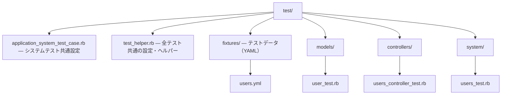
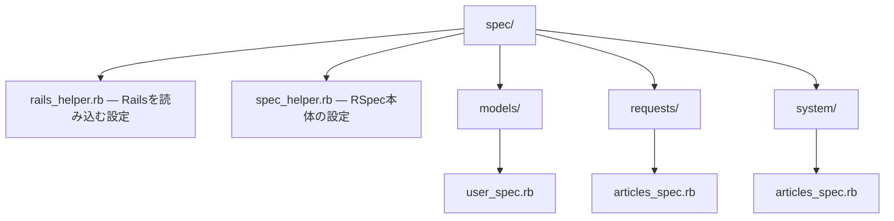

# Rails 第8章: テスト

Railsはテストを最初から重視するフレームワークで、標準でMinitestベースのテスト環境が組み込まれています。この章ではRails標準のテスト（モデル・統合・システムテスト）から、RSpecやFactoryBotなどのデファクトなgemによる構成までを実務目線で解説します。Rails 7.2 / 8系を前提とします。

---

## 目次

1. [テスト構成](#テスト構成)
2. [Minitestによるモデルテスト](#minitestによるモデルテスト)
3. [フィクスチャ](#フィクスチャ)
4. [コントローラとリクエスト統合テスト](#コントローラとリクエスト統合テスト)
5. [システムテスト](#システムテスト)
6. [テストの実行](#テストの実行)
7. [RSpecの導入](#rspecの導入)
8. [FactoryBotとFaker](#factorybotとfaker)
9. [外部HTTPのモック](#外部httpのモック)
10. [カバレッジ計測](#カバレッジ計測)
11. [関連資料](#関連資料)

---

## テスト構成

Railsの新規アプリケーションを作成すると、`test/` ディレクトリ以下にテストの雛形が生成されます。テストの種類ごとにディレクトリが分かれており、それぞれ対応する基底クラスを継承します。

| 種類 | ディレクトリ | 基底クラス | 対象 |
|------|-------------|-----------|------|
| モデルテスト | `test/models/` | `ActiveSupport::TestCase` | モデルのバリデーション・メソッド |
| コントローラ/リクエスト | `test/controllers/` | `ActionDispatch::IntegrationTest` | HTTPリクエストとレスポンス |
| 統合テスト | `test/integration/` | `ActionDispatch::IntegrationTest` | 複数コントローラをまたぐフロー |
| システムテスト | `test/system/` | `ApplicationSystemTestCase` | ブラウザ操作を伴うE2E |
| メーラーテスト | `test/mailers/` | `ActionMailer::TestCase` | メール送信 |
| ジョブテスト | `test/jobs/` | `ActiveJob::TestCase` | 非同期ジョブ |
| ヘルパーテスト | `test/helpers/` | `ActionView::TestCase` | ビューヘルパー |

主要なファイルは次の通りです。



`test/test_helper.rb` は全テストから読み込まれる共通設定ファイルです。並列実行やフィクスチャの読み込みがここで設定されます。

```ruby
# test/test_helper.rb
ENV["RAILS_ENV"] ||= "test"
require_relative "../config/environment"
require "rails/test_help"

module ActiveSupport
  class TestCase
    # プロセッサ数に応じてテストを並列実行する
    parallelize(workers: :number_of_processors)

    # test/fixtures 以下のすべてのフィクスチャを読み込む
    fixtures :all
  end
end
```

**🎯 Django:**

Djangoも `python manage.py test` の実行時にテスト用DB（`test_<dbname>`）を自動作成し、終了時に破棄します（テストDBの自動作成はRailsと共通）。テストは各アプリ内の `tests.py` または `tests/` パッケージに置き、Railsのような種類別の基底クラス階層（`ActiveSupport::TestCase` 等）はなく、多くを `django.test.TestCase` で書きます。

---

## Minitestによるモデルテスト

Rails標準のテストはMinitestで書きます。`test "説明" do ... end` というブロック形式が推奨されるスタイルです（内部で `def test_...` メソッドを定義しています）。

```ruby
# test/models/user_test.rb
require "test_helper"

class UserTest < ActiveSupport::TestCase
  # setup は各テストの実行前に毎回呼ばれる
  setup do
    @user = User.new(name: "山田太郎", email: "taro@example.com")
  end

  test "名前とメールがあれば有効" do
    assert @user.valid?
  end

  test "名前が空だと無効" do
    @user.name = ""
    assert_not @user.valid?
    # エラーメッセージの内容も検証する
    assert_includes @user.errors[:name], "を入力してください"
  end

  test "メールは一意でなければならない" do
    @user.save!
    duplicate = @user.dup # 同じ属性を持つ別インスタンス
    assert_not duplicate.valid?
  end

  test "save でレコードが1件増える" do
    # ブロック内の実行前後で User.count が 1 増えることを検証
    assert_difference "User.count", 1 do
      @user.save!
    end
  end
end
```

### 主なアサーションメソッド

Minitest本体とRailsが追加するアサーションのうち、実務で頻出するものを挙げます。`assert_not_*` はRailsが追加したエイリアスで、Minitest純正の `refute_*` と同義です。

| メソッド | 成功条件 |
|---------|---------|
| `assert(test)` | `test` が真 |
| `assert_not(test)` | `test` が偽（≒ `refute`） |
| `assert_equal(exp, act)` | `exp == act` |
| `assert_not_equal(exp, act)` | `exp != act` |
| `assert_nil(obj)` | `obj` が `nil` |
| `assert_not_nil(obj)` | `obj` が `nil` でない |
| `assert_empty(obj)` | `obj.empty?` が真 |
| `assert_includes(coll, obj)` | `coll` が `obj` を含む |
| `assert_match(regexp, str)` | `str` が `regexp` にマッチ |
| `assert_no_match(regexp, str)` | マッチしない |
| `assert_instance_of(klass, obj)` | `obj` が `klass` のインスタンス |
| `assert_kind_of(klass, obj)` | `obj` が `klass` またはサブクラス |
| `assert_respond_to(obj, :meth)` | `obj` が `:meth` に応答する |
| `assert_predicate(obj, :empty?)` | `obj.empty?` が真 |
| `assert_in_delta(exp, act, delta)` | 浮動小数の近似比較 |
| `assert_raises(ErrClass) { ... }` | ブロックが例外を送出 |
| `assert_difference("expr", n) { }` | ブロック前後で数値が `n` 変化 |
| `assert_no_difference("expr") { }` | ブロック前後で変化なし |
| `assert_changes("expr") { }` | ブロック前後で値が変化 |

> 補足: Minitestではアサーション以外にも `assert_nothing_raised { ... }` などが使えます。落とし穴として、`assert_equal(actual, expected)` と引数を逆にすると失敗メッセージが読みづらくなるため、必ず `assert_equal(期待値, 実際値)` の順で書きます。

**🎯 Django:**

`django.test.TestCase` は `unittest` ベースで、`setUp`/`tearDown` と `assertEqual`/`assertTrue`/`assertRaises` などのアサーションを使います。Railsの `test "..." do` に対し、Djangoは `test_` で始まるメソッドで各テストを定義します。モデルのバリデーションは `full_clean()` を呼んで検証します。

```python
from django.core.exceptions import ValidationError
from django.test import TestCase

class UserTest(TestCase):
    def setUp(self):  # 各テストの前に毎回呼ばれる
        self.user = User(name="山田太郎", email="taro@example.com")

    def test_valid_with_name_and_email(self):
        self.user.full_clean()  # 例外が出なければ有効

    def test_invalid_without_name(self):
        self.user.name = ""
        with self.assertRaises(ValidationError):
            self.user.full_clean()
```

---

## フィクスチャ

フィクスチャはテスト用のサンプルデータをYAMLで定義する仕組みです。`test/fixtures/*.yml` に置き、ファイル名がテーブル名（＝モデルの複数形）に対応します。テスト実行前にテスト用DBへ自動でロードされます。

```yaml
# test/fixtures/users.yml
# 各ブロックの先頭（taro, hanako）が「フィクスチャ名」
taro:
  name: 山田太郎
  email: taro@example.com
  admin: false

hanako:
  name: 佐藤花子
  email: hanako@example.com
  admin: true
```

テストコードからは `モデル名の複数形(:フィクスチャ名)` で参照できます。

```ruby
# test/models/user_test.rb
class UserTest < ActiveSupport::TestCase
  test "フィクスチャを参照できる" do
    user = users(:taro) # taro ブロックのレコード
    assert_equal "山田太郎", user.name
    assert_not user.admin?
  end
end
```

関連（アソシエーション）はフィクスチャ名で参照でき、外部キーのidを直接書く必要はありません。ERB埋め込みも使えます。

```yaml
# test/fixtures/articles.yml
first_post:
  title: 最初の記事
  user: taro          # users(:taro) を関連付け（user_id を自動解決）
  published_at: <%= 1.day.ago %>  # ERB でRubyを埋め込める
```

| 特徴 | 説明 |
|------|------|
| 高速 | バリデーションを通さず直接INSERTするため速い |
| 一貫性 | 全テストで同じデータを共有できる |
| 難点 | データ量が増えると管理が煩雑になりやすい |

> フィクスチャはバリデーションやコールバックを経由しない点に注意します。生成過程のロジックまで検証したい場合や、テストごとに柔軟なデータが欲しい場合は、後述のFactoryBotが適しています。

**🎯 Django:**

Djangoのフィクスチャは JSON（既定）/YAML/XML で書き、`python manage.py loaddata` や `TestCase` の `fixtures` 属性でロードします。関連はフィクスチャ名ではなく主キー（`pk`）で参照する点がRailsと異なります。より柔軟なデータ生成には後述の `factory_boy` が広く使われます。

```python
class UserTest(TestCase):
    fixtures = ["users.json"]  # テスト実行時に自動ロード
```

---

## コントローラとリクエスト統合テスト

コントローラのテストは `ActionDispatch::IntegrationTest` を継承し、実際のHTTPリクエストを送ってレスポンスを検証します（Rails 5以降は結合テストスタイルが標準）。`get` `post` `patch` `put` `delete` といったHTTPメソッドが使えます。

```ruby
# test/controllers/articles_controller_test.rb
require "test_helper"

class ArticlesControllerTest < ActionDispatch::IntegrationTest
  setup do
    @article = articles(:first_post)
  end

  test "一覧ページが表示される" do
    get articles_url # 名前付きルートヘルパーでURLを指定
    assert_response :success              # 2xx を検証
    assert_select "h1", "記事一覧"        # h1タグの中身を検証
  end

  test "詳細ページが表示される" do
    get article_url(@article)
    assert_response :success
    assert_select "title", /#{@article.title}/
  end

  test "作成に成功するとリダイレクトする" do
    assert_difference "Article.count", 1 do
      post articles_url, params: { article: { title: "新規", body: "本文" } }
    end
    assert_redirected_to article_url(Article.last) # リダイレクト先を検証
    follow_redirect! # リダイレクトを実際にたどる
    assert_select "div.notice", "記事を作成しました"
  end

  test "バリデーション失敗時は422を返す" do
    assert_no_difference "Article.count" do
      post articles_url, params: { article: { title: "" } }
    end
    assert_response :unprocessable_entity
  end
end
```

### レスポンス・DOMを検証するアサーション

| メソッド | 用途 |
|---------|------|
| `assert_response(:success)` | ステータス種別（`:success` `:redirect` `:missing` `:error`）または数値で検証 |
| `assert_redirected_to(url)` | `Location` ヘッダのリダイレクト先を検証 |
| `assert_select("css", text)` | CSSセレクタで要素を選び、内容/件数を検証 |
| `follow_redirect!` | リダイレクトレスポンスを実際にたどる |

`assert_response` に渡せる主なシンボルとステータスの対応です。

| シンボル | HTTPステータス |
|---------|---------------|
| `:success` | 200-299 |
| `:redirect` | 300-399 |
| `:missing` | 404 |
| `:error` | 500-599 |
| `:unprocessable_entity` | 422 |

セッションを使う操作（ログインが必要なページなど）は、リクエストを送る前にログイン処理を行います。

```ruby
test "ログイン後にダッシュボードへアクセスできる" do
  post login_url, params: { email: users(:taro).email, password: "password" }
  get dashboard_url
  assert_response :success
end
```

**🎯 Django:**

Djangoはテストクライアント `self.client` でリクエストを送ります。戻り値 `response` に対し、`assertContains`（本文にテキストを含む）、`assertRedirects`（リダイレクト先）、`assertTemplateUsed`（使用テンプレート）などで検証します。URLは `reverse()` で名前から解決します。

```python
from django.urls import reverse

class ArticleViewTest(TestCase):
    def test_index(self):
        response = self.client.get(reverse("articles:index"))
        self.assertEqual(response.status_code, 200)
        self.assertContains(response, "記事一覧")

    def test_create_redirects(self):
        response = self.client.post(
            reverse("articles:create"),
            {"title": "新規", "body": "本文"},
        )
        self.assertRedirects(response, reverse("articles:index"))
```

---

## システムテスト

システムテストは実際のブラウザ（またはヘッドレスブラウザ）を操作してアプリ全体を検証するE2Eテストです。内部でCapybaraを利用し、`ApplicationSystemTestCase` を継承します。JavaScriptを含むフロントの挙動まで検証できるのが特徴です。

```ruby
# test/application_system_test_case.rb
require "test_helper"

class ApplicationSystemTestCase < ActionDispatch::SystemTestCase
  # ヘッドレスChromeを使用（画面を開かず高速に実行）
  driven_by :selenium, using: :headless_chrome, screen_size: [1400, 1400]
end
```

```ruby
# test/system/articles_test.rb
require "application_system_test_case"

class ArticlesTest < ApplicationSystemTestCase
  test "記事を新規作成できる" do
    visit articles_url          # 指定URLへアクセス
    click_on "新規作成"          # リンク/ボタンをテキストでクリック

    fill_in "タイトル", with: "システムテスト入門"  # ラベル名で入力
    fill_in "本文", with: "Capybaraでブラウザ操作をテストする"
    select "公開", from: "状態"   # セレクトボックスを選択
    check "利用規約に同意する"     # チェックボックス

    click_on "登録する"

    # 画面に指定テキストが表示されるまで自動で待機して検証
    assert_text "記事を作成しました"
    assert_selector "h1", text: "システムテスト入門"
  end
end
```

### 主なCapybara操作・検証メソッド

| 分類 | メソッド | 説明 |
|------|---------|------|
| 移動 | `visit(url)` | ページを開く |
| 操作 | `click_on(text)` | リンク/ボタンをクリック（`click_link` / `click_button` 別々にも指定可） |
| 入力 | `fill_in(label, with:)` | テキスト入力 |
| 選択 | `select(opt, from:)` | セレクトボックス |
| 選択 | `check` / `uncheck` | チェックボックス |
| 選択 | `choose` | ラジオボタン |
| 検証 | `assert_text(str)` | テキストの表示を検証（自動待機あり） |
| 検証 | `assert_no_text(str)` | テキストが無いことを検証 |
| 検証 | `assert_selector("css")` | 要素の存在を検証 |
| 制御 | `accept_confirm { ... }` | JSのconfirmダイアログを承認 |

> Capybaraの検証系メソッドはAjax等の非同期更新を見越して既定で数秒間リトライしながら待機します。そのため `sleep` を挟む必要は基本的にありません。ヘッドレスブラウザにはChrome（`headless_chrome`）のほか、`cuprite` や `playwright` を使う構成も一般的です。

**🎯 Django:**

Djangoでブラウザを操作するE2Eテストは `StaticLiveServerTestCase`（または `LiveServerTestCase`）+ Selenium が標準的で、近年は `playwright` を使う構成も増えています。テスト用サーバーを起動し `self.live_server_url` へアクセスします。Capybaraのような自動待機は無いため、Seleniumでは `WebDriverWait` などで明示的に待機します。

```python
from django.contrib.staticfiles.testing import StaticLiveServerTestCase
from selenium.webdriver import Chrome

class ArticleSystemTest(StaticLiveServerTestCase):
    def test_create_article(self):
        driver = Chrome()
        driver.get(f"{self.live_server_url}/articles/new")
        driver.find_element("name", "title").send_keys("システムテスト入門")
        driver.find_element("css selector", "input[type=submit]").click()
```

---

## テストの実行

Railsのテストは `bin/rails test` で実行します。よく使うコマンドをまとめます。

```bash
# 全テストを実行（システムテストは除く）
bin/rails test

# システムテストも含めてすべて実行
bin/rails test:all

# システムテストのみ実行
bin/rails test:system

# ディレクトリ単位（例: モデルテストのみ）
bin/rails test test/models

# 特定のファイルだけ実行
bin/rails test test/models/user_test.rb

# 特定の行（そのテストブロックだけ）を実行
bin/rails test test/models/user_test.rb:15

# テスト名（正規表現）で絞り込む
bin/rails test -n "/メール/"

# 失敗した時点で即座に停止する
bin/rails test --fail-fast
```

| コマンド | 内容 |
|---------|------|
| `bin/rails test` | システムテスト以外の全テスト |
| `bin/rails test:all` | システムテスト含む全テスト |
| `bin/rails test:system` | システムテストのみ |
| `bin/rails test path:line` | 特定の行のテストのみ |
| `bin/rails test -n "/正規表現/"` | 名前でフィルタ |

### 並列テスト

Railsはデフォルトでテストの並列実行に対応しています。`test_helper.rb` の `parallelize` で有効化され、ワーカーごとに独立したテスト用DB（`app_test-0`, `app_test-1` …）が自動生成されます。

```ruby
# ワーカー数をプロセッサ数に合わせる（既定）
parallelize(workers: :number_of_processors)

# スレッドベースにする場合（デフォルトはプロセスベースの :processes）
parallelize(workers: 2, with: :threads)
```

```ruby
# 並列プロセスのセットアップ/後始末フック
parallelize_setup do |worker|
  # 各ワーカー開始時の処理（例: 外部リソースの準備）
end

parallelize_teardown do |worker|
  # 各ワーカー終了時の処理
end
```

**🎯 Django:**

```bash
# 全テストを実行（bin/rails test 相当。unittest ランナー）
python manage.py test

# アプリ/モジュール/クラス/メソッド単位で絞り込む
python manage.py test app.tests.UserTest.test_valid

# 並列実行
python manage.py test --parallel
```

> pytest-django を導入している場合は `pytest` コマンドで実行し、`pytest path::TestClass::test_name` で絞り込めます。

---

## RSpecの導入

Rails標準はMinitestですが、実務ではRSpecを採用するプロジェクトも多くあります。`rspec-rails` gemを使うとRailsと統合されます。

```ruby
# Gemfile
group :development, :test do
  gem "rspec-rails", "~> 7.0"
end
```

```bash
# インストール後、初期ファイルを生成する
bundle install
bin/rails generate rspec:install
# => .rspec, spec/spec_helper.rb, spec/rails_helper.rb が作成される
```

RSpecでは `test/` の代わりに `spec/` ディレクトリを使い、`*_spec.rb` というファイル名にします。



RSpecは `describe` / `context` / `it` で構造化し、`expect(...).to matcher` で検証します。

```ruby
# spec/models/user_spec.rb
require "rails_helper"

RSpec.describe User, type: :model do
  describe "バリデーション" do
    it "名前とメールがあれば有効" do
      user = User.new(name: "山田太郎", email: "taro@example.com")
      expect(user).to be_valid
    end

    context "名前が空の場合" do
      it "無効になる" do
        user = User.new(name: "", email: "taro@example.com")
        expect(user).not_to be_valid
        expect(user.errors[:name]).to be_present
      end
    end
  end
end
```

リクエストスペック（コントローラの検証。Rails公式もコントローラスペックよりリクエストスペックを推奨）:

```ruby
# spec/requests/articles_spec.rb
require "rails_helper"

RSpec.describe "Articles", type: :request do
  describe "GET /articles" do
    it "200を返す" do
      get articles_path
      expect(response).to have_http_status(:success)
      expect(response.body).to include("記事一覧")
    end
  end

  describe "POST /articles" do
    it "記事が作成される" do
      expect {
        post articles_path, params: { article: { title: "新規", body: "本文" } }
      }.to change(Article, :count).by(1)
      expect(response).to redirect_to(article_path(Article.last))
    end
  end
end
```

システムスペック（Capybaraでブラウザ操作。`type: :system`）:

```ruby
# spec/system/articles_spec.rb
require "rails_helper"

RSpec.describe "記事管理", type: :system do
  it "記事を新規作成できる" do
    visit articles_path
    click_on "新規作成"
    fill_in "タイトル", with: "RSpec入門"
    fill_in "本文", with: "system specの例"
    click_on "登録する"

    expect(page).to have_content("記事を作成しました")
  end
end
```

Minitestとの用語対応は次の通りです。

| Minitest | RSpec |
|----------|-------|
| `assert value` | `expect(value).to be_truthy` |
| `assert_equal exp, act` | `expect(act).to eq(exp)` |
| `assert_nil obj` | `expect(obj).to be_nil` |
| `assert_includes coll, x` | `expect(coll).to include(x)` |
| `assert_raises(E) { }` | `expect { }.to raise_error(E)` |
| `assert_difference "X.count"` | `expect { }.to change(X, :count)` |

> RSpecの文法・マッチャの詳細は [../gems/rspec.md](../gems/rspec.md) を参照してください。

**🎯 Django:**

RSpec + rspec-rails に相当する定番はDjango統合プラグイン `pytest-django` です。`pip install pytest-django` と `pytest.ini`（`DJANGO_SETTINGS_MODULE` の指定）で導入し、DBアクセスするテストには `@pytest.mark.django_db` を付けます。`describe/it` ではなく `test_` で始まる関数として書け、model/request/system spec はいずれもpytestのテスト関数に対応します。

```python
import pytest

@pytest.mark.django_db
def test_user_is_valid():
    user = User(name="山田太郎", email="taro@example.com")
    user.full_clean()

def test_index(client):  # client は pytest-django が提供する fixture
    response = client.get("/articles/")
    assert response.status_code == 200
    assert "記事一覧" in response.content.decode()
```

---

## FactoryBotとFaker

フィクスチャの代わりに、テストごとに柔軟なデータを生成したい場合はFactoryBotを使います。Fakerと組み合わせるとリアルなダミーデータを生成できます。

```ruby
# Gemfile
group :development, :test do
  gem "factory_bot_rails"
  gem "faker"
end
```

ファクトリは `spec/factories/`（または `test/factories/`）に定義します。

```ruby
# spec/factories/users.rb
FactoryBot.define do
  factory :user do
    # Faker でランダムかつ現実的な値を生成
    name  { Faker::Name.name }
    email { Faker::Internet.unique.email } # unique で重複回避
    admin { false }

    # trait: 一部だけ差し替える変種を定義できる
    trait :admin do
      admin { true }
    end

    # 関連（アソシエーション）も定義できる
    factory :user_with_articles do
      after(:create) do |user|
        create_list(:article, 3, user: user) # 記事3件を紐付け
      end
    end
  end
end
```

生成メソッドの使い分けが重要です。

| メソッド | 動作 | DB保存 |
|---------|------|--------|
| `FactoryBot.build(:user)` | インスタンス生成のみ | されない |
| `FactoryBot.create(:user)` | 生成して保存 | される |
| `FactoryBot.build_stubbed(:user)` | 保存せずidを持つ擬似オブジェクト | されない（高速） |
| `FactoryBot.attributes_for(:user)` | 属性のHashを返す | されない |

```ruby
# spec/models/user_spec.rb
RSpec.describe User, type: :model do
  it "ファクトリからユーザーを生成できる" do
    user = create(:user)             # DBに保存
    expect(user).to be_persisted
  end

  it "trait で管理者を生成できる" do
    admin = create(:user, :admin)    # admin trait を適用
    expect(admin).to be_admin
  end

  it "属性を上書きできる" do
    user = build(:user, name: "指定した名前") # 個別に上書き
    expect(user.name).to eq("指定した名前")
  end
end
```

`create`/`build` などをレシーバ無しで呼べるようにするには、RSpecの設定でFactoryBotのメソッドをincludeします。

```ruby
# spec/rails_helper.rb
RSpec.configure do |config|
  config.include FactoryBot::Syntax::Methods
end
```

よく使うFakerのジェネレータ例です。

```ruby
Faker::Name.name          # => "山田 太郎"（ロケール設定時）
Faker::Internet.email     # => "foo@example.net"
Faker::PhoneNumber.cell_phone
Faker::Lorem.paragraph    # ダミー文章
Faker::Number.between(from: 1, to: 100)
```

**🎯 Django:**

FactoryBotに相当するのが `factory_boy`、Fakerは同名のPython版 `faker`（factory_boy内蔵の `factory.Faker` からも利用可能）です。`build`/`create` は `FactoryClass.build()` / `FactoryClass.create()` に対応します。

```python
import factory
from myapp.models import User

class UserFactory(factory.django.DjangoModelFactory):
    class Meta:
        model = User

    name = factory.Faker("name")
    email = factory.Faker("email")

user = UserFactory.create()   # DBに保存（build() は保存しない）
```

---

## 外部HTTPのモック

テスト中に外部APIへ実際のHTTPリクエストを飛ばすのは、遅く不安定で望ましくありません。WebMockでリクエストをスタブ化し、VCRで実際の通信を記録・再生します。

```ruby
# Gemfile
group :test do
  gem "webmock"
  gem "vcr"
end
```

WebMockは指定したリクエストを横取りして固定レスポンスを返します。

```ruby
# spec/rails_helper.rb
require "webmock/rspec"
# 外部通信をすべて禁止（localhost は許可）
WebMock.disable_net_connect!(allow_localhost: true)
```

```ruby
# spec 内での利用例
it "外部APIのレスポンスを処理できる" do
  stub_request(:get, "https://api.example.com/rates")
    .to_return(
      status: 200,
      body: { usd: 150.0 }.to_json,
      headers: { "Content-Type" => "application/json" }
    )

  result = CurrencyService.fetch_usd_rate
  expect(result).to eq(150.0)
end
```

VCRは初回実行時に実際の通信を「カセット」（YAML）へ記録し、2回目以降はそれを再生します。

```ruby
# spec/rails_helper.rb
VCR.configure do |c|
  c.cassette_library_dir = "spec/vcr_cassettes"
  c.hook_into :webmock
  c.configure_rspec_metadata! # metadata で :vcr を使えるようにする
end
```

```ruby
it "為替レートを取得する", :vcr do
  # 初回は実通信を記録、以降はカセットを再生
  expect(CurrencyService.fetch_usd_rate).to be_a(Float)
end
```

---

## カバレッジ計測

SimpleCovでテストがコードのどれだけを網羅しているかを計測できます。

```ruby
# Gemfile
group :test do
  gem "simplecov", require: false
end
```

`SimpleCov.start` は計測対象を読み込む前、つまりテストヘルパーの最上部で呼ぶ必要があります。

```ruby
# spec/rails_helper.rb（RSpec）または test/test_helper.rb（Minitest）の先頭
require "simplecov"
SimpleCov.start "rails" do
  add_filter "/config/"    # 計測対象から除外
  add_filter "/vendor/"
end
```

テスト実行後、`coverage/index.html` にHTMLレポートが生成されます。`.gitignore` に `/coverage` を追加しておきます。CIで最低カバレッジを強制する場合は `minimum_coverage` を設定します。

```ruby
SimpleCov.minimum_coverage 90 # 90%未満なら失敗扱いにする
```

**🎯 Django:**

Djangoのカバレッジは `coverage.py` を使うのが定番で、`coverage run manage.py test` の後 `coverage html` でHTMLレポート（`htmlcov/`）を生成します。pytest-django環境では `pytest-cov`（`pytest --cov`）が手軽です。`--fail-under` で最低カバレッジを強制できます。

```bash
coverage run --source='.' manage.py test
coverage report --fail-under=90  # 90%未満なら失敗
coverage html                    # htmlcov/ にレポート生成
```

---

## 関連資料

- Rubyのテスト全般（Minitest/RSpecの基礎、TDD/BDDの考え方、テストダブル）は [../13_テスト.md](../13_テスト.md) を参照してください。
- RSpecの文法・マッチャ・共有例などの詳細は [../gems/rspec.md](../gems/rspec.md) を参照してください。

| ツール | 役割 | 本章での位置づけ |
|--------|------|-----------------|
| Minitest | Rails標準テスト | モデル/統合/システムテストの基本 |
| RSpec | BDDフレームワーク | 代替のテスト構成 |
| FactoryBot / Faker | テストデータ生成 | フィクスチャの代替 |
| WebMock / VCR | 外部HTTPのモック | 外部依存の分離 |
| SimpleCov | カバレッジ計測 | 品質の可視化 |

---

[← 第7章: 認証と認可](07_認証と認可.md) | [Rails目次](README.md) | [第9章: 発展機能 →](09_発展機能.md)
